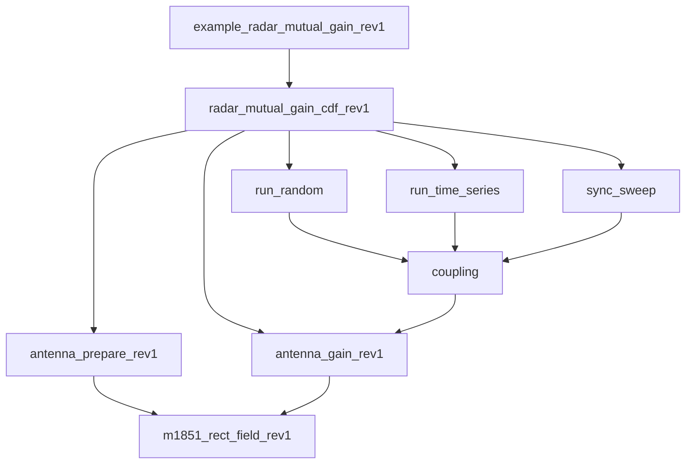

# Methodology report: mutual antenna gain between scanning radars

Draft of November 2, 2026. Source: repository `nicklasorte/mutual_antenna_gain`, branch `main`, commit `5395ec84b05e8dfeb36b5b35e0d47acd0727778f`. The source has no CUI or pre-decisional markings, so this draft has none. The README is empty. This report comes from the code and its comments.

## 1. Purpose and method

The model estimates the mutual antenna gain (antenna coupling) between two radars whose antennas scan. It adds the transmit gain of one radar toward the other to the receive gain of the other radar toward the first. It repeats this calculation for many pointing states. The result is a distribution, a table of percentiles, and, in the time-series mode, statistics on how long and how often high coupling lasts.[^1]

The method follows Rec. ITU-R M.2069-0, Annex 1. The example script applies it to an air-traffic-control reflector radar in the 2.7 GHz to 3.1 GHz band. This radar is the victim (Radar A). The interferers are a second reflector radar, a rotating active phased array, and a four-face staring array. The script then compares an unsynchronized ASR-9 pair with a synchronized ASR-9 pair.[^2]

The geometry does not depend on location. The two radars lie on a horizontal line of sight. Radar 2 is at 0° azimuth from radar 1, and radar 1 is at 180° azimuth from radar 2. Each antenna sweeps all azimuths. The bearing between the radars therefore changes only the rotation phase. It does not change the distribution. The path elevation at each end is an input, and the default is 0°.[^3]

## 2. Coupling calculation

For path 1 to 2 and path 2 to 1, the model calculates:

g12 = G_tx,1(toward radar 2) + G_rx,2(toward radar 1)  (1)

g21 = G_tx,2(toward radar 1) + G_rx,1(toward radar 2)  (2)

In these equations, each G is an antenna gain in dBi. The model finds it in the direction of the other radar, for the current pointing state of the antenna. The gains add in decibels, which is the same as a product of linear gains. If a radar uses one pattern for transmit and receive, g12 and g21 are equal. If a system defines separate `tx` and `rx` models, g12 and g21 can differ.[^4]

## 3. Antenna models

The model supports six antenna types. The example script uses Statgain, F.1245 (for the ASR-9 comparison), and the planar array.

| Type | Basis | Parameters |
| --- | --- | --- |
| Statgain (default) | NTIA TM-13-489, Table 4-1 | Peak gain of 10 dBi or more |
| F.1245 | Rec. ITU-R F.1245 | Peak gain, D/λ |
| Rectangular aperture | Rec. ITU-R M.1851-2, Annex 1, Section 2.1. Azimuth and elevation cuts combine in dB (Equation 15). Optional cosecant-squared elevation. | Beamwidths, sidelobe levels, envelope |
| Parabolic | Rec. ITU-R M.1851-2, Section 4 (circular aperture) | Beamwidth, sidelobe level, envelope |
| Measured | Digitized principal-plane cuts | Cuts relative to peak, floor |
| Planar array | Rec. ITU-R M.1851-2, Section 6.2, Equations 50 to 53 | Element count, spacing, taper |

Statgain and F.1245 depend only on the off-axis angle. This angle is between the beam axis and the direction of the target. The model finds it with the spherical law of cosines. The inputs are the azimuth offset, the target elevation, and the beam tilt.[^5]

For Statgain, with a peak gain G from 22 dBi to 48 dBi and an off-axis angle θ in degrees, the model uses these equations:

- Main beam (θ up to θm): G − 4×10⁻⁴ · 10^(G/10) · θ²
- First sidelobe region (θ above θm, up to θr): 0.75G − 7
- Far sidelobes (θ above θr, up to 48°): 53 − G/2 − 25 log₁₀ θ
- Back region (θ above 48°): 11 − G/2

In these equations, θm = 50√(0.25G + 7)/10^(G/20) and θr = 250/10^(G/20). Other ranges of peak gain use other constants.[^6] For Radar A (33.5 dBi), θm is 4.14° and θr is 5.28°. The back-region level is −5.75 dBi. For Radar B (34 dBi), the back-region level is −6.0 dBi.

For the planar array, the model builds a square array that reaches the requested peak gain. It applies a Taylor taper on each axis (default sidelobe level −25 dB, `nbar` of 4). It calculates the array factor on a zero-padded FFT grid, and an interpolant reads this grid. The element spacing is half a wavelength at 2,900 MHz. The element gain is the gain of one unit cell, 10 log₁₀(4π·dx·dy/λ²), or 4.97 dBi. A request for 40 dBi gives a 63-by-63 array with a broadside gain of 40.09 dBi (derived by running the preparation function).[^7] The far-sidelobe floor and the front-to-back level default to the Statgain back level for the same peak gain.[^8]

## 4. Pointing states and sampling

The model has two modes.

**Random mode** is the default. It draws the pointing state of each radar independently. A mechanically rotating antenna gets a uniform azimuth from 0° to 360°. For a volume scan with several elevation steps, the model picks a step with a probability in proportion to its dwell time. An array also gets a random steering azimuth and elevation within set limits. For a multi-face array, the model draws a beam azimuth and assigns it to the face with the nearest normal.[^9] The default is 5 million samples in chunks of 250,000. This matches the sample count of the M.2069-0 method. Each chunk uses its own substream of a `mrg32k3a` generator that starts from the user seed. Serial and parallel runs therefore give the same samples.[^10]

For two radars with equal rates, independent sampling averages over an unknown relative phase. The code comments call this the Mutual Antenna Coupling Distribution of the 2.7 GHz link-budget working paper. The model gives a warning for equal rates. It also gives a warning for rates in a small-integer ratio. In that case, the pointing pair follows a closed path again and again. Random mode describes such a pair only if the rates drift apart.[^11]

**Time-series mode** turns each antenna at its own rate from a random start phase. Each trial draws a start offset in the scan cycle. If you set `rate_jitter_deg_s`, each trial also draws a rate offset, uniform between minus and plus that value. The default time step is one tenth of the shortest time that a beam needs to cross its own 3 dB width. The defaults are four trials of 3,600 s each.[^12] For each threshold, the model reports the number of events, the events per hour, the mean and maximum duration, and the percentage of time above the threshold. One event is a run of consecutive samples at or above the threshold. A run that a trial boundary cuts also counts as an event.[^13]

**Synchronized rotation** applies to two mechanical radars that have one equal rate. The model sweeps one revolution in steps. Radar 2 is at the azimuth of radar 1 plus a fixed offset. The step is 1/100 of the narrowest azimuth beamwidth. The result is the maximum coupling.[^14]

## 5. Output statistics

The model builds a cumulative table and an exceedance table on a 0.1 dB grid. It uses a histogram because an empirical CDF returns one row for each sample. It reports the 50th, 90th, 99th, 99.9th, 99.99th, and 99.999th percentiles. For each percentile, it also reports the number of samples above it. A count below 10 means that the tail has too few samples.[^15]

## 6. Cases in the example script

| Case | Interferer | Antenna | Scan |
| --- | --- | --- | --- |
| Victim (Radar A) | Not applicable | Statgain, 33.5 dBi | 75 degrees per second, 0° tilt |
| 1 | Radar B | Statgain, 34 dBi | 90 degrees per second, 0° tilt |
| 2 | Rotating AESA | Planar array, 40 dBi, 10° face tilt, transmit Taylor −17 dB | 60 degrees per second, random beam, elevation 0° to 30°, dwell 0.05 s |
| 3 | Four-face array | Planar array, defaults (41 dBi), transmit Taylor −17 dB | Random beam over four faces, face 1 at 45° |
| Pair | ASR-9 pair | Statgain, then F.1245, 34 dBi | 12.5 rpm for both |

All runs use seed 20261101 and 5 million random samples. Case 1 also has a time series of 3,600 s with 8 trials. Its thresholds are 20 dBi, 30 dBi, 40 dBi, and 50 dBi.[^16] The script marks the beam-axis tilt and the AESA face tilt as TODO. It takes other values from Rec. ITU-R M.1464-2, Tables 1 and 2.

## 7. Checks done in this review

These checks test the implementation. They do not validate the model.

- The repository test file ran 79 tests. None failed and none were incomplete. The tests include a serial-versus-parallel match on a pool of two workers.
- A reduced run of Case 1 (random mode, seed 20261101, 5 million samples) took about 1 s. The percentiles are in the table below.
- The 50th percentile (−11.75 dBi) equals the sum of the two back-region levels (−5.75 dBi and −6.0 dBi). This is the expected result when both antennas point away from each other for more than half of the time.
- The Statgain level is 3 dB below the peak at half of the implied 3 dB beamwidth of 3.66°. The gain is 30.50 dBi at 1.83° for a 33.5 dBi peak.

| Percentile | Mutual gain, path 2 to 1 (dBi) | Samples above |
| --- | --- | --- |
| 50 | −11.75 | 2,500,000 |
| 90 | 7.46 | 500,000 |
| 99 | 28.06 | 50,000 |
| 99.9 | 46.21 | 5,000 |
| 99.99 | 63.49 | 500 |
| 99.999 | 67.12 | 50 |

The maximum was 67.50 dBi. The model gave its warning for rates in a small-integer ratio (5:6, joint period 24 s). The run used one pattern for transmit and receive on each radar. The run is a code check from this review. It is not a study result.

## 8. Open items

1. **Rate jitter in random mode.** The example script sets `rate_jitter_deg_s` to 0.5 on both rotating reflector radars. Only the time-series mode uses this value. The random-mode result for the 75 and 90 degrees-per-second pair (5:6 ratio, derived) therefore assumes rates that drift apart. The script does not model this.[^17]
2. **No results.** The repository has no result files, so there are no findings beyond the check in Section 7.
3. **Claims in comments only.** This review did not verify the script comment that the synchronized F.1245 maximum is 24.425 dBi. This review linted `crosscheck_csharp_rev1.m` but did not read it or run it.
4. **TODO inputs.** The beam-axis tilt, the AESA face tilt, and the multi-face beam schedule are placeholders.
5. **Scope.** The model has no propagation, pathloss, clutter, noise, or interference-to-noise calculation. It gives antenna coupling only. It does not model polarization mismatch.
6. **Input limits.** Statgain needs a peak gain of 10 dBi or more. F.1245 needs a peak gain above G1.[^18]

## Appendix A. Code traceability

Commit `5395ec84b05e8dfeb36b5b35e0d47acd0727778f` is the only repository in scope. The call tracer found 5 files and 57 functions. It found no shadowed names, no data handoffs, and no missing project dependencies. All other functions are MATLAB built-in or toolbox functions. The functions `taylorwin` and `physconst` come from the Signal Processing and Aerospace toolboxes. The functions `wrapTo180` and `wrapTo360` come from the Mapping Toolbox.

| Report claim | Implementation | Condition | Evidence level |
| --- | --- | --- | --- |
| Coupling is the sum of transmit and receive gains | `radar_mutual_gain_cdf_rev1.m`, lines 233 to 240 | Always | Static inspection, tests pass |
| Random mode is independent and time-weighted | `radar_mutual_gain_cdf_rev1.m`, lines 243 to 264 | `mode = "random"` | Static inspection |
| One substream for each chunk | `radar_mutual_gain_cdf_rev1.m`, lines 218 to 230 | Always | Test and static inspection |
| Statgain pattern | `antenna_gain_rev1.m`, lines 73 to 95. `antenna_prepare_rev1.m`, lines 296 to 317. | `type = "statgain"` | Static inspection, run |
| Percentiles | `radar_mutual_gain_cdf_rev1.m`, lines 442 to 446 | Always | Run |

Files in scope:

- `example_radar_mutual_gain_rev1.m`: entry point.
- `radar_mutual_gain_cdf_rev1.m`: sampling, coupling, statistics.
- `antenna_prepare_rev1.m`: input checks and pattern constants.
- `antenna_gain_rev1.m`: gain calculation.
- `m1851_rect_field_rev1.m`: field of a cosine-taper aperture.
- `test_radar_mutual_gain_cdf_rev1.m` and `crosscheck_csharp_rev1.m`: test code.

[^1]: radar_mutual_gain_cdf_rev1.m, lines 2 to 19 | https://github.com/nicklasorte/mutual_antenna_gain/blob/5395ec84b05e8dfeb36b5b35e0d47acd0727778f/radar_mutual_gain_cdf_rev1.m#L2-L19
[^2]: example_radar_mutual_gain_rev1.m, lines 1 to 11 | https://github.com/nicklasorte/mutual_antenna_gain/blob/5395ec84b05e8dfeb36b5b35e0d47acd0727778f/example_radar_mutual_gain_rev1.m#L1-L11
[^3]: radar_mutual_gain_cdf_rev1.m, lines 38 to 44 | https://github.com/nicklasorte/mutual_antenna_gain/blob/5395ec84b05e8dfeb36b5b35e0d47acd0727778f/radar_mutual_gain_cdf_rev1.m#L38-L44
[^4]: radar_mutual_gain_cdf_rev1.m, lines 233 to 240 | https://github.com/nicklasorte/mutual_antenna_gain/blob/5395ec84b05e8dfeb36b5b35e0d47acd0727778f/radar_mutual_gain_cdf_rev1.m#L233-L240
[^5]: antenna_gain_rev1.m, lines 65 to 71 | https://github.com/nicklasorte/mutual_antenna_gain/blob/5395ec84b05e8dfeb36b5b35e0d47acd0727778f/antenna_gain_rev1.m#L65-L71
[^6]: antenna_gain_rev1.m, lines 73 to 95 | https://github.com/nicklasorte/mutual_antenna_gain/blob/5395ec84b05e8dfeb36b5b35e0d47acd0727778f/antenna_gain_rev1.m#L73-L95
[^7]: antenna_prepare_rev1.m, lines 168 to 212 | https://github.com/nicklasorte/mutual_antenna_gain/blob/5395ec84b05e8dfeb36b5b35e0d47acd0727778f/antenna_prepare_rev1.m#L168-L212
[^8]: antenna_prepare_rev1.m, lines 214 to 227 | https://github.com/nicklasorte/mutual_antenna_gain/blob/5395ec84b05e8dfeb36b5b35e0d47acd0727778f/antenna_prepare_rev1.m#L214-L227
[^9]: radar_mutual_gain_cdf_rev1.m, lines 243 to 264 | https://github.com/nicklasorte/mutual_antenna_gain/blob/5395ec84b05e8dfeb36b5b35e0d47acd0727778f/radar_mutual_gain_cdf_rev1.m#L243-L264
[^10]: radar_mutual_gain_cdf_rev1.m, lines 546 to 549 | https://github.com/nicklasorte/mutual_antenna_gain/blob/5395ec84b05e8dfeb36b5b35e0d47acd0727778f/radar_mutual_gain_cdf_rev1.m#L546-L549
[^11]: radar_mutual_gain_cdf_rev1.m, lines 592 to 616 | https://github.com/nicklasorte/mutual_antenna_gain/blob/5395ec84b05e8dfeb36b5b35e0d47acd0727778f/radar_mutual_gain_cdf_rev1.m#L592-L616
[^12]: radar_mutual_gain_cdf_rev1.m, lines 291 to 301 | https://github.com/nicklasorte/mutual_antenna_gain/blob/5395ec84b05e8dfeb36b5b35e0d47acd0727778f/radar_mutual_gain_cdf_rev1.m#L291-L301
[^13]: radar_mutual_gain_cdf_rev1.m, lines 399 to 426 | https://github.com/nicklasorte/mutual_antenna_gain/blob/5395ec84b05e8dfeb36b5b35e0d47acd0727778f/radar_mutual_gain_cdf_rev1.m#L399-L426
[^14]: radar_mutual_gain_cdf_rev1.m, lines 173 to 187 | https://github.com/nicklasorte/mutual_antenna_gain/blob/5395ec84b05e8dfeb36b5b35e0d47acd0727778f/radar_mutual_gain_cdf_rev1.m#L173-L187
[^15]: radar_mutual_gain_cdf_rev1.m, lines 429 to 446 | https://github.com/nicklasorte/mutual_antenna_gain/blob/5395ec84b05e8dfeb36b5b35e0d47acd0727778f/radar_mutual_gain_cdf_rev1.m#L429-L446
[^16]: example_radar_mutual_gain_rev1.m, lines 19 to 104 | https://github.com/nicklasorte/mutual_antenna_gain/blob/5395ec84b05e8dfeb36b5b35e0d47acd0727778f/example_radar_mutual_gain_rev1.m#L19-L104
[^17]: example_radar_mutual_gain_rev1.m, lines 22 to 36 | https://github.com/nicklasorte/mutual_antenna_gain/blob/5395ec84b05e8dfeb36b5b35e0d47acd0727778f/example_radar_mutual_gain_rev1.m#L22-L36
[^18]: antenna_prepare_rev1.m, lines 278 to 317 | https://github.com/nicklasorte/mutual_antenna_gain/blob/5395ec84b05e8dfeb36b5b35e0d47acd0727778f/antenna_prepare_rev1.m#L278-L317
