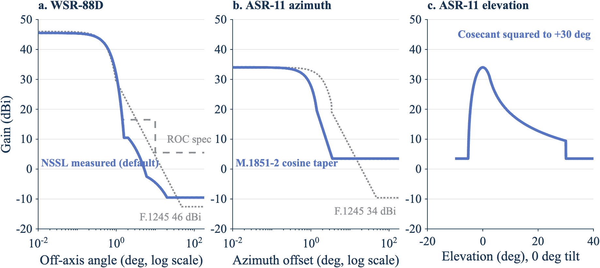
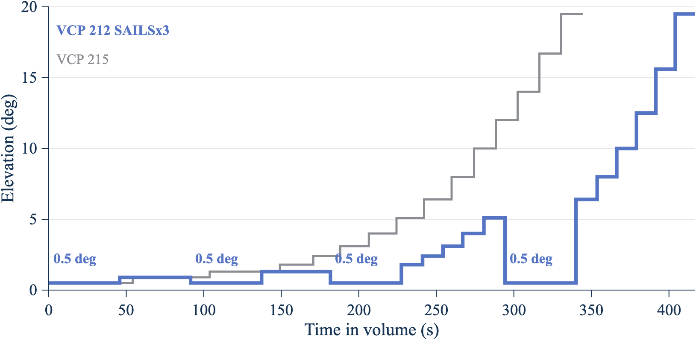
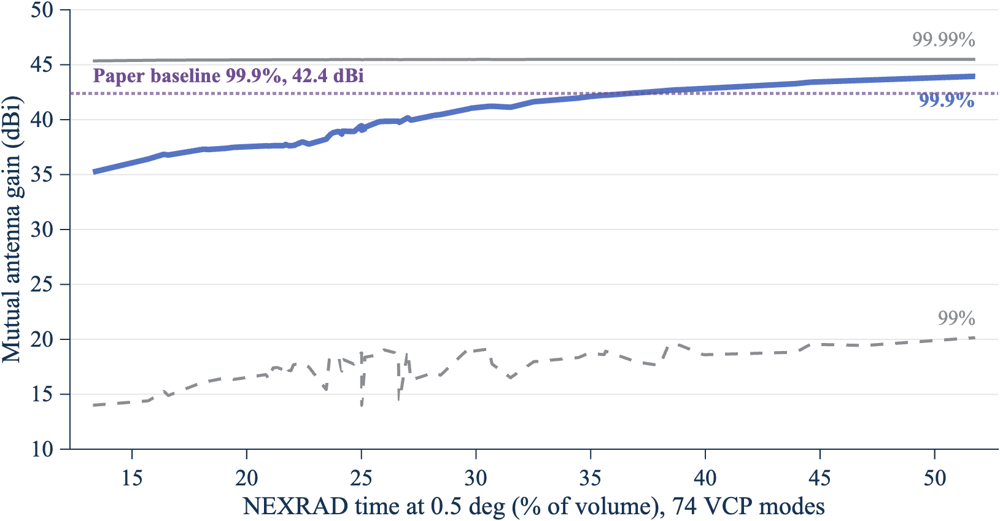
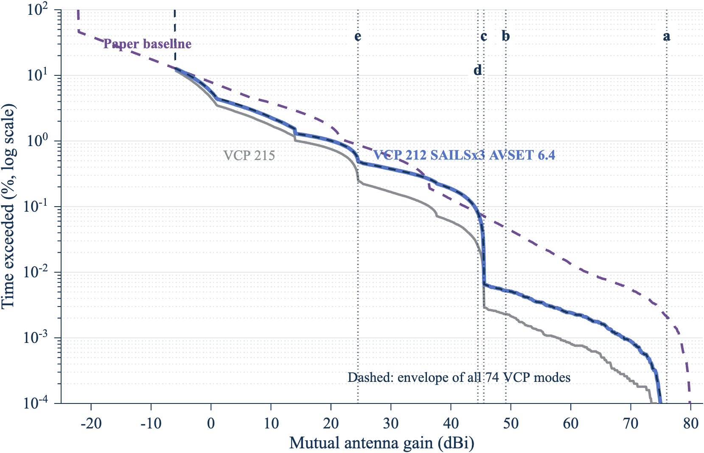
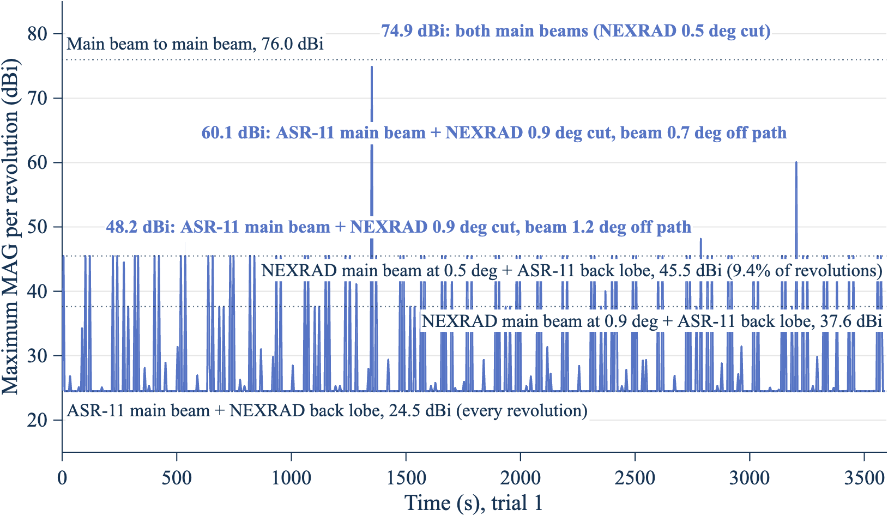
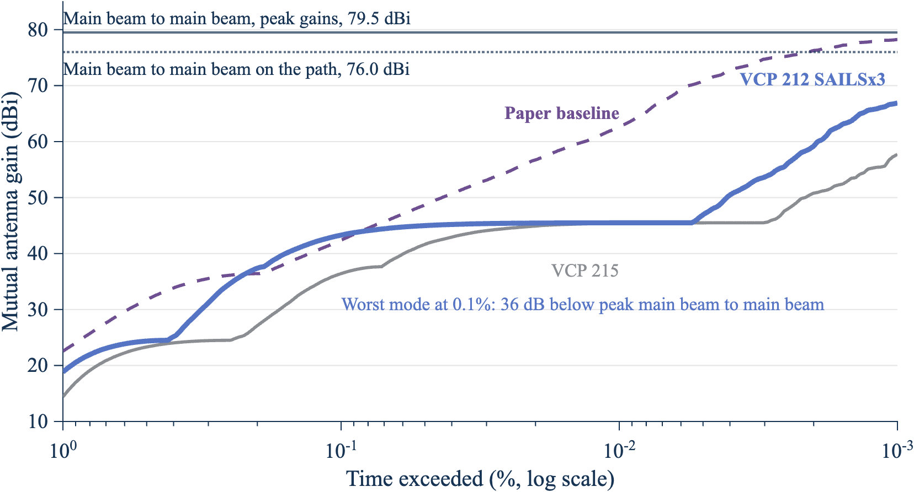
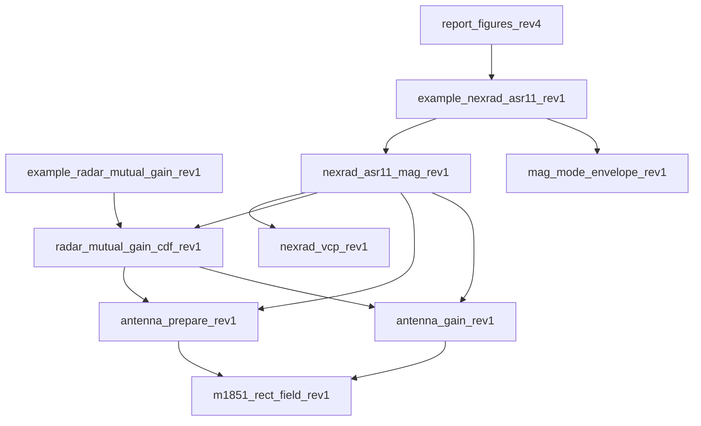

**DRAFT//PRE-DECISIONAL**

# Methodology report: mutual antenna gain between scanning radars

Revision 4, draft of November 5, 2026. Source: repository `nicklasorte/mutual_antenna_gain`, branch `docs/methodology-report-rev4`, commit `6dc4df589d56a90b3dce43649be10e188d60d156`. This report comes from the code, its comments, and runs of the code in MATLAB.

Changes from revision 3:

- Adds a worked example between a NOAA WSR-88D (NEXRAD) weather radar and an FAA ASR-11 airport surveillance radar (Section 7). It uses the operational NEXRAD volume coverage patterns (VCPs), published antenna patterns for both radars, and the rotation rate of the ASR-11 with its variance.
- Compares main beam to main beam coupling with the statistical mutual antenna gain (MAG), and adds a bound that holds for any mix of NEXRAD scan modes (Sections 7.5 and 7.6).
- Records the concerns raised at the 2.7 GHz Retuning LOE meeting of November 4, 2026, and how this revision addresses each one (Section 8).
- Corrects Case 1 of the example script. Revision 3 called it "Radar B, 34 dBi, 90 degrees per second." In Rec. ITU-R M.1464-2 Table 1, Radar B is 33.5 dBi at 75 degrees per second, so Case 1 now uses Radar D (32.8 dBi, 90 degrees per second).
- Adds the `offaxis_table` antenna type, per-scan maxima, and main-beam and sidelobe reference levels.

## Summary of the WSR-88D and ASR-11 example

- **Main beam to main beam is 79.5 dBi** with both peak gains (45.5 dBi and 34 dBi). On a horizontal path it is 76.0 dBi, because the lowest NEXRAD elevation (0.5°) puts the path 0.5° off the NEXRAD beam axis.
- **The statistical MAG is far below main beam to main beam.** For the worst NEXRAD scan mode, the 99.9% MAG is 43.3 dBi, 36 dB below the peak-gain value. The 99.999% MAG is 66.9 dBi, 13 dB below.
- **The share of time that the NEXRAD spends at 0.5° drives the result.** The worst mode is VCP 212 with three SAILS rescans, which spends 44% of each volume at 0.5°.
- **The unknown mix of NEXRAD modes doesn't change the bound.** For any mix of the 21 modes studied, the 99.9% MAG is at most 43.3 dBi.
- **The paper baseline is more conservative in the far tail.** The model of the 2.7 GHz link budget working paper (F.1245 patterns, NEXRAD at 3 rpm on the horizon) gives 62.7 dBi at 99.99%, against 45.5 dBi for the worst VCP.

## 1. Purpose and method

The model estimates the mutual antenna gain (antenna coupling) between two radars whose antennas scan. It adds the transmit gain of one radar toward the other to the receive gain of the other radar toward the first. It repeats this calculation for many pointing states. The result is a distribution, a table of percentiles, and, in the time-series mode, statistics on how long and how often high coupling lasts.[^1]

The method follows Rec. ITU-R M.2069-0, Annex 1. Two example scripts apply it in the 2.7 GHz to 3.1 GHz band:

- `example_radar_mutual_gain_rev1.m` uses an air-traffic-control reflector radar as the victim (Radar A). The interferers are a second reflector radar (Radar D), a rotating active phased array, and a four-face staring array. The script then compares an unsynchronized ASR-9 pair with a synchronized ASR-9 pair.[^2]
- `example_nexrad_asr11_rev1.m` runs a WSR-88D against an ASR-11 for every operational NEXRAD scan mode and ranks the modes by worst-case MAG. Section 7 describes it.[^3]

The geometry does not depend on location. The two radars lie on a horizontal line of sight. Radar 2 is at 0° azimuth from radar 1, and radar 1 is at 180° azimuth from radar 2. Each antenna sweeps all azimuths. The bearing between the radars therefore changes only the rotation phase. It does not change the distribution. The path elevation at each end is an input, and the default is 0°.[^4]

## 2. Coupling calculation

For path 1 to 2 and path 2 to 1, the model calculates:

g12 = G_tx,1(toward radar 2) + G_rx,2(toward radar 1)  (1)

g21 = G_tx,2(toward radar 1) + G_rx,1(toward radar 2)  (2)

In these equations, each G is an antenna gain in dBi. The model finds it in the direction of the other radar, for the current pointing state of the antenna. The gains add in decibels, which is the same as a product of linear gains. If a radar uses one pattern for transmit and receive, g12 and g21 are equal. If a system defines separate `tx` and `rx` models, g12 and g21 can differ.[^5]

## 3. Antenna models

The model supports seven antenna types.

| Type | Basis | Parameters |
| --- | --- | --- |
| Statgain (default) | NTIA TM-13-489, Table 4-1 | Peak gain of 10 dBi or more |
| F.1245 | Rec. ITU-R F.1245 | Peak gain, D/λ |
| Rectangular aperture | Rec. ITU-R M.1851-2, Annex 1, Section 2.1. Azimuth and elevation cuts combine in dB (Equation 15). Optional cosecant-squared elevation. | Beamwidths, sidelobe levels, envelope |
| Parabolic | Rec. ITU-R M.1851-2, Section 4 (circular aperture) | Beamwidth, sidelobe level, envelope |
| Off-axis table | Measured or specified pencil-beam envelope, rotationally symmetric | Gain against off-axis angle, 0° to 180° |
| Measured | Digitized principal-plane cuts | Cuts relative to peak, floor |
| Planar array | Rec. ITU-R M.1851-2, Section 6.2, Equations 50 to 53 | Element count, spacing, taper |

Statgain, F.1245, and the off-axis table depend only on the off-axis angle. This angle is between the beam axis and the direction of the target. The model finds it with the spherical law of cosines. The inputs are the azimuth offset, the target elevation, and the beam tilt.[^6] The off-axis table interpolates the gain linearly in dB. It checks that the table spans 0° to 180°, increases strictly, and peaks at 0 dB.[^7]

For Statgain, with a peak gain G from 22 dBi to 48 dBi and an off-axis angle θ in degrees, the model uses these equations:

- Main beam (θ up to θm): G − 4×10⁻⁴ · 10^(G/10) · θ²
- First sidelobe region (θ above θm, up to θr): 0.75G − 7
- Far sidelobes (θ above θr, up to 48°): 53 − G/2 − 25 log₁₀ θ
- Back region (θ above 48°): 11 − G/2

In these equations, θm = 50√(0.25G + 7)/10^(G/20) and θr = 250/10^(G/20). Other ranges of peak gain use other constants.[^8] For Radar A (33.5 dBi), θm is 4.14° and θr is 5.28°. The back-region level is −5.75 dBi. For Radar D (32.8 dBi), the back-region level is −5.4 dBi.

For the planar array, the model builds a square array that reaches the requested peak gain. It applies a Taylor taper on each axis (default sidelobe level −25 dB, `nbar` of 4). It calculates the array factor on a zero-padded FFT grid, and an interpolant reads this grid. The element spacing is half a wavelength at 2,900 MHz. The element gain is the gain of one unit cell, 10 log₁₀(4π·dx·dy/λ²), or 4.97 dBi. A request for 40 dBi gives a 63-by-63 array with a broadside gain of 40.09 dBi. The far-sidelobe floor and the front-to-back level default to the Statgain back level for the same peak gain.[^9]

## 4. Pointing states and sampling

The model has two modes.

**Random mode** is the default. It draws the pointing state of each radar independently. A mechanically rotating antenna gets a uniform azimuth from 0° to 360°. For a volume scan with several elevation steps, the model picks a step with a probability in proportion to its dwell time. A NEXRAD VCP is such a volume scan: each elevation cut is one step of one revolution at the cut's rate and elevation. An array also gets a random steering azimuth and elevation within set limits. For a multi-face array, the model draws a beam azimuth and assigns it to the face with the nearest normal.[^10] The default is 5 million samples in chunks of 250,000. This matches the sample count of the M.2069-0 method. Each chunk uses its own substream of a `mrg32k3a` generator that starts from the user seed. Serial and parallel runs therefore give the same samples.[^11]

For two radars with equal rates, independent sampling averages over an unknown relative phase. The code comments call this the Mutual Antenna Coupling Distribution of the 2.7 GHz link budget working paper. The model gives a warning for equal rates. It also gives a warning for rates in a small-integer ratio. In that case, the pointing pair follows a closed path again and again. Random mode describes such a pair only if the rates drift apart.[^12]

**Time-series mode** turns each antenna at its own rate from a random start phase. Each trial draws a start offset in the scan cycle. If you set `rate_jitter_deg_s`, each trial also draws a rate offset, uniform between minus and plus that value. The default time step is one tenth of the shortest time that a beam needs to cross its own 3 dB width. The defaults are four trials of 3,600 s each.[^13] For each threshold, the model reports the number of events, the events per hour, the mean and maximum duration, and the percentage of time above the threshold. One event is a run of consecutive samples at or above the threshold. A run that a trial boundary cuts also counts as an event.[^14]

**Synchronized rotation** applies to two mechanical radars that have one equal rate. The model sweeps one revolution in steps. Radar 2 is at the azimuth of radar 1 plus a fixed offset. The step is 1/100 of the narrowest azimuth beamwidth. The result is the maximum coupling.[^15]

## 5. Output statistics

The model builds a cumulative table and an exceedance table on a 0.1 dB grid. It uses a histogram because an empirical CDF returns one row for each sample. It also returns the CDF as a plain numeric array, `cdf_array12` and `cdf_array21`: column 1 is the percent of time from 0 to 100, and column 2 is the MAG in dBi that is not exceeded for that percent of time. The option `cdf_pct` sets the percent grid; the default is every 1% plus 99.5%, 99.9%, 99.95%, 99.99%, 99.995%, and 99.999%. The arrays for the cases in Figure 6 are in `docs/figures/cdf_array_rev4.csv`.[^28] It reports the 50th, 90th, 99th, 99.9th, 99.99th, and 99.999th percentiles. For each percentile, it also reports the number of samples above it. A count below 10 means that the tail has too few samples.[^16]

The WSR-88D and ASR-11 function adds four outputs:

- **Maximum MAG per scan.** A time series of both antennas gives the largest MAG in each ASR-11 revolution, each NEXRAD elevation cut, and each NEXRAD volume. Scans that a trial boundary cuts are flagged and left out of the statistics.[^17]
- **Reference levels.** These are the MAG values for main beam to main beam and for each radar's main beam into the other's near sidelobe and back lobe, on the link path.[^18]
- **Sensitivity table.** This table lists each MAG choice with its difference from the peak-gain main beam to main beam value.[^19]
- **Mode envelope.** For each percentile, the envelope is the largest value over all scan modes. Section 7.6 shows that it bounds any mix of the modes.[^20]

## 6. Cases in the example script

| Case | Interferer | Antenna | Scan |
| --- | --- | --- | --- |
| Victim (Radar A) | Not applicable | Statgain, 33.5 dBi | 75 degrees per second, 0° tilt |
| 1 | Radar D | Statgain, 32.8 dBi | 90 degrees per second, 0° tilt |
| 2 | Rotating AESA | Planar array, 40 dBi, 10° face tilt, transmit Taylor −17 dB | 60 degrees per second, random beam, elevation 0° to 30°, dwell 0.05 s |
| 3 | Four-face array | Planar array, defaults (41 dBi), transmit Taylor −17 dB | Random beam over four faces, face 1 at 45° |
| Pair | ASR-9 pair | Statgain, then F.1245, 34 dBi | 12.5 rpm for both |

All runs use seed 20261101 and 5 million random samples. Case 1 also has a time series of 3,600 s with 8 trials. Its thresholds are 20 dBi, 30 dBi, 40 dBi, and 50 dBi.[^21] The script marks the beam-axis tilt and the AESA face tilt as TODO. It takes other values from Rec. ITU-R M.1464-2, Tables 1 and 2.

## 7. WSR-88D and ASR-11 example

This example answers a question from the 2.7 GHz Retuning LOE: how does the MAG between a NOAA weather radar and an FAA ATC radar depend on the NEXRAD scan mode, and how does it compare with main beam to main beam? The function `nexrad_asr11_mag_rev1` holds every input with a source key. Its `citations` table gives the URL of each source.[^22]

### 7.1 Inputs

| Parameter | Value | Source |
| --- | --- | --- |
| NEXRAD peak gain | 45.5 dBi at 2,850 MHz, including the radome | NOAA ROC, NEXRAD Technical Information (Rec. ITU-R M.1849-3 Radar 1: 45.0 dBi) |
| NEXRAD 3 dB beamwidth | 0.925° | NOAA ROC, NEXRAD Technical Information |
| NEXRAD sidelobes (default) | −35 dB to 2°, −48 dB at 6°, −55 dB at 20° and beyond | NSSL measurements of the KOUN antenna, 1998 report errata |
| NEXRAD sidelobes (alternative) | −29 dB beyond the main beam, −40 dB beyond 10° | NOAA ROC specification |
| NEXRAD scan | VCPs 12, 35, 112, 212, and 215, with SAILS, MRLE, and AVSET options | Decoded from operational Level II data (Section 7.2) |
| ASR-11 peak gain | 34 dBi | Rec. ITU-R M.1464-2 Table 1, Radar C |
| ASR-11 beamwidths | 1.45° azimuth, 4.8° elevation | Rec. ITU-R M.1464-2 Table 1, Radar C |
| ASR-11 elevation pattern | Cosecant squared to +30°, Rec. ITU-R M.1851-2 Equations 25 to 27 | Rec. ITU-R M.1464-2 Table 1, Radar C |
| ASR-11 sidelobes | First +9.5 dBi (cosine taper), remote +3.5 dBi | Rec. ITU-R M.1464-2 Table 1, Radar C |
| ASR-11 tilt | 0° (beam nose on the horizon); allowed range −2.5° to +2.5° | Rec. ITU-R M.1464-2 Table 1, Radar C (TODO: site value) |
| ASR-11 rotation rate | 12.5 rpm (75 degrees per second) | Rec. ITU-R M.1464-2 Table 1, Radar C; Forecast International |
| ASR-11 rotation-rate variance | Uniform ±0.5 degrees per second, per trial or per revolution | Rec. ITU-R M.2069-0 Annex 1 drive accuracy (TODO: FAA Order JO 6310.30B value) |
| Path elevation | 0° at both ends | Location-agnostic assumption |
| Polarization mismatch | Not modeled | Study assumption |

Radar C matches the ASR-11: a 25 kW solid-state transmitter with 1 µs and 89 µs pulses. The FAA standard and tolerance for the ASR-11 rotation rate are in FAA Order JO 6310.30B, which is available only on the FAA network. Until that value is available, the model uses the ±0.5 degrees per second drive accuracy of M.2069-0, and `opts.asr_rate_jitter_deg_s` changes it.[^23] Each radar uses one pattern for transmit and receive, so g12 equals g21. The ASR-11 low beam is assumed for transmit and receive; the high beam is not modeled.

The NEXRAD main beam is a parabola in dB, G − 12(θ/θ3)², until it meets the sidelobe envelope. This fills the first null, which is conservative.[^24] Figure 1 shows the patterns.

*Figure 1. The measured NEXRAD envelope falls below F.1245 beyond 1.5°, and the ASR-11 cosine taper is narrower than F.1245. Panel a: WSR-88D gain against off-axis angle. Panel b: ASR-11 azimuth cut. Panel c: ASR-11 elevation cut at 0° tilt. Source: NTIA analysis with `report_figures_rev4.m` (2026).*

### 7.2 NEXRAD scan modes

The NOAA Radar Operations Center (ROC) lists VCPs 12, 35, 112, 212, and 215 as the modes in use. The cut tables in `nexrad_vcp_rev1` come from the VCP messages in operational Level II files on the NOAA archive, decoded with MetPy. Files from KOAX, KHGX, and KLWX give the same cuts and rates. The one exception is the Doppler cut of the 0.5° to 1.3° split cuts, whose rate follows the site's Doppler PRF (12.524, 14.458, 15.831, or 17.106 degrees per second); `cd_rate_deg_s` sets it.[^25]

| VCP | Use | Cuts | Volume time (s) | Time at 0.5° (%) | Most SAILS rescans |
| --- | --- | --- | --- | --- | --- |
| 35 | Clear air, 0.5° to 6.4° | 12 | 410.0 | 23.8 | 1 |
| 215 | Default precipitation | 18 | 344.5 | 15.7 | 1 |
| 212 | Rapidly evolving convection | 17 | 279.3 | 16.4 | 3 |
| 12 | Rapidly evolving convection | 17 | 236.4 | 13.3 | 3 |
| 112 | Large-scale, high-velocity systems | 20 | 320.1 | 19.4 | 1 |

The volume time is the sum of 360°/rate over the cuts; elevation transitions are not modeled. For VCP 112, the ROC gives 322 s for the 20-cut volume, against 320.1 s here. SAILS adds rescans of the 0.5° cuts during the volume. MRLE rescans the lowest two to four elevations midway through the volume and cannot be used with SAILS. AVSET ends the volume at 6.4° or above when no significant echoes lie above that elevation.[^26] Figure 2 shows how SAILS changes the schedule.

*Figure 2. SAILS×3 returns the NEXRAD beam to 0.5° four times per volume. Source: cut tables in `nexrad_vcp_rev1.m`, decoded from NOAA Level II data (2026).*

### 7.3 Results across all scan modes

`example_nexrad_asr11_rev1` runs 21 VCP modes and the paper baseline, with seed 20261105, 5 million random samples, and a time series of 4 trials of 3,600 s each.[^27] The table shows the time-weighted MAG on the path from the ASR-11 to the NEXRAD.

| Mode | Time at 0.5° (%) | 99% (dBi) | 99.9% (dBi) | 99.99% (dBi) |
| --- | --- | --- | --- | --- |
| VCP 212 SAILS×3 | 43.9 | 18.8 | 43.3 | 45.5 |
| VCP 12 SAILS×3, Doppler cut at 12.524 degrees per second | 43.9 | 18.8 | 43.3 | 45.5 |
| VCP 35 SAILS×1, Doppler cut at 12.524 degrees per second | 38.7 | 19.6 | 42.7 | 45.5 |
| VCP 35 SAILS×1 | 38.4 | 19.5 | 42.7 | 45.5 |
| VCP 12 SAILS×3 | 38.0 | 17.6 | 42.6 | 45.5 |
| VCP 112 SAILS×1 | 32.5 | 18.0 | 41.6 | 45.5 |
| VCP 215 SAILS×1 | 27.2 | 16.3 | 40.0 | 45.5 |
| VCP 35 | 23.8 | 18.3 | 38.8 | 45.5 |
| VCP 112 | 19.4 | 16.3 | 37.5 | 45.4 |
| VCP 212 | 16.4 | 15.3 | 36.8 | 45.4 |
| VCP 215 | 15.7 | 14.4 | 36.4 | 45.4 |
| VCP 12 | 13.3 | 14.0 | 35.2 | 45.4 |
| Paper baseline (F.1245, 3 rpm, horizon) | 100 | 22.5 | 42.4 | 62.7 |

The full table, including the MRLE and AVSET variants, is in `docs/figures/vcp_sweep_rev4.csv`. VCP 212 has a default Doppler-cut rate of 12.524 degrees per second, so its "Doppler cut at 12.524" variant repeats VCP 212 SAILS×3. Figure 3 shows what drives the ranking.

*Figure 3. The more time the NEXRAD spends at 0.5°, the higher the 99.9% coupling. The lines join the 21 VCP modes in order of time at 0.5°. The 99.99% MAG stays near 45.5 dBi for every mode. Source: `docs/figures/vcp_sweep_rev4.csv` (2026).*

The 99.99% MAG is near 45.5 dBi for every VCP mode. That level is the NEXRAD main beam on the path at 0.5° (42.0 dBi) plus the ASR-11 remote sidelobe level (+3.5 dBi). The ASR-11 remote sidelobe value from M.1464-2 therefore sets this percentile.

*Figure 4. Below 0.01% of the time, the worst VCP mode couples far less than the paper baseline. The dashed dark line is the envelope of all 21 VCP modes. The dotted lines are reference levels: a, main beam to main beam on the path (76.0 dBi); b, NEXRAD main beam and ASR-11 near sidelobe (49.2 dBi); c, NEXRAD main beam and ASR-11 back lobe (45.5 dBi); d, ASR-11 main beam and NEXRAD near sidelobe (44.5 dBi); e, ASR-11 main beam and NEXRAD back lobe (24.5 dBi). Source: `docs/figures/ref_levels_rev4.csv` (2026).*

### 7.4 Maximum MAG per scan

The ASR-11 is a surveillance radar, so the MAG that matters to it is the largest value in each 4.8 s revolution. In each revolution, the ASR-11 main beam crosses the NEXRAD once.

| Statistic over 3,000 ASR-11 revolutions, worst mode | MAG (dBi) |
| --- | --- |
| 50th percentile of the per-revolution maximum | 24.5 |
| 90th percentile | 41.6 |
| 99th percentile | 45.5 |
| 99.9th percentile | 68.6 |
| Largest | 76.0 |

*Figure 5. Most ASR-11 revolutions peak at 24.5 dBi, the ASR-11 main beam on the NEXRAD back lobe; 9.5% reach 45.5 dBi. The figure shows trial 1 of the worst mode (VCP 212 SAILS×3). Source: `nexrad_asr11_mag_rev1` time series (2026).*

Every revolution reaches 24.5 dBi or more. In 9.5% of revolutions, the NEXRAD main beam also crosses the ASR-11 during the revolution, and the maximum reaches 45.5 dBi. One revolution in 3,000 came within 0.2 dB of main beam to main beam.

For the NEXRAD, interference at low elevations matters most, because the composite products draw on the lowest cuts. The table gives the per-cut maximum by elevation for the worst mode, over 32 complete volumes.

| NEXRAD elevation | Complete cuts | Median of cut maxima (dBi) | Largest cut maximum (dBi) |
| --- | --- | --- | --- |
| 0.5° | 275 | 45.5 | 76.0 |
| 0.9° | 68 | 37.6 | 60.1 |
| 1.3° | 66 | 25.3 | 55.8 |
| 1.8° | 34 | 26.0 | 42.8 |
| 2.4° | 34 | 24.5 | 43.2 |
| 3.1° to 19.5° | 34 to 36 each | 24.5 | 24.7 to 34.3 |

### 7.5 Main beam to main beam compared with the statistical MAG

At the November 4, 2026 meeting, the FAA stated that it uses main beam to main beam coupling, and NOAA asked for a main beam to main beam case for every weather radar as a sensitivity analysis. Figure 6 and the table compare the two approaches. A negative difference is the relief, in dB, that a MAG choice takes relative to the peak-gain main beam to main beam value. The same number of decibels applies one for one to the required basic transmission loss.

*Figure 6. Even at 0.001% of the time, the statistical MAG of every VCP mode stays at least 12 dB below peak-gain main beam to main beam. The lines are the CDF arrays read from 99% to 99.999%; the horizontal lines are main beam to main beam with peak gains (79.5 dBi) and on the path (76.0 dBi). Source: `docs/figures/cdf_array_rev4.csv` and `docs/figures/mbmb_vs_statistical_rev4.csv` (2026).*

| MAG choice | Worst mode (dBi) | Difference from peak-gain main beam to main beam (dB) | VCP 215 (dBi) | Paper baseline (dBi) |
| --- | --- | --- | --- | --- |
| Main beam to main beam, peak gains | 79.5 | 0 | 79.5 | 80.0 |
| Main beam to main beam, on the path | 76.0 | −3.5 | 76.0 | 80.0 |
| Largest MAG in the time series | 76.0 | −3.5 | 75.7 | 80.0 |
| 99.999% MAG | 66.9 | −12.6 | 57.7 | 78.2 |
| 99.99% MAG | 45.5 | −34.0 | 45.4 | 62.7 |
| 99.9% MAG | 43.3 | −36.2 | 36.4 | 42.4 |
| 99% MAG | 18.8 | −60.7 | 14.4 | 22.5 |

The paper baseline uses F.1245 patterns of 46 dBi and 34 dBi, so its main beam to main beam value is 80.0 dBi. Its NEXRAD beam always points at the horizon, so main beam to main beam on the path equals the peak-gain value.

### 7.6 A bound for any mix of NEXRAD scan modes

NOAA reported at the meeting that VCP choice depends on the weather, the site, and the operator, and that usable statistics of mode use may not exist. The mode envelope removes the need for them.

Let mode i have weight wᵢ ≥ 0, with the weights summing to 1. The exceedance of the mixture is P_mix(G > x) = Σ wᵢ Pᵢ(G > x), which is at most the largest Pᵢ(G > x). At x equal to the largest p-percentile over the modes, every Pᵢ(G > x) is at most 1 − p/100. The p-percentile of the mixture is therefore at most the largest p-percentile over the modes.[^20]

| Percentile | Envelope over 21 VCP modes (dBi) | Worst mode |
| --- | --- | --- |
| 99% | 19.6 | VCP 35 SAILS×1, Doppler cut at 12.524 degrees per second |
| 99.9% | 43.3 | VCP 212 SAILS×3 |
| 99.99% | 45.5 | VCP 212 SAILS×3 |
| 99.999% | 67.0 | VCP 12 SAILS×3, Doppler cut at 12.524 degrees per second |

The bound covers only the modes in the envelope. A future NEXRAD mode, or a Radar Next scan strategy, needs its own run, and the envelope then takes the larger value. All operational VCPs rotate a full 360°, so pointing a scan toward the ATC radar does not change the result. A sector scan centered on the ATC radar would need a separate model.

## 8. Concerns from the November 4, 2026 Retuning LOE meeting

The meeting reviewed agency comments on revision 2 of the 2.7 GHz link budget working paper. The table lists the concerns that bear on the MAG and how this revision addresses each one.

| Concern | Raised by | How this revision addresses it |
| --- | --- | --- |
| The FAA uses main beam to main beam; a histogram of pointing states is not a probability unless the pointing is random | FAA | Section 7.5 compares the two. The time series confirms that the time-weighted CDF matches long-run pointing for these unequal rates. |
| A main beam to main beam case is required for every weather radar, with a sensitivity section | NOAA | Section 7.5 and the `sensitivity` output give the peak-gain and on-path main beam to main beam values beside each percentile. |
| NEXRAD modes vary with weather, site, and operator, and mode statistics may not exist | NOAA | Section 7.6 gives a bound that holds for any mix of the modes studied. |
| Run one NEXRAD volume scan toward an ATC radar, then add modes | Meeting participant (agreed approach) | Sections 7.2 and 7.3 run every operational VCP and option. |
| Radars with the same scan rate can drift into synchronization and couple main beam to main beam for long periods | Meeting participant | Open item. NEXRAD rates change with every cut, and the volume time is not a multiple of the 4.8 s ASR-11 period. Consecutive-scan statistics and a multi-day run are planned. |
| A long simulation might miss some antenna interactions | Meeting participant | Section 7.4 reports the largest per-scan MAG. The time series reached main beam to main beam within 0.2 dB in four hours. A multi-day coverage run is planned. |
| The MAG percentile, the I/N exceedance time, and the ITM reliability must be consistent | Meeting participant | The `sensitivity` output gives the time exceeded for each MAG choice. Combining it with the propagation statistics belongs in the link budget working paper. |
| Interference in low NEXRAD elevations persists into the composite products | FAA | Section 7.4 reports the per-cut maximum by elevation. |
| The MAG calculation should be three-dimensional | Working paper author | The model uses the NEXRAD tilt of each cut and the ASR-11 cosecant-squared elevation pattern. |
| ATC radars also detect precipitation, not only point targets | FAA | Noted. The per-revolution maximum applies to both uses. The scan-rate analysis of the working paper assumes a point target. |
| Synchronization applies only between FAA radars, not to other agencies' ATC radars | NOAA | Noted. This example does not use synchronization. |
| Radar Next may scan differently from the WSR-88D | FAA | Rerun with its scan strategy when NOAA defines it. |

The meeting also raised items outside the MAG model, for the link budget working paper: placeholder I/N thresholds, per-link ITM reliability and confidence, ground permittivity, climate settings for each path, aggregate interference, coherent and non-coherent classification, the ASR-11 frequency-pair separation (possibly 60 MHz, not 30 MHz), and ducting.

## 9. Checks done in this review

These checks test the implementation. They do not validate the model.

- The repository tests ran in MATLAB R2025b: 79 tests in `test_radar_mutual_gain_cdf_rev1.m` and 29 tests in `test_nexrad_asr11_rev1.m`. None failed. The code targets R2024b; the one call newer than R2024b (`theme`, in `report_figures_rev4.m`) runs only on R2025a or later.
- The VCP tables reproduce the decoded Level II sequences. VCP 212 with SAILS×1 matches the cut order and volume time of the KLOT, KOAX, and KHGX files within 0.01 s.
- The mode envelope test draws mixtures of two modes with five weights and checks that each mixture percentile is at or below the envelope.
- A rerun of Case 1 (random mode, seed 20261101, 5 million samples) with Radar D gave the percentiles in the table below. The 50th percentile (−11.15 dBi) equals the sum of the two back-region levels (−5.75 dBi and −5.4 dBi).

| Percentile | Mutual gain, path 2 to 1 (dBi) | Samples above |
| --- | --- | --- |
| 50 | −11.15 | 2,500,000 |
| 90 | 8.06 | 500,000 |
| 99 | 27.98 | 50,000 |
| 99.9 | 46.23 | 5,000 |
| 99.99 | 62.81 | 500 |
| 99.999 | 65.99 | 50 |

## 10. Open items

1. **ASR-11 rotation-rate tolerance.** The FAA value in Order JO 6310.30B replaces the ±0.5 degrees per second placeholder.
2. **ASR-11 tilt and beams.** The beam tilt of each site and the high-beam pattern are needed. A 0° tilt puts the beam nose on the horizon, which is the worst case.
3. **ASR-11 remote sidelobes.** The +3.5 dBi level from M.1464-2 sets the 99.99% MAG for every VCP. A measured value would change it directly.
4. **NEXRAD back lobe.** No measured back-lobe data was found; the model holds −55 dB to 180°.
5. **Persistence.** Add consecutive-scan statistics and a multi-day time series (Section 8).
6. **Path elevation.** The path is horizontal. Takeoff angles from the propagation model would change the NEXRAD gain on the path at each cut.
7. **Scope.** The model has no propagation, pathloss, clutter, noise, or interference-to-noise calculation. It gives antenna coupling only. It does not model polarization mismatch.
8. **Input limits.** Statgain needs a peak gain of 10 dBi or more. F.1245 needs a peak gain above G1.

## Appendix A. Code traceability

| Report claim | Implementation | Evidence level |
| --- | --- | --- |
| Coupling is the sum of transmit and receive gains | `radar_mutual_gain_cdf_rev1.m`, `coupling` | Static inspection, tests pass |
| VCP cut tables and options | `nexrad_vcp_rev1.m`, `vcp_table` and `insert_groups` | Tests against decoded Level II files |
| NEXRAD and ASR-11 inputs and sources | `nexrad_asr11_mag_rev1.m`, `assumptions` and `citations` | Static inspection, citation test |
| Maximum MAG per scan | `nexrad_asr11_mag_rev1.m`, `scan_maxima` | Tests of physical bounds and consistency |
| Sensitivity table | `nexrad_asr11_mag_rev1.m`, `sensitivity_table` | Test |
| Mode envelope bound | `mag_mode_envelope_rev1.m` | Mixture test |
| CDF arrays | `radar_mutual_gain_cdf_rev1.m`, `cdf_array` | Test |
| Figures and tables | `report_figures_rev4.m`; every figure in this report comes from this script | Run |

Files in scope:

- `example_radar_mutual_gain_rev1.m` and `example_nexrad_asr11_rev1.m`: entry points.
- `radar_mutual_gain_cdf_rev1.m`: sampling, coupling, statistics.
- `nexrad_asr11_mag_rev1.m`: WSR-88D and ASR-11 inputs, per-scan maxima, reference levels, sensitivity.
- `nexrad_vcp_rev1.m`: NEXRAD VCP cut tables.
- `mag_mode_envelope_rev1.m`: envelope over scan modes.
- `antenna_prepare_rev1.m` and `antenna_gain_rev1.m`: antenna patterns.
- `m1851_rect_field_rev1.m`: field of a cosine-taper aperture.
- `report_figures_rev4.m`: figures and CSV tables for this report.
- `test_radar_mutual_gain_cdf_rev1.m`, `test_nexrad_asr11_rev1.m`, and `crosscheck_csharp_rev1.m`: test code.

## Appendix B. Numbers ledger

| Quantity | Exact value | Source | Form used |
| --- | --- | --- | --- |
| Peak-gain main beam to main beam | 79.5 dBi | 45.5 + 34 | 79.5 dBi |
| Main beam to main beam on the path | 75.994 dBi | `ref_levels_rev4.csv` | 76.0 dBi |
| Worst-mode 99.9% MAG | 43.279 dBi | `sensitivity_rev4.csv` | 43.3 dBi, 36 dB below |
| Worst-mode 99.999% MAG | 66.885 dBi | `sensitivity_rev4.csv` | 66.9 dBi, 13 dB below |
| Envelope 99.9% MAG | 43.279 dBi | `mode_envelope_rev4.csv` | 43.3 dBi |
| Paper baseline 99.99% MAG | 62.700 dBi | `vcp_sweep_rev4.csv` | 62.7 dBi |
| Worst-mode time at 0.5° | 43.94% | `vcp_sweep_rev4.csv` | 44% |
| ASR-11 revolutions at 45.5 dBi or more | 9.47% | `ref_levels_rev4.csv` | 9.5% |

## Appendix C. References

- NOAA Radar Operations Center, [NEXRAD Technical Information](https://roc.noaa.gov/public-documents/wsr88d/NEXRAD-Technical-Information.pdf).
- NOAA Radar Operations Center, [Convective VCP Decision Matrix (VCP Info Sheet)](https://www.roc.noaa.gov/public-documents/operations-branch/VCP_Info_Sheet.pdf), February 2026.
- NOAA Radar Operations Center, [Theory and Concept of Operations for VCP 112](https://roc.noaa.gov/WSR88D/PublicDocs/NewTechnology/Theory_ConOps_VCP112.pdf), March 19, 2019.
- NOAA Radar Operations Center, [New VCP Paradigm](https://www.weather.gov/media/roc/NewScience/New_VCP_Paradigm_Public_Oct_2015.pdf), October 2015.
- NOAA NCEI, [Next Generation Weather Radar (NEXRAD) Level II data](https://www.ncei.noaa.gov/products/radar/next-generation-weather-radar).
- Unidata, [MetPy](https://unidata.github.io/MetPy/).
- NSSL, [Errata and supplement to the 1998 WSR-88D polarimetric upgrade report](https://www.nssl.noaa.gov/publications/wsr88d_reports/ERRATA1998Rpt_D3a(WC).pdf).
- [Recommendation ITU-R M.1849-3](https://www.itu.int/dms_pubrec/itu-r/rec/m/R-REC-M.1849-3-202302-I!!PDF-E.pdf), February 2023.
- [Recommendation ITU-R M.1464-2](https://www.itu.int/dms_pubrec/itu-r/rec/m/R-REC-M.1464-2-201502-I!!PDF-E.pdf), February 2015.
- [Recommendation ITU-R M.1851](https://www.itu.int/rec/R-REC-M.1851/en).
- [Recommendation ITU-R M.2069](https://www.itu.int/rec/R-REC-M.2069/en).
- Forecast International, [ASR-11 (DASR)](https://www.forecastinternational.com/archive/disp_pdf.cfm?DACH_RECNO=1032), August 2014.
- M. E. Weber, [FAA Surveillance Radar Data as a Complement to the WSR-88D Network](https://archive.ll.mit.edu/mission/aviation/publications/publication-files/atc-reports/Weber_1999_ATC-266_WW-15318.pdf), MIT Lincoln Laboratory ATC-266, 1999.
- FAA, [Airport Surveillance Radar (ASR-11)](https://www.faa.gov/air_traffic/technology/asr-11/).
- FAA, [Order JO 6310.30B, Maintenance Handbook for Airport Surveillance Radar, ASR-11 Facilities](https://www.faa.gov/regulations_policies/orders_notices/index.cfm/go/document.information/documentID/1028067), July 20, 2015.
- 2.7 GHz Retuning LOE, link budget analysis working paper comment adjudication meeting, transcript, November 4, 2026 (not public).

[^1]: radar_mutual_gain_cdf_rev1.m, lines 2 to 19 | https://github.com/nicklasorte/mutual_antenna_gain/blob/6dc4df589d56a90b3dce43649be10e188d60d156/radar_mutual_gain_cdf_rev1.m#L2-L19
[^2]: example_radar_mutual_gain_rev1.m, lines 1 to 12 | https://github.com/nicklasorte/mutual_antenna_gain/blob/6dc4df589d56a90b3dce43649be10e188d60d156/example_radar_mutual_gain_rev1.m#L1-L12
[^3]: example_nexrad_asr11_rev1.m, lines 1 to 14 | https://github.com/nicklasorte/mutual_antenna_gain/blob/6dc4df589d56a90b3dce43649be10e188d60d156/example_nexrad_asr11_rev1.m#L1-L14
[^4]: radar_mutual_gain_cdf_rev1.m, lines 38 to 44 | https://github.com/nicklasorte/mutual_antenna_gain/blob/6dc4df589d56a90b3dce43649be10e188d60d156/radar_mutual_gain_cdf_rev1.m#L38-L44
[^5]: radar_mutual_gain_cdf_rev1.m, lines 241 to 248 | https://github.com/nicklasorte/mutual_antenna_gain/blob/6dc4df589d56a90b3dce43649be10e188d60d156/radar_mutual_gain_cdf_rev1.m#L241-L248
[^6]: antenna_gain_rev1.m, off_axis_deg | https://github.com/nicklasorte/mutual_antenna_gain/blob/6dc4df589d56a90b3dce43649be10e188d60d156/antenna_gain_rev1.m
[^7]: antenna_prepare_rev1.m, line 168 and make_offaxis_interp | https://github.com/nicklasorte/mutual_antenna_gain/blob/6dc4df589d56a90b3dce43649be10e188d60d156/antenna_prepare_rev1.m#L168
[^8]: antenna_gain_rev1.m, statgain_dBi | https://github.com/nicklasorte/mutual_antenna_gain/blob/6dc4df589d56a90b3dce43649be10e188d60d156/antenna_gain_rev1.m
[^9]: antenna_prepare_rev1.m, prep_array | https://github.com/nicklasorte/mutual_antenna_gain/blob/6dc4df589d56a90b3dce43649be10e188d60d156/antenna_prepare_rev1.m
[^10]: radar_mutual_gain_cdf_rev1.m, draw_state_random | https://github.com/nicklasorte/mutual_antenna_gain/blob/6dc4df589d56a90b3dce43649be10e188d60d156/radar_mutual_gain_cdf_rev1.m
[^11]: radar_mutual_gain_cdf_rev1.m, random_chunk and fill_opts | https://github.com/nicklasorte/mutual_antenna_gain/blob/6dc4df589d56a90b3dce43649be10e188d60d156/radar_mutual_gain_cdf_rev1.m
[^12]: radar_mutual_gain_cdf_rev1.m, check_random_mode_valid | https://github.com/nicklasorte/mutual_antenna_gain/blob/6dc4df589d56a90b3dce43649be10e188d60d156/radar_mutual_gain_cdf_rev1.m
[^13]: radar_mutual_gain_cdf_rev1.m, run_time_series | https://github.com/nicklasorte/mutual_antenna_gain/blob/6dc4df589d56a90b3dce43649be10e188d60d156/radar_mutual_gain_cdf_rev1.m
[^14]: radar_mutual_gain_cdf_rev1.m, event_stats | https://github.com/nicklasorte/mutual_antenna_gain/blob/6dc4df589d56a90b3dce43649be10e188d60d156/radar_mutual_gain_cdf_rev1.m
[^15]: radar_mutual_gain_cdf_rev1.m, sync_sweep | https://github.com/nicklasorte/mutual_antenna_gain/blob/6dc4df589d56a90b3dce43649be10e188d60d156/radar_mutual_gain_cdf_rev1.m
[^16]: radar_mutual_gain_cdf_rev1.m, cdf_table and pct_table | https://github.com/nicklasorte/mutual_antenna_gain/blob/6dc4df589d56a90b3dce43649be10e188d60d156/radar_mutual_gain_cdf_rev1.m
[^17]: nexrad_asr11_mag_rev1.m, lines 394 to 480 (scan_maxima) | https://github.com/nicklasorte/mutual_antenna_gain/blob/6dc4df589d56a90b3dce43649be10e188d60d156/nexrad_asr11_mag_rev1.m#L394-L480
[^18]: nexrad_asr11_mag_rev1.m, lines 147 to 181 (ref_levels) | https://github.com/nicklasorte/mutual_antenna_gain/blob/6dc4df589d56a90b3dce43649be10e188d60d156/nexrad_asr11_mag_rev1.m#L147-L181
[^19]: nexrad_asr11_mag_rev1.m, lines 184 to 202 (sensitivity_table) | https://github.com/nicklasorte/mutual_antenna_gain/blob/6dc4df589d56a90b3dce43649be10e188d60d156/nexrad_asr11_mag_rev1.m#L184-L202
[^20]: mag_mode_envelope_rev1.m, lines 1 to 64 | https://github.com/nicklasorte/mutual_antenna_gain/blob/6dc4df589d56a90b3dce43649be10e188d60d156/mag_mode_envelope_rev1.m#L1-L64
[^21]: example_radar_mutual_gain_rev1.m, lines 21 to 107 | https://github.com/nicklasorte/mutual_antenna_gain/blob/6dc4df589d56a90b3dce43649be10e188d60d156/example_radar_mutual_gain_rev1.m#L21-L107
[^22]: nexrad_asr11_mag_rev1.m, lines 224 to 334 (assumptions and citations) | https://github.com/nicklasorte/mutual_antenna_gain/blob/6dc4df589d56a90b3dce43649be10e188d60d156/nexrad_asr11_mag_rev1.m#L224-L334
[^23]: nexrad_asr11_mag_rev1.m, lines 258 to 262 and 426 to 443 | https://github.com/nicklasorte/mutual_antenna_gain/blob/6dc4df589d56a90b3dce43649be10e188d60d156/nexrad_asr11_mag_rev1.m#L258-L262
[^24]: nexrad_asr11_mag_rev1.m, lines 379 to 391 (pencil_table) | https://github.com/nicklasorte/mutual_antenna_gain/blob/6dc4df589d56a90b3dce43649be10e188d60d156/nexrad_asr11_mag_rev1.m#L379-L391
[^25]: nexrad_vcp_rev1.m, lines 1 to 101 (help and references) | https://github.com/nicklasorte/mutual_antenna_gain/blob/6dc4df589d56a90b3dce43649be10e188d60d156/nexrad_vcp_rev1.m#L1-L101
[^26]: nexrad_vcp_rev1.m, lines 142 to 241 | https://github.com/nicklasorte/mutual_antenna_gain/blob/6dc4df589d56a90b3dce43649be10e188d60d156/nexrad_vcp_rev1.m#L142-L241
[^27]: example_nexrad_asr11_rev1.m, lines 16 to 108 | https://github.com/nicklasorte/mutual_antenna_gain/blob/6dc4df589d56a90b3dce43649be10e188d60d156/example_nexrad_asr11_rev1.m#L16-L108

[^28]: radar_mutual_gain_cdf_rev1.m, line 450 (cdf_array) | https://github.com/nicklasorte/mutual_antenna_gain/blob/6dc4df589d56a90b3dce43649be10e188d60d156/radar_mutual_gain_cdf_rev1.m#L450-L454

**DRAFT//PRE-DECISIONAL**
