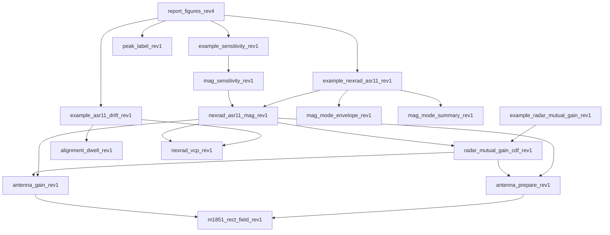

**DRAFT//PRE-DECISIONAL**

# Methodology report: mutual antenna gain between scanning radars

Revision 4, draft of November 5, 2026. Source: repository `nicklasorte/mutual_antenna_gain`, branch `feature/antenna-concerns`, commit `38e19629a610395f903fb845dd5537786d1e4337` (code at the final run), with older references to commits `d367a9047512c436434538e1d61f153c38c2c4a4` and `99d3000fe59a62234992e34e36a25a9913d5161a` where that code is unchanged. This report comes from the code, its comments, and runs of the code in MATLAB.

Changes from revision 3:

- Adds a worked example between a NOAA WSR-88D (NEXRAD) weather radar and an FAA ASR-11 airport surveillance radar (Section 7). It uses the operational NEXRAD volume coverage patterns (VCPs), published antenna patterns for both radars, and the rotation rate of the ASR-11 with its variance.
- Compares main beam to main beam coupling with the statistical mutual antenna gain (MAG), and adds a bound that holds for any mix of NEXRAD scan modes (Sections 7.11 and 7.12).
- Records the concerns raised at the 2.7 GHz Retuning LOE meeting of November 4, 2026, and how this revision addresses each one (Section 10).
- Corrects Case 1 of the example script. Revision 3 called it "Radar B, 34 dBi, 90 degrees per second." In Rec. ITU-R M.1464-2 Table 1, Radar B is 33.5 dBi at 75 degrees per second, so Case 1 now uses Radar D (32.8 dBi, 90 degrees per second).
- Adds the `offaxis_table` antenna type, per-scan maxima with the gains that make each peak, main-beam and sidelobe reference levels, a hand check of the per-scan plateaus, confidence intervals for every percentile, and a 120-hour time series.
- Walks through the WSR-88D and ASR-11 example in 11 numbered steps, each with the numbers it produces (Section 7).
- Covers every WSR-88D VCP in operational data from 2024 to 2026 (12, 31, 32, 34, 35, 112, 212, and 215), found by a survey of all WSR-88D sites on six dates (Section 7.6).
- Runs every option combination the radar allows, 74 modes in all. SAILS with AVSET is the new worst case (Section 7.10).
- Answers the antenna concerns of the November 4, 2026 meeting: time spent in each pair of pattern regions (main beam, sidelobes, back lobe), how long high coupling lasts, a 120-hour run, a sensitivity section (Section 8), and synchronization with the prior practice stated at the meeting (Section 9).

## Summary of the WSR-88D and ASR-11 example

- **Main beam to main beam is 79.5 dBi** with both peak gains (45.5 dBi and 34 dBi). On a horizontal path it is 76.0 dBi, because the lowest NEXRAD elevation (0.5°) puts the path 0.5° off the NEXRAD beam axis.
- **The statistical MAG is far below main beam to main beam.** For the worst NEXRAD scan mode, the 99.9% MAG is 43.9 dBi, 36 dB below the peak-gain value. The 99.999% MAG is 68.9 dBi, 11 dB below.
- **The share of time that the NEXRAD spends at 0.5° drives the result.** The worst mode is VCP 212 with three SAILS rescans and AVSET, which spends 52% of each volume at 0.5°.
- **The unknown mix of NEXRAD modes doesn't change the bound.** For any mix of the 74 modes studied, which cover every WSR-88D VCP and option combination in operational use from 2024 to 2026, the 99.9% MAG is at most 43.9 dBi.
- **Both main beams are on the path together only 0.008% of the time.** For 87% of the time, both antennas point a far sidelobe or the back lobe at the other radar (Section 7.9).
- **High coupling doesn't last long within a volume, but it can come back every volume.** In 120 hours, no two consecutive ASR-11 revolutions reached 50 dBi. In some hours, 74 ASR-11 revolutions nearly matched the NEXRAD volume time, and a peak came back once per volume; the longest run at 60 dBi or more was six consecutive volumes, 35 minutes (Sections 7.9 and 9.2).
- **The ASR-11 remote sidelobe level and the path elevation matter most.** A ±3 dB change in the ASR-11 remote sidelobes moves the 99.9% MAG by about 3 dB. A path at 0.5° elevation raises it by 3.5 dB (Section 8).
- **The paper baseline is more conservative in the far tail.** The model of the 2.7 GHz link budget working paper (F.1245 patterns, NEXRAD at 3 rpm on the horizon) gives 62.7 dBi at 99.99%, against 45.5 dBi for the worst VCP mode.

## 1. Purpose and method

The model estimates the mutual antenna gain (antenna coupling) between two radars whose antennas scan. It adds the transmit gain of one radar toward the other to the receive gain of the other radar toward the first. It repeats this calculation for many pointing states. The result is a distribution, a table of percentiles, and, in the time-series mode, statistics on how long and how often high coupling lasts.[^1]

The method follows Rec. ITU-R M.2069-0, Annex 1. Two example scripts apply it in the 2.7 GHz to 3.1 GHz band:

- `example_radar_mutual_gain_rev1.m` uses an air-traffic-control reflector radar as the victim (Radar A). The interferers are a second reflector radar (Radar D), a rotating active phased array, and a four-face staring array. The script then compares an unsynchronized ASR-9 pair with a synchronized ASR-9 pair.[^2]
- `example_nexrad_asr11_rev1.m` runs a WSR-88D against an ASR-11 for every operational NEXRAD scan mode and ranks the modes by worst-case MAG. Section 7 describes it.[^3]

The geometry does not depend on location. The two radars lie on a horizontal line of sight. Radar 2 is at 0° azimuth from radar 1, and radar 1 is at 180° azimuth from radar 2. Each antenna sweeps all azimuths. The bearing between the radars therefore changes only the rotation phase. It does not change the distribution. The path elevation at each end is an input, and the default is 0°.[^4]

## 2. Coupling calculation

For path 1 to 2 and path 2 to 1, the model calculates:

g12 = G_tx,1(toward radar 2) + G_rx,2(toward radar 1)  (1)

g21 = G_tx,2(toward radar 1) + G_rx,1(toward radar 2)  (2)

In these equations, each G is an antenna gain in dBi. The model finds it in the direction of the other radar, for the current pointing state of the antenna. The gains add in decibels, which is the same as a product of linear gains. If a radar uses one pattern for transmit and receive, g12 and g21 are equal. If a system defines separate `tx` and `rx` models, g12 and g21 can differ.[^5]

## 3. Antenna models

The model supports seven antenna types.

| Type | Basis | Parameters |
| --- | --- | --- |
| Statgain (default) | NTIA TM-13-489, Table 4-1 | Peak gain of 10 dBi or more |
| F.1245 | Rec. ITU-R F.1245 | Peak gain, D/λ |
| Rectangular aperture | Rec. ITU-R M.1851-2, Annex 1, Section 2.1. Azimuth and elevation cuts combine in dB (Equation 15). Optional cosecant-squared elevation. | Beamwidths, sidelobe levels, envelope |
| Parabolic | Rec. ITU-R M.1851-2, Section 4 (circular aperture) | Beamwidth, sidelobe level, envelope |
| Off-axis table | Measured or specified pencil-beam envelope, rotationally symmetric | Gain against off-axis angle, 0° to 180° |
| Measured | Digitized principal-plane cuts | Cuts relative to peak, floor |
| Planar array | Rec. ITU-R M.1851-2, Section 6.2, Equations 50 to 53 | Element count, spacing, taper |

Statgain, F.1245, and the off-axis table depend only on the off-axis angle. This angle is between the beam axis and the direction of the target. The model finds it with the spherical law of cosines. The inputs are the azimuth offset, the target elevation, and the beam tilt.[^6] The off-axis table interpolates the gain linearly in dB. It checks that the table spans 0° to 180°, increases strictly, and peaks at 0 dB.[^7]

For Statgain, with a peak gain G from 22 dBi to 48 dBi and an off-axis angle θ in degrees, the model uses these equations:

- Main beam (θ up to θm): G − 4×10⁻⁴ · 10^(G/10) · θ²
- First sidelobe region (θ above θm, up to θr): 0.75G − 7
- Far sidelobes (θ above θr, up to 48°): 53 − G/2 − 25 log₁₀ θ
- Back region (θ above 48°): 11 − G/2

In these equations, θm = 50√(0.25G + 7)/10^(G/20) and θr = 250/10^(G/20). Other ranges of peak gain use other constants.[^8] For Radar A (33.5 dBi), θm is 4.14° and θr is 5.28°. The back-region level is −5.75 dBi. For Radar D (32.8 dBi), the back-region level is −5.4 dBi.

For the planar array, the model builds a square array that reaches the requested peak gain. It applies a Taylor taper on each axis (default sidelobe level −25 dB, `nbar` of 4). It calculates the array factor on a zero-padded FFT grid, and an interpolant reads this grid. The element spacing is half a wavelength at 2,900 MHz. The element gain is the gain of one unit cell, 10 log₁₀(4π·dx·dy/λ²), or 4.97 dBi. A request for 40 dBi gives a 63-by-63 array with a broadside gain of 40.09 dBi. The far-sidelobe floor and the front-to-back level default to the Statgain back level for the same peak gain.[^9]

## 4. Pointing states and sampling

The model has two modes.

**Random mode** is the default. It draws the pointing state of each radar independently. A mechanically rotating antenna gets a uniform azimuth from 0° to 360°. For a volume scan with several elevation steps, the model picks a step with a probability in proportion to its dwell time. A NEXRAD VCP is such a volume scan: each elevation cut is one step of one revolution at the cut's rate and elevation. An array also gets a random steering azimuth and elevation within set limits. For a multi-face array, the model draws a beam azimuth and assigns it to the face with the nearest normal.[^10] The default is 5 million samples in chunks of 250,000. This matches the sample count of the M.2069-0 method. Each chunk uses its own substream of a `mrg32k3a` generator that starts from the user seed. Serial and parallel runs therefore give the same samples.[^11]

For two radars with equal rates, independent sampling averages over an unknown relative phase. The code comments call this the Mutual Antenna Coupling Distribution of the 2.7 GHz link budget working paper. The model gives a warning for equal rates. It also gives a warning for rates in a small-integer ratio. In that case, the pointing pair follows a closed path again and again. Random mode describes such a pair only if the rates drift apart.[^12]

**Time-series mode** turns each antenna at its own rate from a random start phase. Each trial draws a start offset in the scan cycle. If you set `rate_jitter_deg_s`, each trial also draws a rate offset, uniform between minus and plus that value. The default time step is one tenth of the shortest time that a beam needs to cross its own 3 dB width. The defaults are four trials of 3,600 s each.[^13] For each threshold, the model reports the number of events, the events per hour, the mean and maximum duration, and the percentage of time above the threshold. One event is a run of consecutive samples at or above the threshold. A run that a trial boundary cuts also counts as an event.[^14]

**Synchronized rotation** applies to two mechanical radars that have one equal rate. The model sweeps one revolution in steps. Radar 2 is at the azimuth of radar 1 plus a fixed offset. The step is 1/100 of the narrowest azimuth beamwidth. The result is the maximum coupling.[^15]

## 5. Output statistics

The model builds a cumulative table and an exceedance table on a 0.1 dB grid. It uses a histogram because an empirical CDF returns one row for each sample. Each percentile in the percentile table has a distribution-free 95% confidence interval from order statistics. It also returns the CDF as a plain numeric array, `cdf_array12` and `cdf_array21`: column 1 is the percent of time from 0 to 100, and column 2 is the MAG in dBi that is not exceeded for that percent of time. The option `cdf_pct` sets the percent grid; the default is every 1% plus 99.5%, 99.9%, 99.95%, 99.99%, 99.995%, and 99.999%. The arrays for the cases in Figure 6 are in `docs/figures/cdf_array_rev4.csv`.[^28] It reports the 50th, 90th, 99th, 99.9th, 99.99th, and 99.999th percentiles. For each percentile, it also reports the number of samples above it. A count below 10 means that the tail has too few samples.[^16]

The WSR-88D and ASR-11 function adds four outputs:

- **Maximum MAG per scan.** A time series of both antennas gives the largest MAG in each ASR-11 revolution, each NEXRAD elevation cut, and each NEXRAD volume. At each revolution maximum, it records each radar's gain and beam azimuth off the path, so every peak can be explained. Scans that a trial boundary cuts are flagged and left out of the statistics. Time-series percentiles come from a 0.01 dB histogram, so runs of many hours fit in memory.[^17]
- **Plateau check.** A hand count of how often each NEXRAD cut's main beam crossing falls in an ASR-11 revolution, compared with the simulation.[^29]
- **Reference levels.** These are the MAG values for main beam to main beam and for each radar's main beam into the other's near sidelobe and back lobe, on the link path.[^18]
- **Sensitivity table.** This table lists each MAG choice with its difference from the peak-gain main beam to main beam value.[^19]
- **Mode envelope.** For each percentile, the envelope is the largest value over all scan modes. Section 7.12 shows that it bounds any mix of the modes.[^20]
- **Pattern-region pairs.** The share of time, and the largest MAG, for each pair of pattern regions of the two antennas: main beam, near sidelobe, far sidelobe, and back lobe.[^30]
- **Persistence.** Runs of consecutive ASR-11 revolutions, and of consecutive NEXRAD volumes, whose maximum MAG reaches each threshold.[^33]
- **Sensitivity sweep.** `mag_sensitivity_rev1` changes one antenna or scan assumption at a time and reports the MAG change at each percentile (Section 8).[^34]
- **Alignment dwell.** `alignment_dwell_rev1` finds how long two rotating beams stay aligned when their rates are equal or near a ratio of whole numbers (Section 9).[^32]

## 6. Cases in the example script

| Case | Interferer | Antenna | Scan |
| --- | --- | --- | --- |
| Victim (Radar A) | Not applicable | Statgain, 33.5 dBi | 75 degrees per second, 0° tilt |
| 1 | Radar D | Statgain, 32.8 dBi | 90 degrees per second, 0° tilt |
| 2 | Rotating AESA | Planar array, 40 dBi, 10° face tilt, transmit Taylor −17 dB | 60 degrees per second, random beam, elevation 0° to 30°, dwell 0.05 s |
| 3 | Four-face array | Planar array, defaults (41 dBi), transmit Taylor −17 dB | Random beam over four faces, face 1 at 45° |
| Pair | ASR-9 pair | Statgain, then F.1245, 34 dBi | 12.5 rpm for both |

All runs use seed 20261101 and 5 million random samples. Case 1 also has a time series of 3,600 s with 8 trials. Its thresholds are 20 dBi, 30 dBi, 40 dBi, and 50 dBi.[^21] The script marks the beam-axis tilt and the AESA face tilt as TODO. It takes other values from Rec. ITU-R M.1464-2, Tables 1 and 2.

## 7. WSR-88D and ASR-11 example

This example answers a question from the 2.7 GHz Retuning LOE: how does the MAG between a NOAA weather radar and an FAA ATC radar depend on the NEXRAD scan mode, and how does it compare with main beam to main beam? The function `nexrad_asr11_mag_rev1` holds every input with a source key, and its `citations` table gives the URL of each source.[^22]

The example follows 11 steps. Each step names the code that does the work and the numbers it produces, so that a reader can check each number by hand or rerun it. Every figure and table comes from `report_figures_rev4.m`.

### 7.1 Inputs

| Parameter | Value | Source |
| --- | --- | --- |
| NEXRAD peak gain | 45.5 dBi at 2,850 MHz, including the radome | NOAA ROC, NEXRAD Technical Information (Rec. ITU-R M.1849-3 Radar 1: 45.0 dBi) |
| NEXRAD 3 dB beamwidth | 0.925° | NOAA ROC, NEXRAD Technical Information |
| NEXRAD sidelobes (default) | −35 dB to 2°, −48 dB at 6°, −55 dB at 20° and beyond | NSSL measurements of the KOUN antenna, 1998 report errata |
| NEXRAD sidelobes (alternative) | −29 dB beyond the main beam, −40 dB beyond 10° | NOAA ROC specification |
| NEXRAD scan | VCPs 12, 31, 32, 34, 35, 112, 212, and 215, with SAILS, MRLE, and AVSET options | Decoded from operational Level II data (Step 5) |
| ASR-11 peak gain | 34 dBi | Rec. ITU-R M.1464-2 Table 1, Radar C |
| ASR-11 beamwidths | 1.45° azimuth, 4.8° elevation | Rec. ITU-R M.1464-2 Table 1, Radar C |
| ASR-11 elevation pattern | Cosecant squared to +30°, Rec. ITU-R M.1851-2 Equations 25 to 27 | Rec. ITU-R M.1464-2 Table 1, Radar C |
| ASR-11 sidelobes | First +9.5 dBi (cosine taper), remote +3.5 dBi | Rec. ITU-R M.1464-2 Table 1, Radar C |
| ASR-11 tilt | 0° (beam nose on the horizon); allowed range −2.5° to +2.5° | Rec. ITU-R M.1464-2 Table 1, Radar C (TODO: site value) |
| ASR-11 rotation rate | 12.5 rpm (75 degrees per second, one revolution every 4.8 s) | Rec. ITU-R M.1464-2 Table 1, Radar C; Forecast International |
| ASR-11 rotation-rate variance | Uniform ±0.5 degrees per second, one offset per trial | Rec. ITU-R M.2069-0 Annex 1 drive accuracy (TODO: FAA Order JO 6310.30B value) |
| NEXRAD back lobe (90° to 180° off axis) | −55 dB, the NSSL far level held to 180°; varied in Section 8 | NSSL measurements (no measured back lobe) |
| NEXRAD scan sector | 360° (every operational VCP); narrower sectors in Section 8 | Bounding case asked for at the meeting |
| Path elevation | 0° at both ends | Location-agnostic assumption |
| Polarization mismatch | Not modeled (0 dB) | Study assumption; any mismatch would lower the MAG |
| Separation between the radars | Beyond the NEXRAD far-field distance, 2D²/λ = 1.38 km for the 8.53 m reflector at 2,850 MHz | NOAA ROC, NEXRAD Technical Information |

Radar C matches the ASR-11: a 25 kW solid-state transmitter with 1 µs and 89 µs pulses. The FAA standard and tolerance for the ASR-11 rotation rate are in FAA Order JO 6310.30B, which is available only on the FAA network. Until that value is available, the model uses the ±0.5 degrees per second drive accuracy of M.2069-0, and `opts.asr_rate_jitter_deg_s` changes it.[^23] Each radar uses one pattern to transmit and receive, so the MAG is the same in both directions (g12 = g21). The ASR-11 low beam is assumed for transmit and receive; the high beam is not modeled.

### 7.2 Step 1: Set the geometry

The NEXRAD is radar 1 and the ASR-11 is radar 2. The ASR-11 lies at 0° azimuth from the NEXRAD, and the NEXRAD lies at 180° azimuth from the ASR-11. The path is horizontal (0° elevation) at both ends. The distance between the radars does not enter the MAG; it enters the link budget through the basic transmission loss. Both antennas rotate through 360°, so the true bearing between the sites only shifts the rotation phase and does not change any result.[^4]

### 7.3 Step 2: Find the NEXRAD gain toward the ASR-11

The NEXRAD beam points at azimuth offset Δaz from the path and at the elevation (tilt) of the current cut. The angle γ between the beam axis and the path follows from the spherical law of cosines. With a path elevation of 0°, it reduces to:

cos γ = cos(tilt) · cos(Δaz)  (3)

The NEXRAD gain is then G_N(γ) = 45.5 − 12(γ/0.925)² dBi in the main beam, until that curve meets the sidelobe envelope of Section 7.1. Beyond that point, the gain follows the envelope.[^24] Figure 1 shows the pattern.

*Figure 1. The measured NEXRAD envelope falls below F.1245 beyond 1.5°, and the ASR-11 cosine taper is narrower than F.1245. Panel a: WSR-88D gain against off-axis angle. Panel b: ASR-11 azimuth cut. Panel c: ASR-11 elevation cut at 0° tilt. Source: NTIA analysis with `report_figures_rev4.m` (2026).*

When the NEXRAD beam azimuth is on the path (Δaz = 0), γ equals the tilt. The table gives the NEXRAD gain toward the ASR-11 at that moment for each cut. For the 0.5° cut, for example: 45.5 − 12(0.5/0.925)² = 45.5 − 3.51 = 41.99 dBi. When the NEXRAD beam points away from the path (Δaz = 180°), its gain is the −55 dB floor: 45.5 − 55 = −9.5 dBi.

| NEXRAD cut elevation | NEXRAD gain toward the ASR-11 with the beam azimuth on the path (dBi) | Region of the pattern |
| --- | --- | --- |
| 0.5° | 41.99 | Main beam |
| 0.9° | 34.14 | Main beam |
| 1.3° | 21.80 | Main beam |
| 1.8° | 10.5 | First sidelobe (−35 dB) |
| 2.4° | 9.2 | Sidelobe envelope |
| 3.1° | 6.9 | Sidelobe envelope |
| 4.0° | 4.0 | Sidelobe envelope |
| 5.1° | 0.4 | Sidelobe envelope |
| 6.4° | −2.7 | Sidelobe envelope |
| 8.0° to 19.5° | −3.5 to −9.25 | Far sidelobes |

The NEXRAD main beam reaches the ASR-11 strongly only on the 0.5°, 0.9°, and 1.3° cuts. Above 1.3°, a horizontal path is in the NEXRAD sidelobes even when the beam azimuth points at the ASR-11.

### 7.4 Step 3: Find the ASR-11 gain toward the NEXRAD

The ASR-11 beam points at azimuth offset Δaz_A from the path. Its tilt is 0°, so its elevation pattern adds 0 dB on a horizontal path, and the gain follows the azimuth cut of Figure 1b (Rec. ITU-R M.1851-2 cosine taper, 1.45° beamwidth):

| ASR-11 beam azimuth off the path | ASR-11 gain toward the NEXRAD (dBi) |
| --- | --- |
| 0° | 34.0 (peak) |
| 0.725° (half the beamwidth) | 30.9 |
| 2.9° (two beamwidths, near sidelobe region) | 7.2 |
| Far from the path, out to 180° | 3.5 (remote sidelobe floor) |

### 7.5 Step 4: Add the two gains for one pointing state

The MAG for one pointing state is the sum of the two gains, Equation 2. Two pointing states from trial 61 of the time series in Step 7 show the arithmetic.

| Pointing state | NEXRAD cut | NEXRAD beam off the path | γ, Equation 3 | NEXRAD gain (dBi) | ASR-11 beam off the path | ASR-11 gain (dBi) | MAG (dBi) |
| --- | --- | --- | --- | --- | --- | --- | --- |
| A, t = 3,346.33 s | 0.5° | 0.035° | 0.501° | 41.98 | 0.001° | 34.00 | 75.98 |
| B, t = 143.84 s | 0.9° | 0.074° | 0.903° | 34.06 | 0.066° | 33.98 | 68.04 |

For state B: γ = arccos(cos 0.9° · cos 0.074°) = 0.903°, and 45.5 − 12(0.903/0.925)² = 45.5 − 11.44 = 34.06 dBi.

Four limiting combinations frame every result in this section.[^18]

| Combination | NEXRAD gain (dBi) | ASR-11 gain (dBi) | MAG (dBi) |
| --- | --- | --- | --- |
| Main beam to main beam, peak gains | 45.5 | 34.0 | 79.5 |
| Main beam to main beam on the path (NEXRAD at 0.5°) | 41.99 | 34.0 | 75.99 |
| NEXRAD main beam at 0.5° + ASR-11 remote sidelobe | 41.99 | 3.5 | 45.49 |
| ASR-11 main beam + NEXRAD back lobe | −9.5 | 34.0 | 24.5 |

The last row answers a question from the meeting: the MAG can be lower than the main-beam gain of either radar. The NEXRAD gain beyond about 20° off axis is −9.5 dBi, below 0 dBi, so the ASR-11 main beam on the NEXRAD back lobe gives 34.0 + (−9.5) = 24.5 dBi. In this example that floor holds for every revolution: each ASR-11 revolution sweeps its main beam across the NEXRAD once, so no revolution peaks below 24.5 dBi (Step 8). The −55 dB back-lobe level is not measured; Section 8 changes it by ±10 dB. Below the 99th percentile the change moves the MAG, but it doesn't change the 99.9% and higher values that a link budget uses.

### 7.6 Step 5: Turn a NEXRAD volume coverage pattern into time weights

The model covers every WSR-88D VCP found in operational data. To find them, we read the VCP number from the header of the Level II files of all WSR-88D sites (about 155) on six dates from January 2024 to January 2026, in winter, spring, summer, and fall. The survey found eight VCPs:

- **Precipitation and convective VCPs:** 12, 112, 212, and 215. The NOAA Radar Operations Center (ROC) VCP Info Sheet lists these.
- **Clear-air VCPs:** 31, 32, 34, and 35. ROC NEXRAD Technical Information lists 31, 34, and 35. VCP 32 is not in that table but appears in the 2024 archive.

The same archive holds VCPs 80 and 90, but only at sites whose names start with T. These are FAA Terminal Doppler Weather Radars, which operate in C band, so the model excludes them. The legacy VCPs 11, 21, 121, 211, and 221 didn't appear on any survey date.

The cut tables in `nexrad_vcp_rev1` come from the VCP messages in operational Level II files on the NOAA archive, decoded with MetPy. Each table names the file it came from in `scan.source_file`. Where a VCP was decoded at more than one site (KOAX, KHGX, and KLWX for VCP 212; KFTG for VCP 31; KVBX and KVTX for VCP 32; KAMA for VCP 34), the files give the same cuts and rates. VCPs 31 and 34 use the long pulse and the others the short pulse; pulse width changes the waveform, not the scan or the antenna pattern, so it doesn't change the MAG. The one exception is the Doppler cut of the 0.5° to 1.3° split cuts, whose rate follows the site's Doppler PRF (12.524, 14.458, 15.831, or 17.106 degrees per second); `cd_rate_deg_s` sets it for VCPs 12, 35, 212, and 215.[^25]

Each cut is one full revolution at the cut's azimuth rate, so the cut lasts 360°/rate seconds. Summing the cuts gives the volume time. The share of the volume spent at each elevation is the weight that random sampling gives that elevation. Elevation transitions are not modeled; for VCP 112, the ROC gives 322 s for the 20-cut volume, against 320.1 s here.[^26]

| VCP | Use | Cuts | Volume time (s) | Time at 0.5° (%) | Most SAILS rescans |
| --- | --- | --- | --- | --- | --- |
| 35 | Clear air, 0.5° to 6.4° | 12 | 410.0 | 23.8 | 1 |
| 215 | Default precipitation | 18 | 344.5 | 15.7 | 1 |
| 212 | Rapidly evolving convection | 17 | 279.3 | 16.4 | 3 |
| 12 | Rapidly evolving convection | 17 | 236.4 | 13.3 | 3 |
| 112 | Large-scale, high-velocity systems | 20 | 320.1 | 19.4 | 1 |
| 31 | Clear air, long pulse, 0.5° to 4.5° | 8 | 569.5 | 25.0 | None |
| 32 | Clear air, short pulse, 0.5° to 4.5° | 7 | 569.0 | 26.7 | None |
| 34 | Clear air, long pulse, 0.5° to 4.5° | 10 | 524.4 | 21.7 | 1 |

The clear-air VCPs rotate slowly (4 to 8.5 degrees per second), so their volumes take 8.7 to 9.5 minutes. A slow rotation lengthens each cut but not its share of the volume, so time at 0.5° stays in the same range as for the precipitation VCPs.

SAILS adds rescans of the 0.5° cuts during the volume. MRLE rescans the lowest two to four elevations midway through the volume. AVSET ends the volume at 6.4° or above when no significant echoes lie above that elevation. The ROC VCP Info Sheet lists AVSET as compatible with SAILS and with MRLE; only SAILS and MRLE cannot be combined. The model runs every allowed combination (Step 9).[^35]

The worst mode in Step 9 is VCP 212 with three SAILS rescans and AVSET ending the volume at 6.4°. AVSET drops the five cuts from 8.0° to 19.5°, which shortens the volume from 416.61 s to 353.69 s without removing any 0.5° cut. Its weights are:

| Elevation | Cuts per volume | Azimuth rates (degrees per second) | Time per volume (s) | Share of volume (%) |
| --- | --- | --- | --- | --- |
| 0.5° | 8 | 21.149 (surveillance) and 12.524 (Doppler) | 183.07 | 51.76 |
| 0.9° | 2 | 21.149 and 12.524 | 45.77 | 12.94 |
| 1.3° | 2 | 23.027 and 12.524 | 44.38 | 12.55 |
| 1.8° to 6.4° (6 elevations) | 1 each | 26.389 to 28.224 | 12.76 to 13.64 each | 3.61 to 3.86 each |
| Total | 18 | | 353.69 | 100 |

For example, one 0.5° surveillance cut lasts 360/21.149 = 17.02 s and one 0.5° Doppler cut lasts 360/12.524 = 28.74 s. Four of each give 4 × (17.02 + 28.74) = 183.07 s, which is 183.07/353.69 = 51.76% of the volume. Figure 2 shows the schedule.

*Figure 2. SAILS×3 returns the NEXRAD beam to 0.5° four times per volume, and AVSET ends the volume at 6.4°. Source: cut tables in `nexrad_vcp_rev1.m`, decoded from NOAA Level II data (2026).*

### 7.7 Step 6: Sample pointing states and build the CDF

Random mode draws 5,000,000 independent pointing states. For each draw, the model does the following:[^10]

1. Picks a NEXRAD cut with probability equal to its share of the volume (Step 5).
2. Draws the NEXRAD beam azimuth uniformly from 0° to 360°.
3. Draws the ASR-11 beam azimuth uniformly from 0° to 360°.
4. Computes the NEXRAD gain (Step 2), the ASR-11 gain (Step 3), and their sum (Step 4).

Independent draws are valid because the two radars rotate at unrelated rates: 75 degrees per second for the ASR-11, against 12.5 to 28.7 degrees per second for the NEXRAD, with the rate changing every cut. The time series in Step 7 confirms this: its 99th percentile matches the random-mode value within 0.5 dB, the tolerance of the repository test. Section 9.2 shows the one case where the timing matters: a volume time that matches a whole number of ASR-11 revolutions changes how high coupling repeats from scan to scan, though not the share of time at each MAG averaged over drive offsets.

The model then sorts the 5,000,000 MAG values. The p-th percentile is the MAG that is not exceeded for p percent of the time. The CDF array `cdf_array21` lists these percentiles from 0% to 100%, and the percentile table adds a 95% confidence interval for each value (Step 11).[^28]

### 7.8 Step 7: Run the time series and find the maximum MAG per scan

Random mode gives the share of time at each MAG, but not how the high values group in time. The time series runs both antennas forward from random start phases. Each trial lasts 3,600 s, and the run uses 120 trials (120 hours, 89,883 complete ASR-11 revolutions). A run of two to five days was asked for at the meeting. Each trial draws a new ASR-11 rate within 75 ± 0.5 degrees per second, a new NEXRAD start azimuth, and a new start point in the NEXRAD volume.[^17]

The time step is 0.002 s. In that time the ASR-11 beam moves 0.15°, about one tenth of its 1.45° beamwidth, so a sampled peak falls at most about 0.2 dB below the true peak. For each ASR-11 revolution (4.8 s), the model keeps the largest MAG and records, at that sample, each radar's gain and beam offset from the path.

### 7.9 Step 8: Read the maximum MAG per ASR-11 revolution

Figure 5 shows the maximum MAG in each revolution for one hour of the run. The hour shown is trial 61, the one with the most peaks above the 45.5 dBi plateau; `report_figures_rev4` picks it and reruns that trial alone to keep its samples.

*Figure 5. Most ASR-11 revolutions peak at 24.5 dBi; higher peaks need the NEXRAD beam on one of its three lowest cuts. In this hour the peaks come back once per volume. The figure shows trial 61 of the worst mode (VCP 212 SAILS×3, AVSET 6.4). Source: `nexrad_asr11_mag_rev1` time series (2026).*

The figure has four kinds of features.

**The floor at 24.5 dBi.** Every revolution sweeps the ASR-11 main beam across the NEXRAD once, so every revolution reaches at least the ASR-11 peak gain plus the lowest NEXRAD gain: 34.0 + (−9.5) = 24.5 dBi.

**Plateaus at 45.5 dBi and 37.6 dBi.** Each NEXRAD cut is one revolution, so the NEXRAD main beam crosses the ASR-11 once per cut. During that crossing, the ASR-11 beam usually points elsewhere and contributes its +3.5 dBi floor. The MAG then reaches the NEXRAD gain on the path at that cut's tilt plus 3.5 dBi: 41.99 + 3.5 = 45.49 dBi on the 0.5° cuts and 34.14 + 3.5 = 37.64 dBi on the 0.9° cuts. The share of ASR-11 revolutions that contain such a crossing can be counted by hand. The worst mode has 8 cuts at 0.5° per 353.69 s volume, and each crossing falls in one 4.8 s ASR-11 revolution, so about 8 × 4.8/353.69 = 10.9% of revolutions reach 45.49 dBi.[^29]

| NEXRAD cut | Plateau level (dBi) | Cuts per volume reaching the level | Hand count of revolutions (%) | Simulated revolutions (%) |
| --- | --- | --- | --- | --- |
| 0.5° | 45.49 | 8 | 10.9 | 11.0 |
| 0.9° | 37.64 | 10 (0.5° and 0.9°) | 13.6 | 14.3 |
| 1.3° | 25.30 | 12 (0.5°, 0.9°, and 1.3°) | 16.3 | 19.0 |

The hand count matches the simulation at 45.49 dBi and 37.64 dBi. At 25.30 dBi it is a lower bound, because the ASR-11 main beam on a NEXRAD sidelobe also reaches that level.

**Peaks between 45.5 dBi and main beam to main beam.** A peak above the 45.5 dBi plateau needs the ASR-11 main beam to cross the NEXRAD while the NEXRAD beam is also near the path on one of its three lowest cuts. Figure 5 marks the 16 such peaks in trial 61 and letters the three largest; Figure 6 shows the two largest as they happen.

| Peak in Figure 5 | NEXRAD cut | NEXRAD gain (dBi), beam off the path | ASR-11 gain (dBi), beam off the path | What happened |
| --- | --- | --- | --- | --- |
| a, 76.0 dBi at 3,346 s | 0.5° | 41.98, 0.04° | 34.00, 0.00° | Both main beams on the path at the same time (state A of Step 4) |
| b, 74.1 dBi at 2,993 s | 0.5° | 40.40, 0.34° | 33.65, 0.25° | Both main beams, each a fraction of a degree from the path |
| c, 71.7 dBi at 3,490 s | 0.5° | 38.00, 0.53° | 33.69, 0.24° | ASR-11 main beam crossed while the NEXRAD beam was 0.53° from the path |

*Figure 6. A peak needs the brief ASR-11 main beam to land inside the NEXRAD main beam. In panel a, both beams cross the path together. In panel b, the ASR-11 main beam (dashed) crosses slightly before the NEXRAD beam reaches the path, so the MAG peaks 1.9 dB lower. Source: `nexrad_asr11_mag_rev1` time series, trial 61 (2026).*

**Peaks that come back once per volume.** In trial 61 the 16 peaks are 74 revolutions apart: 74 × 4.78 s ≈ 354 s, one NEXRAD volume. That trial drew an ASR-11 rate of about 75.3 degrees per second, inside the ±0.5 degrees per second tolerance, at which 74 revolutions take the same time as one 353.69 s volume. The same NEXRAD cut and the same part of the ASR-11 revolution then meet every volume, and the meeting point drifts slowly across both main beams. In the first half hour, the 0.9° cut produced peaks of 68.0, 66.9, 64.5, 60.8, 55.9, and 49.7 dBi in six consecutive volumes, falling as the meeting point moved off the beams. In the second half hour, the 0.5° cuts produced peaks of 60.4, 68.9, 74.1, and 76.0 dBi in four consecutive volumes, rising as it moved onto them. Section 9.2 gives the odds of such a lock.

The ASR-11 main beam crosses the NEXRAD in about 0.02 s, while the NEXRAD main beam takes about 0.04 s to 0.07 s to cross the ASR-11. Outside a lock, the two crossings rarely overlap, so the MAG between 45.5 dBi and 76.0 dBi is rare and its exact value depends on how much they overlap. Over the full 120 hours:

| Maximum MAG in a revolution | Revolutions in 120 h | Share of revolutions (%) | Per hour |
| --- | --- | --- | --- |
| 24.5 dBi or more | 89,883 | 100 | 749 |
| 45.5 dBi or more | 9,904 | 11.0 | 82.5 |
| 50 dBi or more | 451 | 0.50 | 3.8 |
| 60 dBi or more | 323 | 0.36 | 2.7 |
| 70 dBi or more | 177 | 0.20 | 1.5 |
| Within 0.2 dB of main beam to main beam on the path (75.8 dBi or more) | 46 | 0.051 | 0.38 |

All 496 revolutions with a peak more than 1 dB above the 45.5 dBi plateau occurred on the 0.5° cuts (372), the 0.9° cuts (82), or the 1.3° cuts (42). The full list, with each radar's gain and beam offset at the peak, is in `docs/figures/peaks_above_plateau_120h_rev4.csv`.

For the NEXRAD, interference on its lowest cuts matters most, because the composite products draw on them. The per-cut maximum by elevation for the worst mode, over 40 complete volumes in the four-trial sweep, is:

| NEXRAD elevation | Complete cuts | Median of cut maxima (dBi) | Largest cut maximum (dBi) |
| --- | --- | --- | --- |
| 0.5° | 323 | 45.5 | 74.1 |
| 0.9° | 80 | 37.6 | 66.7 |
| 1.3° | 82 | 25.3 | 55.7 |
| 1.8° | 40 | 24.5 | 44.5 |
| 2.4° | 40 | 24.5 | 41.5 |
| 3.1° to 6.4° | 40 to 41 each | 24.5 | 31.3 to 38.0 |

#### Which parts of the two patterns couple

At the meeting, participants asked whether a long simulation could miss any interaction: main beam to main beam, main beam to sidelobe, or any other. The model splits each antenna pattern into four regions, by the angle between the beam axis and the direction of the other radar:

- **Main beam:** gain above the first-sidelobe level. For the NEXRAD, this ends where the main beam meets the −35 dB envelope, 1.58° off axis. For the ASR-11, it ends where the azimuth pattern falls to −24.5 dB, 2.52° off the path.
- **Near sidelobe:** from there to where the gain first falls to its far level: 20.0° for the NEXRAD and 3.55° for the ASR-11.
- **Far sidelobe:** from there to 90°.
- **Back lobe:** beyond 90°.

The NEXRAD angle is the 3-D off-axis angle, so it includes the cut's tilt; the ASR-11 angle is the azimuth offset, because its cosecant-squared beam is broad in elevation. In random mode the two beam azimuths are independent and uniform, and the NEXRAD cut is drawn with its time weight. The share of time in each pair of regions is therefore the product of the two antennas' shares, and the code computes it exactly from the patterns. The time series counts the same shares from its samples as a check.[^30]

| NEXRAD region | ASR-11 region | Time (%) | Time in the 120 h series (%) | Largest MAG (dBi) |
| --- | --- | --- | --- | --- |
| Main beam | Main beam | 0.0082 | 0.0077 | 76.0 |
| Main beam | Near sidelobe | 0.0034 | 0.0032 | 51.5 |
| Main beam | Far sidelobe or back lobe | 0.58 | 0.58 | 45.5 |
| Near sidelobe | Main beam | 0.15 | 0.15 | 44.5 |
| Far sidelobe or back lobe | Main beam | 1.25 | 1.24 | 24.5 |
| Near sidelobe | Near, far, or back | 10.31 | 10.30 | 20.0 |
| Far sidelobe or back lobe | Near, far, or back | 87.71 | 87.72 | 0.0 |

Every combination occurs, and the simulation reaches each one's largest value. Both main beams are on the path together 0.0082% of the time, about 7 s a day, and in short pieces. Each antenna's main beam alone is on the path 0.59% (NEXRAD) and 1.40% (ASR-11) of the time. The full 16-pair table is in `docs/figures/lobe_pairs_rev4.csv`.

#### How long high coupling lasts

A high revolution is usually alone. The code counts runs of consecutive ASR-11 revolutions, and of consecutive NEXRAD volumes, whose maximum reaches each level.[^33]

| Level | Runs of high revolutions in 120 h | Longest run of revolutions | High volumes (%) | Longest run of volumes |
| --- | --- | --- | --- | --- |
| 45 dBi | 9,884 | 2 (9.6 s) | 100 | Every volume |
| 50 dBi | 450 | 1 (4.8 s) | 32.5 | 9 (53 min) |
| 60 dBi | 323 | 1 | 23.7 | 6 (35 min) |
| 70 dBi | 175 | 1 | 14.2 | 4 (24 min) |

Two consecutive revolutions reach 45 dBi when the 0.5° surveillance cut and the 0.5° Doppler cut follow each other. No two consecutive revolutions reach 50 dBi, because the NEXRAD beam crosses the path only once per cut. The volume runs come from locks like the one in trial 61, which has two runs of four volumes at 60 dBi or more. Of all the runs of volumes at 60 dBi or more, 77% are single volumes; the longest, six volumes, is in another hour of the run. A criterion stated per scan should use the revolution columns; a criterion that counts repeated hits on the same NEXRAD elevation over time should use the volume columns.

### 7.10 Step 9: Repeat for every scan mode

`example_nexrad_asr11_rev1` repeats Steps 5 to 8 for 74 VCP modes and the paper baseline, with seed 20261105, 5,000,000 random samples, and a time series of 4 trials of 3,600 s each.[^27] For each VCP, it runs every combination the radar allows: no option, SAILS with one to the most rescans, or MRLE of two, three, or four elevations, each with and without AVSET at 6.4°. Where a VCP's default Doppler-cut rate is faster than 12.524 degrees per second, it also runs each combination at that slowest decoded rate.[^35] The table shows the 12 highest modes and each VCP with no options; the full table is in `docs/figures/vcp_sweep_rev4.csv`.

| Mode | Time at 0.5° (%) | 99% (dBi) | 99.9% (dBi) | 99.99% (dBi) |
| --- | --- | --- | --- | --- |
| VCP 212 SAILS×3 AVSET 6.4 | 51.8 | 20.2 | 43.9 | 45.5 |
| VCP 12 SAILS×3 AVSET 6.4, Doppler cut at 12.524 degrees per second | 51.8 | 20.2 | 43.9 | 45.5 |
| VCP 12 SAILS×3 AVSET 6.4 | 47.0 | 19.4 | 43.6 | 45.5 |
| VCP 12 SAILS×2 AVSET 6.4, Doppler cut at 12.524 degrees per second | 44.6 | 19.5 | 43.4 | 45.5 |
| VCP 212 SAILS×2 AVSET 6.4 | 44.6 | 19.5 | 43.4 | 45.5 |
| VCP 212 SAILS×3 | 43.9 | 18.8 | 43.3 | 45.5 |
| VCP 12 SAILS×3, Doppler cut at 12.524 degrees per second | 43.9 | 18.8 | 43.3 | 45.5 |
| VCP 12 SAILS×2 AVSET 6.4 | 39.9 | 18.6 | 42.8 | 45.5 |
| VCP 112 SAILS×1 AVSET 6.4 | 38.9 | 19.4 | 42.7 | 45.5 |
| VCP 35 SAILS×1, Doppler cut at 12.524 degrees per second | 38.7 | 19.6 | 42.7 | 45.5 |
| VCP 35 SAILS×1 | 38.4 | 19.5 | 42.7 | 45.5 |
| VCP 12 SAILS×3 | 38.0 | 17.6 | 42.6 | 45.5 |
| VCP 32 | 26.7 | 14.4 | 39.8 | 45.5 |
| VCP 31 | 25.0 | 14.0 | 39.0 | 45.5 |
| VCP 35 | 23.8 | 18.3 | 38.8 | 45.5 |
| VCP 34 | 21.7 | 17.6 | 37.7 | 45.5 |
| VCP 112 | 19.4 | 16.3 | 37.5 | 45.4 |
| VCP 212 | 16.4 | 15.3 | 36.8 | 45.4 |
| VCP 215 | 15.7 | 14.4 | 36.4 | 45.4 |
| VCP 12 | 13.3 | 14.0 | 35.2 | 45.4 |
| Paper baseline (F.1245, 3 rpm, horizon) | Not applicable (0° tilt) | 22.5 | 42.4 | 62.7 |

AVSET with the most SAILS rescans is the worst case for every VCP that allows both, because AVSET removes high cuts and SAILS adds 0.5° cuts. VCP 212 has a default Doppler-cut rate of 12.524 degrees per second, so VCP 12 at that rate repeats VCP 212. VCPs 31 and 32 allow no SAILS, MRLE, or AVSET, and VCP 34 allows SAILS×1 only.

The clear-air VCPs don't change the worst case. Their 99.9% MAG follows the same trend with time at 0.5° as the other modes. Their 99% MAG is lower, because VCPs 31 and 32 have no cuts at 0.9° and 1.3°: the next elevation above 0.5° is 1.5°, which puts the NEXRAD path gain further down its pattern. Figure 3 shows what drives the ranking.

*Figure 3. The more time the NEXRAD spends at 0.5°, the higher the 99.9% coupling. The lines join the 74 VCP modes in order of time at 0.5°. Source: `docs/figures/vcp_sweep_rev4.csv` (2026).*

The 99.99% MAG is near 45.5 dBi for every VCP mode, because that percentile falls on the 45.49 dBi plateau of Step 8: the NEXRAD main beam at 0.5° plus the ASR-11 remote sidelobe floor. The M.1464-2 remote sidelobe level of the ASR-11 therefore sets this percentile.

*Figure 4. Below 0.01% of the time, the worst VCP mode couples far less than the paper baseline. The dashed dark line is the envelope of all 74 VCP modes. The dotted lines are reference levels: a, main beam to main beam on the path (76.0 dBi); b, NEXRAD main beam and ASR-11 near sidelobe (49.2 dBi); c, NEXRAD main beam and ASR-11 back lobe (45.5 dBi); d, ASR-11 main beam and NEXRAD near sidelobe (44.5 dBi); e, ASR-11 main beam and NEXRAD back lobe (24.5 dBi). Source: `docs/figures/ref_levels_rev4.csv` (2026).*

### 7.11 Step 10: Compare main beam to main beam with the statistical MAG

At the November 4, 2026 meeting, participants described main beam to main beam coupling as current FAA practice, and asked for a main beam to main beam case for every weather radar as a sensitivity analysis. Figure 7 and the table compare the two approaches. A negative difference is the relief, in dB, that a MAG choice takes relative to the peak-gain main beam to main beam value. The same number of decibels applies one for one to the required basic transmission loss.[^19]

*Figure 7. Even at 0.001% of the time, the statistical MAG of the worst VCP mode stays 10.6 dB below peak-gain main beam to main beam. The lines are the time-weighted MAG from 99% to 99.999%; the horizontal lines are main beam to main beam with peak gains (79.5 dBi) and on the path (76.0 dBi). Source: `docs/figures/cdf_array_rev4.csv` and `docs/figures/mbmb_vs_statistical_rev4.csv` (2026).*

| MAG choice | Worst mode (dBi) | Difference from peak-gain main beam to main beam (dB) | VCP 215 (dBi) | Paper baseline (dBi) |
| --- | --- | --- | --- | --- |
| Main beam to main beam, peak gains | 79.5 | 0 | 79.5 | 80.0 |
| Main beam to main beam, on the path | 76.0 | −3.5 | 76.0 | 80.0 |
| Largest MAG in the 4-hour time series | 74.1 | −5.4 | 75.7 | 80.0 |
| 99.999% MAG | 68.9 | −10.6 | 57.7 | 78.2 |
| 99.99% MAG | 45.5 | −34.0 | 45.4 | 62.7 |
| 99.9% MAG | 43.9 | −35.6 | 36.4 | 42.4 |
| 99% MAG | 20.2 | −59.3 | 14.4 | 22.5 |

The paper baseline uses F.1245 patterns of 46 dBi and 34 dBi, so its main beam to main beam value is 80.0 dBi. Its NEXRAD beam always points at the horizon, so main beam to main beam on the path equals the peak-gain value.

The time-weighted MAG and the per-revolution maximum answer different questions. The 99.9% time-weighted MAG (43.9 dBi) is exceeded 0.1% of the time. The maximum MAG in a revolution reaches 45.5 dBi in 11.0% of ASR-11 revolutions, because each revolution contains many samples and the peak is taken over all of them. A link budget that compares a time percentage of interference with an I/N criterion uses the time-weighted MAG. A criterion stated per scan, such as missed detections, uses the per-revolution maximum.

### 7.12 Step 11: Bound the MAG for any mix of scan modes

Participants at the meeting noted that VCP choice depends on the weather, the site, and the operator, and that usable statistics of mode use may not exist. The mode envelope removes the need for them.

Let mode i have weight wᵢ ≥ 0, with the weights summing to 1. The exceedance of the mixture is P_mix(G > x) = Σ wᵢ Pᵢ(G > x), which is at most the largest Pᵢ(G > x). At x equal to the largest p-percentile over the modes, every Pᵢ(G > x) is at most 1 − p/100. The p-percentile of the mixture is therefore at most the largest p-percentile over the modes.[^20]

| Percentile | Envelope over 74 VCP modes (dBi) | Worst mode |
| --- | --- | --- |
| 99% | 20.2 | VCP 12 SAILS×3 AVSET 6.4, Doppler cut at 12.524 degrees per second |
| 99.9% | 43.9 | VCP 212 SAILS×3 AVSET 6.4 |
| 99.99% | 45.5 | VCP 212 SAILS×3 AVSET 6.4 |
| 99.999% | 68.9 | VCP 212 SAILS×3 AVSET 6.4 |

The bound covers only the modes in the envelope. The 74 modes include every WSR-88D VCP in the 2024 to 2026 survey (Step 5) and every option combination the radar allows, so the bound holds for any mix of current operations. A future NEXRAD mode, or a Radar Next scan strategy, needs its own run, and the envelope then takes the larger value. All operational VCPs rotate a full 360°, so pointing a scan toward the ATC radar does not change the result. Section 8 bounds a sector scan centered on the ATC radar, which the meeting asked for as a worst case.

### 7.13 Sample size

Both parts of the method use samples, so both have sampling error.

**Random mode.** The 95% confidence interval of each percentile comes from order statistics: the p-quantile lies between the sorted samples at ranks n·p ∓ 1.96·√(n·p·(1 − p)). The table gives the interval for the worst mode at three sample sizes.[^28]

| Samples | 99% (dBi), 95% interval | 99.9% (dBi), 95% interval | 99.99% (dBi), 95% interval | 99.999% (dBi), 95% interval |
| --- | --- | --- | --- | --- |
| 500,000 | 19.9 (19.4 to 20.3) | 43.8 (43.5 to 44.2) | 45.49 (45.49 to 45.49) | 71.0 (63.7 to 73.4) |
| 5,000,000 | 20.2 (20.0 to 20.3) | 43.9 (43.9 to 44.0) | 45.49 (45.49 to 45.49) | 68.9 (66.8 to 71.1) |
| 20,000,000 | 20.2 (20.1 to 20.3) | 44.0 (43.9 to 44.0) | 45.49 (45.49 to 45.49) | 68.6 (67.6 to 69.6) |

With 5,000,000 samples, the 99%, 99.9%, and 99.99% values are known to within 0.2 dB, so more samples do not change them. The 99.999% value has only 50 samples above it, and its interval spans 4.2 dB. A link budget that uses the 99.999% MAG needs 20,000,000 samples or more, or should quote the interval.

**Time series.** The per-revolution statistics depend on rare events, so they need a long run. Four hours (about 3,000 revolutions) gave a 99.9th percentile of the per-revolution maximum of 70.4 dBi; 120 hours (89,883 revolutions) gave 74.5 dBi. Four hours contained no revolution within 0.2 dB of main beam to main beam; 120 hours contained 46. Only the long run caught the volume locks of Step 8. Per-scan results in this report therefore use the 120-hour run.

## 8. Sensitivity

At the meeting, participants asked for a sensitivity section and for main beam to main beam as a sensitivity case for every weather radar. Section 7.11 gives the main beam to main beam case. This section changes one antenna or scan assumption at a time, starting from the worst mode, and reports how far the MAG moves. Every run uses the same seed, so each change comes from the assumption and not from sampling. A MAG change applies one for one to the required basic transmission loss, so the working paper can carry these numbers straight into its frequency separations.[^34]

The table gives the change in the time-weighted MAG at each percentile from the baseline. The steps are study choices, not measured alternatives. Where a published value exists, the step uses it: the ROC specification envelope, the F.1245 patterns of the working paper, and the M.1464-2 tilt range. Where no value exists, the step is a round amount on each side of the baseline: ±10 dB for the NEXRAD back lobe and ±3 dB for the ASR-11 remote sidelobes. The low ASR-11 tilt is −2.0° rather than the M.1464-2 limit of −2.5°, because the M.1851-2 cosecant-squared pattern starts at the tilt plus 2.4°, which must stay above 0°.

*Figure 8. The ASR-11 sidelobe level, the path elevation, and a NEXRAD sector scan move the MAG the most; the NEXRAD back lobe and the ASR-11 rate tolerance don't move the upper percentiles. Source: `docs/figures/sensitivity_sweep_rev4.csv` (2026).*

| Assumption | Case | 99% (dB) | 99.9% (dB) | 99.99% (dB) | 99.999% (dB) | Main beam to main beam on the path (dBi) |
| --- | --- | --- | --- | --- | --- | --- |
| Baseline (worst mode) | 20.2, 43.9, 45.5, and 68.9 dBi | 0 | 0 | 0 | 0 | 76.0 |
| NEXRAD pattern | ROC specification envelope | +10.8 | +0.7 | +4.8 | 0 | 76.0 |
| NEXRAD pattern | F.1245, 46 dBi | +4.5 | −0.1 | +3.9 | −1.1 | 75.8 |
| NEXRAD back lobe | −45 dB | +2.8 | 0 | 0 | 0 | 76.0 |
| NEXRAD back lobe | −65 dB | −5.9 | 0 | 0 | 0 | 76.0 |
| ASR-11 pattern | F.1245, 34 dBi | +3.0 | −11.5 | +7.9 | +4.2 | 76.0 |
| ASR-11 remote sidelobe | +0.5 dBi | −0.7 | −2.9 | −3.0 | 0 | 76.0 |
| ASR-11 remote sidelobe | +6.5 dBi | +0.6 | +2.9 | +3.0 | 0 | 76.0 |
| ASR-11 tilt | −2.0° | −1.6 | 0 | 0 | −2.0 | 73.9 |
| ASR-11 tilt | +2.5° | −2.6 | −0.1 | 0 | −3.3 | 72.7 |
| Path elevation | 0.5° | +1.3 | +3.5 | +3.5 | +4.8 | 79.4 |
| Path elevation | 1° | +1.1 | +1.4 | +3.3 | +3.6 | 75.5 |
| Path elevation | 2° | −5.1 | −9.4 | +1.2 | −12.0 | 45.9 |
| ASR-11 rate tolerance | 0 degrees per second | 0 | 0 | 0 | 0 | 76.0 |
| ASR-11 rate tolerance | 2 degrees per second | 0 | 0 | 0 | 0 | 76.0 |
| NEXRAD sector | 180° | +4.3 | +1.2 | +3.8 | +2.4 | 76.0 |
| NEXRAD sector | 90° | +16.9 | +1.5 | +12.8 | +5.0 | 76.0 |
| NEXRAD sector | 30° | +24.3 | +1.5 | +23.9 | +6.5 | 76.0 |
| NEXRAD sector | 10° | +25.3 | +13.9 | +28.4 | +7.0 | 76.0 |

The rows group into four findings.

- **The ASR-11 sidelobes set the 99.9% and 99.99% MAG.** Those percentiles sit on the plateau of the NEXRAD main beam plus the ASR-11 remote sidelobes (Step 8), so they move one for one with the remote sidelobe level: ±3 dB in gives ±3 dB out. With F.1245 for the ASR-11, the 99.9% MAG falls 11.5 dB, because F.1245 far sidelobes fall to −10 dBi, below the +3.5 dBi remote level, while the 99.99% value rises 7.9 dB, because F.1245 sidelobes near the main beam are higher. A measured ASR-11 pattern would replace this assumption directly.
- **The NEXRAD pattern matters less.** The ROC specification envelope (−29 dB sidelobes) raises the 99.99% MAG by 4.8 dB; F.1245 raises it by 3.9 dB. The back lobe changes only the low percentiles: ±10 dB moves the 99% MAG by +2.8 dB and −5.9 dB and leaves the 99.9% and higher values unchanged.
- **The path elevation matters at both ends.** A path 0.5° above the horizon puts the NEXRAD 0.5° beam on the path, so main beam to main beam on the path rises from 76.0 dBi to 79.4 dBi and the 99.9% MAG rises 3.5 dB. At 2°, the path is above the lowest cuts, and the 99.9% MAG falls 9.4 dB. The ASR-11 tilt has the opposite effect, small at 99.9% and up to 3.3 dB lower at 99.999%. The real path elevation comes from the propagation model for each pair of sites.
- **A sector scan aimed at the ATC radar is the largest change.** No operational VCP scans a sector, but the meeting asked for this bounding case. With a 30° sector centered on the ASR-11, the NEXRAD beam is near the path 12 times as often, the 99.99% MAG rises 24 dB, and 82% of ASR-11 revolutions reach 45 dBi. With a 10° sector, every revolution does. A sector scan would need its own MAG.

The ASR-11 rate tolerance doesn't change the time-weighted MAG, because random mode averages over every rate. It changes how long high coupling lasts (Section 9.2).

Two more assumptions bound where the model applies:

- **Near field.** The patterns are far-field patterns. They hold for radars farther apart than 2D²/λ, which is 1.38 km for the 8.53 m NEXRAD reflector at 2,850 MHz. Closer pairs need a near-field analysis.
- **Polarization.** The model assumes no polarization mismatch loss. The NEXRAD transmits both linear polarizations; any mismatch with the ASR-11 would lower the coupling, so this choice is conservative.

## 9. Synchronization and prior practice

### 9.1 Prior practice, as stated at the meeting

Participants at the November 4, 2026 meeting described how earlier studies chose the MAG. The source reports were not available for this review, so the code records each statement as an assumption with the source key `LOE_20261104`, and this report treats each one as correct.[^31]

| Study or practice | MAG choice | Reason given at the meeting |
| --- | --- | --- |
| 1.3 GHz study, ARSR-4 to ARSR-4 | Main beam to main beam | Equal scan rates can drift into relative synchronization and couple main beam to main beam for long periods, as long as about a month. |
| 1.3 GHz study, CARSR to CARSR | Not main beam to main beam | The antennas were synchronized so that they don't point at each other. |
| 1.3 GHz study, radars with different scan rates | Not main beam to main beam | No synchronization concern. |
| 1.3 GHz study, statistical model used for the FAA | High percentiles, 99.5% and above | Main beam to main beam is rare, so a high percentile stays conservative without assuming it. |
| Earlier 2.7 GHz study | About 99.9% (exact value not recalled) | Statistical MAG below 100%. |
| Current FAA practice for 2.7 GHz ATC assignments | Main beam to main beam | The system must be protected at all times. |

The meeting also noted that scan rates shouldn't be integer multiples of each other (for example, 5 rpm and 10 rpm), because such radars can stay aligned in the same way as radars with equal rates.

### 9.2 How long two beams stay aligned

`alignment_dwell_rev1` turns the synchronization concern into a number.[^32] Two antennas rotate at rates r₁ and r₂. Main beam to main beam means that both beams are inside their 3 dB beamwidths of the path at the same instant, so the MAG is within 6 dB of the peak-gain value. Take the nearest ratio r₁/r₂ ≈ p/q. The joint pointing repeats every joint period T_j = 360p/r₁, with one chance of main beam to main beam in each period. Once the beams are aligned, they stay aligned while a phase drifts across a window:

δ = q·r₁ − p·r₂  (4)

W = q·BW₁ + p·BW₂  (5)

T_ep = W / |δ|  (6)

In these equations, δ is the phase drift rate in degrees per second, W is the alignment window in degrees, BW is each 3 dB azimuth beamwidth, and T_ep is the length of an aligned episode in seconds. Equal nominal rates give δ = 0, so only the difference between the two drives ends an episode. With each drive offset by a constant amount, uniform in ±0.5 degrees per second, the code finds the probability that an episode lasts longer than a given time. A constant offset is the persistent case; a drive whose rate wanders ends episodes sooner.

| Radar pair | Ratio | Joint period (s) | Window (°) | Probability an aligned episode lasts longer than 10 min | 1 h | 1 day | 30 days |
| --- | --- | --- | --- | --- | --- | --- | --- |
| ASR-11 and ASR-11, both 12.5 rpm | 1:1 | 4.8 | 2.9 | 0.96% | 0.16% | 0.0067% | 0.00022% |
| ASR-11 at 12.5 rpm and a 6.25 rpm radar with the same beam | 2:1 | 9.6 | 4.35 | 0.73% | 0.12% | 0.0050% | 0.00017% |
| ASR-11 and one WSR-88D cut (0.5° Doppler cut, 28.7 s) | 6:1 | 28.8 | 7.0 | 0 | 0 | 0 | 0 |
| ASR-11 and a whole WSR-88D volume (worst mode, 353.69 s) | 74:1 | 355.2 | 7.0 | 2.3% | 0.39% | 0.016% | 0.00054% |

For example, for two ASR-11 radars an episode lasts longer than 1 h when |δ| < 2.9/3,600 = 0.00081 degrees per second. The difference of two uniform ±0.5 degrees per second offsets has a triangular distribution on ±1 degree per second, so the probability is 1 − (1 − 0.00081)² = 0.16%.

The equal-rate and 2:1 rows support the prior practice of main beam to main beam for radars with equal or multiple rates: a pair that aligns can stay aligned for hours, and the drive tolerance alone sets how often. The FAA rotation-rate tolerance (Order JO 6310.30B) would replace the ±0.5 degrees per second placeholder in these rows.

The two WSR-88D rows show two different things. Within one cut, the NEXRAD rate changes at the end of the cut, which lasts at most 28.7 s, so alignment can't outlast the cut.

Across volumes, it can. Each cut crosses the path once per volume, so the volume acts as a slow rotation at 360/353.69 = 1.018 degrees per second, and its "beamwidth" is the 0.925° beam crossed at the 0.5° Doppler rate, 0.925 × 1.018/12.524 = 0.075° of volume phase. Equation 4 then gives the 74:1 row: 74 ASR-11 revolutions take about one volume, and if the ASR-11 rate is near 74 × 360/353.69 = 75.32 degrees per second, the same pair of crossings meets every volume. That rate is inside the ±0.5 degrees per second tolerance. With a uniform offset, the chance of a lock that lasts longer than 1 h is 0.39%. In the 120-hour run, which drew one constant rate offset per hour, trial 61 locked for the whole hour (Step 8).

So the prior practice for radars with different scan rates holds in part. The WSR-88D and ASR-11 rates are different, and within a volume, coupling of 50 dBi or more lasts at most one revolution. But a WSR-88D mode with a steady volume time can lock to a whole number of ASR-11 revolutions, and then the same coupling returns every volume, about every 6 minutes, until the ASR-11 rate drifts or the NEXRAD changes mode. Two facts would settle how often this happens: the FAA rotation-rate tolerance and drift of the ASR-11 (Order JO 6310.30B), and how steady the WSR-88D volume time is in practice. Until then, a link budget that counts repeated hits on the same NEXRAD elevation should use the volume persistence of Step 8, not only the per-revolution statistics.

## 10. Concerns from the November 4, 2026 Retuning LOE meeting

The meeting reviewed agency comments on revision 2 of the 2.7 GHz link budget working paper. The table lists the concerns that bear on the antennas and the MAG, grouped by topic, and how this revision addresses each one. The "Raised by" column records who spoke at the meeting, from the transcript; it does not state a coordinated agency position.

| Group | Concern | Raised by | How this revision addresses it |
| --- | --- | --- | --- |
| MAG basis | Main beam to main beam is current FAA practice; a histogram of pointing states is not a probability unless the pointing is random | FAA | Section 7.11 compares the two. Step 6 explains when independent sampling is valid, and Section 9.2 shows when it is not (equal, multiple, or volume-locked rates). |
| MAG basis | Prior practice: main beam to main beam for ARSR-4 pairs, statistical MAG for radars with different rates, about 99.9% in the earlier 2.7 GHz study | Meeting participants | Recorded as assumptions in the code and in Section 9.1, as stated at the meeting. |
| MAG basis | A main beam to main beam case is required for every weather radar, with a sensitivity section | NOAA | Section 7.11 gives the main beam to main beam values beside each percentile. Section 8 is the sensitivity section. |
| Completeness | A run of several days might still miss some antenna interactions: main beam to main beam, main beam to sidelobe, everything | Meeting participant | Step 8 gives the time share and largest MAG of every pair of pattern regions, exact from the patterns and checked in a 120-hour run. Every pair occurs. |
| Synchronization | Radars with the same scan rate, or rates that are multiples, can drift into alignment and couple main beam to main beam for long periods | Meeting participants | Section 9.2 gives how long alignment lasts and its odds. The 120-hour run found the WSR-88D form of it: a volume that matches a whole number of ASR-11 revolutions (Step 8). |
| Synchronization | Synchronization is not a coherent concept for the WSR-88D, which changes rate with each cut | NOAA | True within a volume (no two consecutive high revolutions in 120 hours). Across volumes, a steady volume time can lock to the ASR-11 (Section 9.2). |
| Synchronization | Synchronization applies only between FAA radars | NOAA | Noted. This example doesn't use synchronization. |
| Scan modes | NEXRAD modes vary with weather, site, and operator, and mode statistics may not exist; there are 40 to 50 option combinations | NOAA | Steps 9 and 11 run all 74 allowed combinations and bound any mix of them. |
| Scan modes | Aim one NEXRAD scan pattern at the ATC radar as a worst case, then add modes | Meeting participant (agreed approach) | Steps 5 to 9 run one volume in detail and then every mode. Section 8 adds a sector scan aimed at the ATC radar as a bounding case. |
| Scan modes | Radar Next may scan differently from the WSR-88D | FAA | Rerun with its scan strategy when NOAA defines it. |
| Patterns | The MAG can fall below the main-beam gain of either radar; is that the right assumption? | FAA | Step 4 explains the 24.5 dBi floor. Section 8 varies the NEXRAD back lobe by ±10 dB: the 99.9% and higher MAG don't change. |
| Patterns | The MAG calculation should be three-dimensional | Working paper author | The model uses the NEXRAD tilt of each cut and the ASR-11 cosecant-squared elevation pattern. Section 8 varies the path elevation and the ASR-11 tilt. |
| Use of the MAG | Interference in low NEXRAD elevations persists into the composite products | FAA | Step 8 reports the per-cut maximum by elevation and how many consecutive volumes stay high. |
| Use of the MAG | The MAG percentile, the I/N exceedance time, and the ITM reliability must be consistent | Meeting participant | The `sensitivity` output gives the time exceeded for each MAG choice. Combining them with the propagation statistics belongs in the link budget working paper. |
| Use of the MAG | ATC radars also detect precipitation, not only point targets | FAA | Noted. The per-revolution maximum applies to both uses. |

The meeting also raised items outside the MAG model, for the link budget working paper: placeholder I/N thresholds, per-link ITM reliability and confidence, ground permittivity, climate settings for each path, aggregate interference, coherent and non-coherent classification, the ASR-11 frequency-pair separation (possibly 60 MHz, not 30 MHz), and ducting.

## 11. Checks done in this review

These checks test the implementation. They do not validate the model.

- The repository tests ran in MATLAB R2025b: 149 tests in four files (`test_radar_mutual_gain_cdf_rev1.m`, `test_nexrad_asr11_rev1.m`, `test_scripts_rev1.m`, and `test_validation_rev1.m`). None failed. The script tests run every example script, the C# crosscheck, and `report_figures_rev4.m` end to end with small runs. The code targets R2024b; the one call newer than R2024b (`theme`, in `report_figures_rev4.m`) runs only on R2025a or later.
- MATLAB code coverage over all four test files reached 2,352 of 2,353 lines (99.96%). The one line not reached is a check in `nexrad_vcp_rev1` that valid option limits can't trigger.
- The tests found two defects, both fixed: the envelope built from mode summaries cut its low end short, and an ASR-11 tilt at or below −2.4° put the cosecant-squared start below 0° (now a clear error).
- The VCP tables reproduce the decoded Level II sequences. VCP 212 with SAILS×1 matches the cut order and volume time of the KLOT, KOAX, and KHGX files within 0.01 s.
- The mode envelope test draws mixtures of two modes with five weights and checks that each mixture percentile is at or below the envelope. The envelope built from mode summaries equals the one built from the samples.
- The main beam to main beam share of time matches a hand count from the beamwidths and the cut weights within 0.2%, and the time series matches the exact pattern-region shares within 0.1 percentage point.
- The alignment dwell matches a brute-force count of aligned periods for a 1:1 and a 2:1 rate pair within two periods, and its probabilities match closed forms.
- At every per-revolution maximum, the MAG equals the recorded NEXRAD gain plus the recorded ASR-11 gain, and the two worked pointing states of Step 4 reproduce by hand to 0.01 dB.
- The hand count of the 45.49 dBi and 37.64 dBi plateaus matches the simulated share of revolutions within 0.8 percentage points (Section 7.9).
- A rerun of Case 1 (random mode, seed 20261101, 5 million samples) with Radar D gave the percentiles in the table below. The 50th percentile (−11.15 dBi) equals the sum of the two back-region levels (−5.75 dBi and −5.4 dBi).

| Percentile | Mutual gain, path 2 to 1 (dBi) | Samples above |
| --- | --- | --- |
| 50 | −11.15 | 2,500,000 |
| 90 | 8.06 | 500,000 |
| 99 | 27.98 | 50,000 |
| 99.9 | 46.23 | 5,000 |
| 99.99 | 62.81 | 500 |
| 99.999 | 65.99 | 50 |

## 12. Open items

1. **ASR-11 rotation-rate tolerance and drift.** The FAA value in Order JO 6310.30B replaces the ±0.5 degrees per second placeholder. It sets how often a volume lock happens (Section 9.2).
2. **WSR-88D volume-time stability.** How steady the volume time is in practice decides whether a lock to the ASR-11 lasts (Section 9.2).
3. **ASR-11 sidelobes.** The +3.5 dBi remote level from M.1464-2 sets the 99.9% and 99.99% MAG one for one (Section 8). A measured pattern would replace it.
4. **ASR-11 tilt and beams.** The beam tilt of each site and the high-beam pattern are needed. A 0° tilt puts the beam nose on the horizon. The pattern model needs a tilt above −2.4°.
5. **Path elevation.** The path is horizontal. Takeoff angles from the propagation model for each pair of sites would replace it; Section 8 shows the MAG moves by up to 3.5 dB at 0.5°.
6. **NEXRAD back lobe.** No measured back-lobe data was found; the model holds −55 dB to 180°. Section 8 shows this doesn't change the 99.9% and higher MAG.
7. **Prior practice.** The prior-practice values in Section 9.1 come from the meeting, not from the source reports.
8. **Scope.** The model has no propagation, pathloss, clutter, noise, or interference-to-noise calculation. It gives antenna coupling only, in the far field (beyond 1.38 km for the NEXRAD), with no polarization mismatch loss.
9. **Input limits.** Statgain needs a peak gain of 10 dBi or more. F.1245 needs a peak gain above G1.

## Appendix A. Code traceability

| Report claim | Implementation | Evidence level |
| --- | --- | --- |
| Coupling is the sum of transmit and receive gains | `radar_mutual_gain_cdf_rev1.m`, `coupling` | Static inspection, tests pass |
| VCP cut tables and options | `nexrad_vcp_rev1.m`, `vcp_table` and `insert_groups` | Tests against decoded Level II files |
| NEXRAD and ASR-11 inputs and sources | `nexrad_asr11_mag_rev1.m`, `assumptions` and `citations` | Static inspection, citation test |
| Maximum MAG per scan and the gains at each peak | `nexrad_asr11_mag_rev1.m`, `scan_maxima` | Tests of physical bounds, consistency, and decomposition |
| Plateau hand check | `nexrad_asr11_mag_rev1.m`, `plateau_check` | Test against the simulation |
| Percentile confidence intervals | `radar_mutual_gain_cdf_rev1.m`, `pct_table` | Test |
| Sensitivity table | `nexrad_asr11_mag_rev1.m`, `sensitivity_table` | Test |
| Mode envelope bound | `mag_mode_envelope_rev1.m` | Mixture test |
| CDF arrays | `radar_mutual_gain_cdf_rev1.m`, `cdf_array` | Test |
| Pattern-region pairs | `nexrad_asr11_mag_rev1.m`, `region_edges` and `lobe_pairs` | Hand-count test, time-series check |
| Persistence by revolution and by volume | `nexrad_asr11_mag_rev1.m`, `persistence` | Consistency test |
| Sector scan | `radar_mutual_gain_cdf_rev1.m`, `sector_az`; `nexrad_asr11_mag_rev1.m`, `scan_maxima` | Known-value tests |
| Sensitivity sweep | `mag_sensitivity_rev1.m`, `example_sensitivity_rev1.m` | Test, end-to-end script test |
| Alignment dwell | `alignment_dwell_rev1.m`, `example_asr11_drift_rev1.m` | Closed-form and brute-force tests |
| Prior practice and near field | `nexrad_asr11_mag_rev1.m`, `assumptions` (source `LOE_20261104`) | Citation test |
| Figures and tables | `report_figures_rev4.m`; every figure in this report comes from this script | Run |

Files in scope:

- `example_radar_mutual_gain_rev1.m` and `example_nexrad_asr11_rev1.m`: entry points.
- `radar_mutual_gain_cdf_rev1.m`: sampling, coupling, statistics.
- `nexrad_asr11_mag_rev1.m`: WSR-88D and ASR-11 inputs, per-scan maxima, reference levels, sensitivity.
- `nexrad_vcp_rev1.m`: NEXRAD VCP cut tables.
- `mag_mode_envelope_rev1.m` and `mag_mode_summary_rev1.m`: envelope over scan modes, from samples or compact summaries.
- `mag_sensitivity_rev1.m` and `example_sensitivity_rev1.m`: one-at-a-time sensitivity (Section 8).
- `alignment_dwell_rev1.m` and `example_asr11_drift_rev1.m`: alignment of equal, multiple, and volume-locked rates (Section 9).
- `peak_label_rev1.m` and `merge_overrides_rev1.m`: Figure 5 peak labels; small-run overrides for the script tests.
- `antenna_prepare_rev1.m` and `antenna_gain_rev1.m`: antenna patterns.
- `m1851_rect_field_rev1.m`: field of a cosine-taper aperture.
- `report_figures_rev4.m`: figures and CSV tables for this report.
- `test_radar_mutual_gain_cdf_rev1.m`, `test_nexrad_asr11_rev1.m`, `test_scripts_rev1.m`, `test_validation_rev1.m`, and `crosscheck_csharp_rev1.m`: test code.

## Appendix B. Numbers ledger

| Quantity | Exact value | Source | Form used |
| --- | --- | --- | --- |
| Peak-gain main beam to main beam | 79.5 dBi | 45.5 + 34 | 79.5 dBi |
| Main beam to main beam on the path | 75.994 dBi | `ref_levels_rev4.csv` | 76.0 dBi |
| Worst-mode 99.9% MAG | 43.949 dBi | `sensitivity_rev4.csv` | 43.9 dBi, 36 dB below |
| Worst-mode 99.999% MAG | 68.857 dBi | `sensitivity_rev4.csv` | 68.9 dBi, 11 dB below |
| Envelope 99.9% MAG, 74 modes | 43.949 dBi | `mode_envelope_rev4.csv` | 43.9 dBi |
| Paper baseline 99.99% MAG | 62.700 dBi | `vcp_sweep_rev4.csv` | 62.7 dBi |
| Worst-mode time at 0.5° | 51.76% | `vcp_sweep_rev4.csv` | 52% |
| Main beam to main beam share of time | 0.00822% | `lobe_pairs_rev4.csv` | 0.008% |
| Both antennas on far sidelobes or back lobes | 87.2% | `lobe_pairs_rev4.csv` | 87% |
| ASR-11 revolutions at 45.5 dBi or more, 120 h | 11.02% | `plateaus_rev4.csv` | 11.0% |
| Revolutions per hour within 0.2 dB of main beam to main beam, 120 h | 0.383 | `rev_exceedance_120h_rev4.csv` | 0.38 per hour |
| Longest run of consecutive revolutions at 50 dBi or more, 120 h | 1 | `persistence_120h_rev4.csv` | one revolution |
| Longest run of consecutive volumes at 60 dBi or more, 120 h | 6 (2,122 s) | `persistence_volume_120h_rev4.csv` | six volumes, 35 min |
| Chance a volume lock lasts more than 1 h | 0.390% | `alignment_dwell_rev4.csv` | 0.39% |
| 99.9% MAG change for ±3 dB ASR-11 remote sidelobes | −2.92 and +2.95 dB | `sensitivity_sweep_rev4.csv` | about 3 dB |
| Worst-mode 99.999% MAG, 95% interval at 5,000,000 samples | 66.84 to 71.07 dBi | `convergence_rev4.csv` | 66.8 to 71.1 dBi |

## Appendix C. References

- NOAA Radar Operations Center, [NEXRAD Technical Information](https://roc.noaa.gov/public-documents/wsr88d/NEXRAD-Technical-Information.pdf).
- NOAA Radar Operations Center, [Convective VCP Decision Matrix (VCP Info Sheet)](https://www.roc.noaa.gov/public-documents/operations-branch/VCP_Info_Sheet.pdf), February 2026.
- NOAA Radar Operations Center, [Theory and Concept of Operations for VCP 112](https://roc.noaa.gov/WSR88D/PublicDocs/NewTechnology/Theory_ConOps_VCP112.pdf), March 19, 2019.
- NOAA Radar Operations Center, [New VCP Paradigm](https://www.weather.gov/media/roc/NewScience/New_VCP_Paradigm_Public_Oct_2015.pdf), October 2015.
- NOAA NCEI, [Next Generation Weather Radar (NEXRAD) Level II data](https://www.ncei.noaa.gov/products/radar/next-generation-weather-radar).
- Unidata, [MetPy](https://unidata.github.io/MetPy/).
- NSSL, [Errata and supplement to the 1998 WSR-88D polarimetric upgrade report](https://www.nssl.noaa.gov/publications/wsr88d_reports/ERRATA1998Rpt_D3a(WC).pdf).
- [Recommendation ITU-R M.1849-3](https://www.itu.int/dms_pubrec/itu-r/rec/m/R-REC-M.1849-3-202302-I!!PDF-E.pdf), February 2023.
- [Recommendation ITU-R M.1464-2](https://www.itu.int/dms_pubrec/itu-r/rec/m/R-REC-M.1464-2-201502-I!!PDF-E.pdf), February 2015.
- [Recommendation ITU-R M.1851](https://www.itu.int/rec/R-REC-M.1851/en).
- [Recommendation ITU-R M.2069](https://www.itu.int/rec/R-REC-M.2069/en).
- Forecast International, [ASR-11 (DASR)](https://www.forecastinternational.com/archive/disp_pdf.cfm?DACH_RECNO=1032), August 2014.
- M. E. Weber, [FAA Surveillance Radar Data as a Complement to the WSR-88D Network](https://archive.ll.mit.edu/mission/aviation/publications/publication-files/atc-reports/Weber_1999_ATC-266_WW-15318.pdf), MIT Lincoln Laboratory ATC-266, 1999.
- FAA, [Airport Surveillance Radar (ASR-11)](https://www.faa.gov/air_traffic/technology/asr-11/).
- FAA, [Order JO 6310.30B, Maintenance Handbook for Airport Surveillance Radar, ASR-11 Facilities](https://www.faa.gov/regulations_policies/orders_notices/index.cfm/go/document.information/documentID/1028067), July 20, 2015.
- 2.7 GHz Retuning LOE, link budget analysis working paper comment adjudication meeting, transcript, November 4, 2026 (not public).

[^1]: radar_mutual_gain_cdf_rev1.m, lines 2 to 19 | https://github.com/nicklasorte/mutual_antenna_gain/blob/99d3000fe59a62234992e34e36a25a9913d5161a/radar_mutual_gain_cdf_rev1.m#L2-L19
[^2]: example_radar_mutual_gain_rev1.m, lines 1 to 12 | https://github.com/nicklasorte/mutual_antenna_gain/blob/99d3000fe59a62234992e34e36a25a9913d5161a/example_radar_mutual_gain_rev1.m#L1-L12
[^3]: example_nexrad_asr11_rev1.m, lines 1 to 14 | https://github.com/nicklasorte/mutual_antenna_gain/blob/d367a9047512c436434538e1d61f153c38c2c4a4/example_nexrad_asr11_rev1.m#L1-L14
[^4]: radar_mutual_gain_cdf_rev1.m, lines 38 to 44 | https://github.com/nicklasorte/mutual_antenna_gain/blob/99d3000fe59a62234992e34e36a25a9913d5161a/radar_mutual_gain_cdf_rev1.m#L38-L44
[^5]: radar_mutual_gain_cdf_rev1.m, lines 243 to 250 | https://github.com/nicklasorte/mutual_antenna_gain/blob/99d3000fe59a62234992e34e36a25a9913d5161a/radar_mutual_gain_cdf_rev1.m#L243-L250
[^6]: antenna_gain_rev1.m, off_axis_deg | https://github.com/nicklasorte/mutual_antenna_gain/blob/99d3000fe59a62234992e34e36a25a9913d5161a/antenna_gain_rev1.m
[^7]: antenna_prepare_rev1.m, line 168 and make_offaxis_interp | https://github.com/nicklasorte/mutual_antenna_gain/blob/99d3000fe59a62234992e34e36a25a9913d5161a/antenna_prepare_rev1.m#L168
[^8]: antenna_gain_rev1.m, statgain_dBi | https://github.com/nicklasorte/mutual_antenna_gain/blob/99d3000fe59a62234992e34e36a25a9913d5161a/antenna_gain_rev1.m
[^9]: antenna_prepare_rev1.m, prep_array | https://github.com/nicklasorte/mutual_antenna_gain/blob/99d3000fe59a62234992e34e36a25a9913d5161a/antenna_prepare_rev1.m
[^10]: radar_mutual_gain_cdf_rev1.m, draw_state_random | https://github.com/nicklasorte/mutual_antenna_gain/blob/99d3000fe59a62234992e34e36a25a9913d5161a/radar_mutual_gain_cdf_rev1.m
[^11]: radar_mutual_gain_cdf_rev1.m, random_chunk and fill_opts | https://github.com/nicklasorte/mutual_antenna_gain/blob/99d3000fe59a62234992e34e36a25a9913d5161a/radar_mutual_gain_cdf_rev1.m
[^12]: radar_mutual_gain_cdf_rev1.m, check_random_mode_valid | https://github.com/nicklasorte/mutual_antenna_gain/blob/99d3000fe59a62234992e34e36a25a9913d5161a/radar_mutual_gain_cdf_rev1.m
[^13]: radar_mutual_gain_cdf_rev1.m, run_time_series | https://github.com/nicklasorte/mutual_antenna_gain/blob/99d3000fe59a62234992e34e36a25a9913d5161a/radar_mutual_gain_cdf_rev1.m
[^14]: radar_mutual_gain_cdf_rev1.m, event_stats | https://github.com/nicklasorte/mutual_antenna_gain/blob/99d3000fe59a62234992e34e36a25a9913d5161a/radar_mutual_gain_cdf_rev1.m
[^15]: radar_mutual_gain_cdf_rev1.m, sync_sweep | https://github.com/nicklasorte/mutual_antenna_gain/blob/99d3000fe59a62234992e34e36a25a9913d5161a/radar_mutual_gain_cdf_rev1.m
[^16]: radar_mutual_gain_cdf_rev1.m, cdf_table and pct_table | https://github.com/nicklasorte/mutual_antenna_gain/blob/99d3000fe59a62234992e34e36a25a9913d5161a/radar_mutual_gain_cdf_rev1.m
[^17]: nexrad_asr11_mag_rev1.m, lines 404 to 533 (scan_maxima) | https://github.com/nicklasorte/mutual_antenna_gain/blob/99d3000fe59a62234992e34e36a25a9913d5161a/nexrad_asr11_mag_rev1.m#L404-L533
[^18]: nexrad_asr11_mag_rev1.m, lines 157 to 191 (ref_levels) | https://github.com/nicklasorte/mutual_antenna_gain/blob/99d3000fe59a62234992e34e36a25a9913d5161a/nexrad_asr11_mag_rev1.m#L157-L191
[^19]: nexrad_asr11_mag_rev1.m, lines 194 to 212 (sensitivity_table) | https://github.com/nicklasorte/mutual_antenna_gain/blob/99d3000fe59a62234992e34e36a25a9913d5161a/nexrad_asr11_mag_rev1.m#L194-L212
[^20]: mag_mode_envelope_rev1.m, lines 1 to 64 | https://github.com/nicklasorte/mutual_antenna_gain/blob/99d3000fe59a62234992e34e36a25a9913d5161a/mag_mode_envelope_rev1.m#L1-L64
[^21]: example_radar_mutual_gain_rev1.m, lines 21 to 107 | https://github.com/nicklasorte/mutual_antenna_gain/blob/99d3000fe59a62234992e34e36a25a9913d5161a/example_radar_mutual_gain_rev1.m#L21-L107
[^22]: nexrad_asr11_mag_rev1.m, lines 234 to 344 (assumptions and citations) | https://github.com/nicklasorte/mutual_antenna_gain/blob/99d3000fe59a62234992e34e36a25a9913d5161a/nexrad_asr11_mag_rev1.m#L234-L344
[^23]: nexrad_asr11_mag_rev1.m, lines 268 to 272 and 440 to 456 | https://github.com/nicklasorte/mutual_antenna_gain/blob/99d3000fe59a62234992e34e36a25a9913d5161a/nexrad_asr11_mag_rev1.m#L268-L272
[^24]: nexrad_asr11_mag_rev1.m, lines 389 to 401 (pencil_table) | https://github.com/nicklasorte/mutual_antenna_gain/blob/99d3000fe59a62234992e34e36a25a9913d5161a/nexrad_asr11_mag_rev1.m#L389-L401
[^25]: nexrad_vcp_rev1.m, lines 1 to 122 (help, references and survey) | https://github.com/nicklasorte/mutual_antenna_gain/blob/d367a9047512c436434538e1d61f153c38c2c4a4/nexrad_vcp_rev1.m#L1-L122
[^26]: nexrad_vcp_rev1.m, lines 124 to 291 | https://github.com/nicklasorte/mutual_antenna_gain/blob/d367a9047512c436434538e1d61f153c38c2c4a4/nexrad_vcp_rev1.m#L124-L291
[^27]: example_nexrad_asr11_rev1.m, lines 16 to 145 | https://github.com/nicklasorte/mutual_antenna_gain/blob/38e19629a610395f903fb845dd5537786d1e4337/example_nexrad_asr11_rev1.m#L16-L145

[^28]: radar_mutual_gain_cdf_rev1.m, lines 452 to 474 (cdf_array and pct_table) | https://github.com/nicklasorte/mutual_antenna_gain/blob/99d3000fe59a62234992e34e36a25a9913d5161a/radar_mutual_gain_cdf_rev1.m#L452-L474

[^29]: nexrad_asr11_mag_rev1.m, lines 536 to 576 (plateau_check) | https://github.com/nicklasorte/mutual_antenna_gain/blob/99d3000fe59a62234992e34e36a25a9913d5161a/nexrad_asr11_mag_rev1.m#L536-L576
[^30]: nexrad_asr11_mag_rev1.m, lines 673 to 741 (region_edges, lobe_pairs) | https://github.com/nicklasorte/mutual_antenna_gain/blob/38e19629a610395f903fb845dd5537786d1e4337/nexrad_asr11_mag_rev1.m#L673-L741
[^31]: nexrad_asr11_mag_rev1.m, lines 345 to 351 (prior-practice assumptions, source LOE_20261104) | https://github.com/nicklasorte/mutual_antenna_gain/blob/38e19629a610395f903fb845dd5537786d1e4337/nexrad_asr11_mag_rev1.m#L345-L351
[^32]: alignment_dwell_rev1.m, lines 1 to 148; example_asr11_drift_rev1.m | https://github.com/nicklasorte/mutual_antenna_gain/blob/38e19629a610395f903fb845dd5537786d1e4337/alignment_dwell_rev1.m#L1-L148
[^33]: nexrad_asr11_mag_rev1.m, lines 760 to 791 (persistence) | https://github.com/nicklasorte/mutual_antenna_gain/blob/38e19629a610395f903fb845dd5537786d1e4337/nexrad_asr11_mag_rev1.m#L760-L791
[^34]: mag_sensitivity_rev1.m and example_sensitivity_rev1.m | https://github.com/nicklasorte/mutual_antenna_gain/blob/38e19629a610395f903fb845dd5537786d1e4337/example_sensitivity_rev1.m
[^35]: example_nexrad_asr11_rev1.m, lines 25 to 73 (option combinations) | https://github.com/nicklasorte/mutual_antenna_gain/blob/38e19629a610395f903fb845dd5537786d1e4337/example_nexrad_asr11_rev1.m#L25-L73

**DRAFT//PRE-DECISIONAL**
