**DRAFT//PRE-DECISIONAL**

# Methodology report: mutual antenna gain between scanning radars

Revision 8, draft of November 11, 2026. Source: repository `nicklasorte/mutual_antenna_gain`, `main` at commit `de831d2` plus the code changes of this revision (listed below); links in the notes for revision 6 and 7 code point to commit `f4d05b4`, and links in Appendix D to the older commits listed in revision 5. This report comes from the code, its comments, and runs of the code in MATLAB R2025b.

Changes from revision 7. Revision 8 answers the 14 findings of the independent review of revision 7 (`docs/rev7_independent_review_rev1.md`, findings Q1 to Q14). No CDF percentile of revision 7 changes.

- **Reports the time-series results over all 216 modes** (Q1). The mode that is worst for the CDF isn't worst for persistence or harm: VCP 34 with one SAILS rescan sets the share of volumes reaching a level, and the clear-air VCPs 31 and 32 set the harm metric (Section 9).
- **Reports run lengths over 20 seeds and three drift models** (Q2, Q3). The ATC rate-drift model, not the seed or the trial length, decides whether a volume lock lasts minutes or hours (Section 9.3).
- **Fixes a silent wrong answer in the code** (Q6). The wrapper's on-path reference levels now use the cut whose beam points closest to the path, not the lowest cut, so a supplemental low cut no longer lowers them.
- **Scripts every cited evidence file** (Q7). `report_numbers_rev8.m` writes every revision 8 table, and `report_figures_rev8.m` draws Figures 12 to 14 from those tables.
- **Corrects the text where the review found it wrong or loose** (Q4, Q5, Q8 to Q14): the NOAA case range and its worst takeoff angle, the ASR-9 mechanism at 0.5°, the worst-mode claim and its ties, main beam to main beam on the path, the location of the largest values, the timing conditions, and the time-step limit at 50.5 dBi. Section 11.7 lists each finding and what revision 8 does.

Earlier changes are listed in revisions 5 to 7.

## Summary of the WSR-88D and ATC radar results

These results use the revision 6 defaults: the ROC specification pattern for the WSR-88D, all 216 scan modes, the ASR-11, and exact CDFs. The time-series results are for 120 hours at every one of the 216 modes. Each CDF value is high by at most 0.3 dB from grid rounding, except in rare one-bin cases (Section 7). The takeoff angle is the elevation of the other radar seen from each antenna; the propagation model gives it for each pair of sites.

- **Main beam to main beam is 79.5 dBi** with both peak gains. On the path it is 76.0 dBi for a horizontal path and 79.5 dBi when the WSR-88D takeoff angle is 0.5°, the lowest WSR-88D cut, and the ATC takeoff angle is 0° (Table 8-2).
- **The 99.9% MAG is 44.8 dBi on a horizontal path and up to 48.1 dBi** for takeoff angles from −1° to 3°. The 99.999% MAG is 68.7 dBi on a horizontal path and up to 73.4 dBi. The largest values occur with the WSR-88D takeoff angle between 0.4° and 1.25° and the ATC takeoff angle near 0°; a horizontal path isn't a bounding case (Section 8.2).
- **The WSR-88D pattern sets the middle of the distribution and the 99.99% value, not the 99.9% or 99.999% values.** From the NSSL measured pattern to the ROC specification envelope, the median rises from −6.0 to 9.0 dBi and the 99.99% MAG from 45.5 to 50.3 dBi; the 99.9% MAG moves 0.8 dB and the 99.999% MAG not at all (Section 8.3).
- **One result depends on the flat specification sidelobe alone.** With the specification envelope, the ATC main beam plus the WSR-88D near sidelobe gives 50.5 dBi, so nearly every volume reaches 50 dBi. Lower the envelope by 3 dB, or use the measured pattern, and about a third do. Results within about 1 dB of 50.5 dBi should be read from the exceedance curves, not from one threshold (Section 9.2).
- **High coupling comes back in up to half of the WSR-88D volumes at 60 dBi, depending on the scan mode.** Over the 216 modes, the share of volumes reaching 60 dBi is up to 34.8% on a horizontal path and 48.6% at 0.5°, both set by the clear-air mode VCP 34 with one SAILS rescan, whose 10.6-minute volume holds more ATC revolutions. The mode that is worst for the CDF gives 23.7% and 30.9%. The share of ATC revolutions reaching 60 dBi, by contrast, is near its largest at the mode that is worst for the CDF (Section 9.2).
- **How long high coupling lasts depends on the ATC rate drift.** The median run is one volume and the 95th percentile two to five volumes for every mode, seed, and drift model tested, but 40% to 76% of the volumes reaching 60 dBi at 0.5° fall in runs of two or more. With one fixed rate offset per 24-hour trial, some seeds hold a volume lock for hours: up to 54 volumes (5.3 hours) for VCP 212 and 40 volumes (7.1 hours) for VCP 34. With a random walk of the rate, the longest run in 4,800 hours of each mode is 17 volumes (3.0 hours). No public value for the drift was found (Section 9.3).
- **Few radials are hit at once, but the slow clear-air cuts are hit most often.** At 60 dBi, up to 9.8% of the 0.5° cuts have a radial hit on a horizontal path and 10.6% at 0.5°, set by VCP 32, against 2.8% and 3.1% for the mode that is worst for the CDF. No mode has more than two 1° radials hit in one cut (Section 9.4).
- **For the CDF, the worst mode is VCP 212 with three SAILS rescans and AVSET terminating at 6.4° at 99.9% and 99.999%**, tied with one other mode, for both ATC radars and every pattern in the bracket at the angles tested, with one exception at 99.999%. At 99.99% many modes tie, so the envelope over the modes, not one mode, is the result to use (Section 8.3).
- **The NOAA case adds 0.8 to 3 dB below 99.999%.** With the ATC remote sidelobe at +6.5 dBi, the largest values over the takeoff surface are 50.65 dBi at 99.9% and 52.0 dBi at 99.99%, against 48.05 and 50.45 dBi for the baseline (Section 11.4).
- **Two red teams and two independent reviews found 37 defects or weak claims in the code and the paper (X1 to X3, R1 to R6, P1 to P14, Q1 to Q14); all are fixed or stated.** The main attacks still pass with the revision 6 inputs (Section 11).
- **The MAG doesn't cover aggregate interference from several ATC radars, polarization, pulse-level effects, or validation against observed interference** (Section 12).

## 1. Purpose and method

The model estimates the mutual antenna gain (antenna coupling) between two radars whose antennas scan. It adds the transmit gain of one radar toward the other to the receive gain of the other radar toward the first. It repeats this calculation for many pointing states. The result is a distribution, a table of percentiles, and, in the time-series mode, statistics on how long and how often high coupling lasts.[^1]

The method follows Rec. ITU-R M.2069-0, Annex 1. Two example scripts apply it in the 2.7 GHz to 3.1 GHz band:

- `example_radar_mutual_gain_rev1.m` uses an air-traffic-control reflector radar as the victim (Radar A). The interferers are a second reflector radar (Radar D), a rotating active phased array, and a four-face staring array. The script then compares an unsynchronized ASR-9 pair with a synchronized ASR-9 pair.[^2]
- `example_nexrad_asr11_rev1.m` runs a WSR-88D against an ASR-11 for every operational NEXRAD scan mode and ranks the modes by worst-case MAG. Section D.1 describes it.[^3]

Revision 6 adds a third entry point, the two-part model (`gain_dist_table_rev1.m` and `mag_pair_cdf_rev1.m`). It builds one gain table per radar system and then gets the MAG CDF of any pair from its two takeoff angles, for use with the 2.7 GHz RFS tool (Section 7).

The geometry does not depend on location. The two radars lie on a horizontal line of sight. Radar 2 is at 0° azimuth from radar 1, and radar 1 is at 180° azimuth from radar 2. Each antenna sweeps all azimuths. The bearing between the radars therefore changes only the rotation phase. It does not change the distribution. The path elevation at each end is an input, and the default is 0°.[^4]

## 2. Coupling calculation

For path 1 to 2 and path 2 to 1, the model calculates:

g12 = G_tx,1(toward radar 2) + G_rx,2(toward radar 1)  (1)

g21 = G_tx,2(toward radar 1) + G_rx,1(toward radar 2)  (2)

In these equations, each G is an antenna gain in dBi. The model finds it in the direction of the other radar, for the current pointing state of the antenna. The gains add in decibels, which is the same as a product of linear gains. If a radar uses one pattern for transmit and receive, g12 and g21 are equal. If a system defines separate `tx` and `rx` models, g12 and g21 can differ.[^5]

## 3. Antenna models

The model supports seven antenna types.

| Type | Basis | Parameters |
| --- | --- | --- |
| Statgain (default) | NTIA TM-13-489, Table 4-1 | Peak gain of 10 dBi or more |
| F.1245 | Rec. ITU-R F.1245 | Peak gain, D/λ |
| Rectangular aperture | Rec. ITU-R M.1851-2, Annex 1, Section 2.1. Azimuth and elevation cuts combine in dB (Equation 15). Optional cosecant-squared elevation. | Beamwidths, sidelobe levels, envelope |
| Parabolic | Rec. ITU-R M.1851-2, Section 4 (circular aperture) | Beamwidth, sidelobe level, envelope |
| Off-axis table | Measured or specified pencil-beam envelope, rotationally symmetric | Gain against off-axis angle, 0° to 180° |
| Measured | Digitized principal-plane cuts | Cuts relative to peak, floor |
| Planar array | Rec. ITU-R M.1851-2, Section 6.2, Equations 50 to 53 | Element count, spacing, taper |

Statgain, F.1245, and the off-axis table depend only on the off-axis angle. This angle is between the beam axis and the direction of the target. The model finds it with the spherical law of cosines. The inputs are the azimuth offset, the target elevation, and the beam tilt.[^6] The off-axis table interpolates the gain linearly in dB. It checks that the table spans 0° to 180°, increases strictly, and peaks at 0 dB.[^7]

For Statgain, with a peak gain G from 22 dBi to 48 dBi and an off-axis angle θ in degrees, the model uses these equations:

- Main beam (θ up to θm): G − 4×10⁻⁴ · 10^(G/10) · θ²
- First sidelobe region (θ above θm, up to θr): 0.75G − 7
- Far sidelobes (θ above θr, up to 48°): 53 − G/2 − 25 log₁₀ θ
- Back region (θ above 48°): 11 − G/2

In these equations, θm = 50√(0.25G + 7)/10^(G/20) and θr = 250/10^(G/20). Other ranges of peak gain use other constants.[^8] For Radar A (33.5 dBi), θm is 4.14° and θr is 5.28°. The back-region level is −5.75 dBi. For Radar D (32.8 dBi), the back-region level is −5.4 dBi.

For the planar array, the model builds a square array that reaches the requested peak gain. It applies a Taylor taper on each axis (default sidelobe level −25 dB, `nbar` of 4). It calculates the array factor on a zero-padded FFT grid, and an interpolant reads this grid. The element spacing is half a wavelength at 2,900 MHz. The element gain is the gain of one unit cell, 10 log₁₀(4π·dx·dy/λ²), or 4.97 dBi. A request for 40 dBi gives a 63-by-63 array with a broadside gain of 40.09 dBi. The far-sidelobe floor and the front-to-back level default to the Statgain back level for the same peak gain.[^9]

## 4. Pointing states and sampling

The model has two modes.

**Random mode** is the default. It draws the pointing state of each radar independently. A mechanically rotating antenna gets a uniform azimuth from 0° to 360°. For a volume scan with several elevation steps, the model picks a step with a probability in proportion to its dwell time. A NEXRAD VCP is such a volume scan: each elevation cut is one step of one revolution at the cut's rate and elevation. An array also gets a random steering azimuth and elevation within set limits. For a multi-face array, the model draws a beam azimuth and assigns it to the face with the nearest normal.[^10] The default is 5 million samples in chunks of 250,000. This matches the sample count of the M.2069-0 method. Each chunk uses its own substream of a `mrg32k3a` generator that starts from the user seed. Serial and parallel runs therefore give the same samples.[^11]

For two radars with equal rates, independent sampling averages over an unknown relative phase. The code comments call this the Mutual Antenna Coupling Distribution of the 2.7 GHz link budget working paper. The model gives a warning for equal rates. It also gives a warning for rates in a small-integer ratio. In that case, the pointing pair follows a closed path again and again. Random mode describes such a pair only if the rates drift apart.[^12]

**Time-series mode** turns each antenna at its own rate from a random start phase. Each trial draws a start offset in the scan cycle. If you set `rate_jitter_deg_s`, each trial also draws a rate offset, uniform between minus and plus that value. The default time step is one tenth of the shortest time that a beam needs to cross its own 3 dB width. The defaults are four trials of 3,600 s each.[^13] For each threshold, the model reports the number of events, the events per hour, the mean and maximum duration, and the percentage of time above the threshold. One event is a run of consecutive samples at or above the threshold. A run that a trial boundary cuts also counts as an event.[^14]

**Synchronized rotation** applies to two mechanical radars that have one equal rate. The model sweeps one revolution in steps. Radar 2 is at the azimuth of radar 1 plus a fixed offset. The step is 1/100 of the narrowest azimuth beamwidth. The result is the maximum coupling.[^15]

## 5. Output statistics

This section describes the Monte Carlo statistics of the original model (`cdf_method = "monte_carlo"`). Since revision 7 the wrapper `nexrad_asr11_mag_rev1` computes the CDF exactly by default (Section 7), with the same percentile and CDF-array outputs and no sampling intervals.

In Monte Carlo mode, the model builds a cumulative table and an exceedance table on a 0.1 dB grid. It uses a histogram because an empirical CDF returns one row for each sample. Each percentile in the percentile table has a distribution-free 95% confidence interval from order statistics. It also returns the CDF as a plain numeric array, `cdf_array12` and `cdf_array21`: column 1 is the percent of time from 0 to 100, and column 2 is the MAG in dBi that is not exceeded for that percent of time. The option `cdf_pct` sets the percent grid; the default is every 1% plus 99.5%, 99.9%, 99.95%, 99.99%, 99.995%, and 99.999%. The arrays for the cases in Figure 6 are in `docs/figures/cdf_array_rev5.csv`.[^28] It reports the 50th, 90th, 99th, 99.9th, 99.99th, and 99.999th percentiles. For each percentile, it also reports the number of samples above it. A count below 10 means that the tail has too few samples.[^16]

The WSR-88D and ASR-11 function adds four outputs:

- **Maximum MAG per scan.** A time series of both antennas gives the largest MAG in each ASR-11 revolution, each NEXRAD elevation cut, and each NEXRAD volume. At each revolution maximum, it records each radar's gain and beam azimuth off the path, so every peak can be explained. Scans that a trial boundary cuts are flagged and left out of the statistics. Time-series percentiles come from a 0.01 dB histogram, so runs of many hours fit in memory.[^17]
- **Plateau check.** A hand count of how often each NEXRAD cut's main beam crossing falls in an ASR-11 revolution, compared with the simulation.[^29]
- **Reference levels.** These are the MAG values for main beam to main beam and for each radar's main beam into the other's near sidelobe and back lobe, on the link path.[^18]
- **Sensitivity table.** This table lists each MAG choice with its difference from the peak-gain main beam to main beam value.[^19]
- **Mode envelope.** For each percentile, the envelope is the largest value over all scan modes. Section D.1.12 shows that it bounds any mix of the modes.[^20]
- **Pattern-region pairs.** The share of time, and the largest MAG, for each pair of pattern regions of the two antennas: main beam, near sidelobe, far sidelobe, and back lobe.[^30]
- **Persistence.** Runs of consecutive ASR-11 revolutions, and of consecutive NEXRAD volumes, whose maximum MAG reaches each threshold.[^33]
- **Sensitivity sweep.** `mag_sensitivity_rev1` changes one antenna or scan assumption at a time and reports the MAG change at each percentile (Section D.2).[^34]
- **Alignment dwell.** `alignment_dwell_rev1` finds how long two rotating beams stay aligned when their rates are equal or near a ratio of whole numbers (Section D.3).[^32]

## 6. Cases in the example script

| Case | Interferer | Antenna | Scan |
| --- | --- | --- | --- |
| Victim (Radar A) | Not applicable | Statgain, 33.5 dBi | 75 degrees per second, 0° tilt |
| 1 | Radar D | Statgain, 32.8 dBi | 90 degrees per second, 0° tilt |
| 2 | Rotating AESA | Planar array, 40 dBi, 10° face tilt, transmit Taylor −17 dB | 60 degrees per second, random beam, elevation 0° to 30°, dwell 0.05 s |
| 3 | Four-face array | Planar array, defaults (41 dBi), transmit Taylor −17 dB | Random beam over four faces, face 1 at 45° |
| Pair | ASR-9 pair | Statgain, then F.1245, 34 dBi | 12.5 rpm for both |

All runs use seed 20261101 and 5 million random samples. Case 1 also has a time series of 3,600 s with 8 trials. Its thresholds are 20 dBi, 30 dBi, 40 dBi, and 50 dBi.[^21] The script marks the beam-axis tilt and the AESA face tilt as TODO. It takes other values from Rec. ITU-R M.1464-2, Tables 1 and 2.

## 7. Exact CDF and the two-part model

Revision 5 built the random-mode CDF from 5,000,000 random pointing states. In random mode the two antennas point independently (Rec. ITU-R M.2069-0, Annex 1), so the MAG distribution is the convolution of the two single-antenna gain distributions. Revision 6 computes those distributions exactly and convolves them. The result has no sampling noise: the 99.999% MAG had a 95% interval of 66.8 to 71.1 dBi at 5,000,000 samples (Section D.1.13) and is now one value.

### 7.1 Gain distribution of one antenna

For one antenna, one beam tilt, and one takeoff angle toward the other radar, the code finds the share of a full rotation (or of a sector) that the antenna spends at each gain. The function `gain_slice_rev1` does this in one of three ways, chosen by the pattern:[^38]

- **Closed form,** for patterns that depend only on the off-axis angle (Statgain, F.1245, the off-axis table, and both WSR-88D patterns). For a uniform azimuth, the share of time with off-axis angle below γ is acos((cos γ − sin(el)·sin(tilt)) / (cos(el)·cos(tilt))) / π, with el the takeoff angle and tilt the beam tilt. The code pushes this through the pattern table, so no azimuth grid is needed.
- **Shift rule,** for separable patterns (the ASR-11 and ASR-9). The gain is the peak gain plus the larger of the azimuth pattern plus the elevation pattern and the floor, so the distribution at any takeoff angle is one azimuth histogram shifted by the elevation gain and clamped at the floor.
- **Azimuth grid,** for every other pattern (planar arrays and measured cuts).

Gains fall in 0.05 dB bins and are rounded up to the bin edge. The closed form also takes the larger end gain of each pattern cell. Each rounding is conservative, so a percentile can be high by at most two bins per antenna: 0.2 dB for one radar pair. The red team found the stated bound too small at first and corrected it (register row X3).

### 7.2 Exact CDF in the original model

The option `cdf_method = "exact"` of `nexrad_asr11_mag_rev1`, the default since revision 7 (red-team finding P6), replaces the random draws with `mag_exact_cdf_rev1`: one gain distribution per WSR-88D tilt, weighted by the share of the volume spent at that tilt (Step 5), convolved with the ATC radar's distribution.[^39] The CDF step takes 0.087 s, against 1.09 s for 5,000,000 samples. The exact percentiles fell inside the revision 5 Monte Carlo intervals, or within the stated round-up above them, at every percentile and mode tested. Monte Carlo stays available (`cdf_method = "monte_carlo"`), and the revision 5 reproductions set it.

### 7.3 Two-part model

The 2.7 GHz RFS tool needs the MAG for thousands of radar pairs, each with its own takeoff angles. The two-part model splits that work:[^40]

1. **Build one table per radar system, once.** `gain_dist_table_rev1` stores the gain distribution of each tilt on a grid of takeoff angles from −5° to 10° in 0.05° steps. The WSR-88D table holds every tilt of all 216 modes; the ATC radar table holds its one tilt.
2. **Get any pair's CDF from the two tables.** `mag_pair_cdf_rev1` takes the two takeoff angles, reads the distributions at those angles, convolves every pair of tilts, and weights them into each scan mode. It returns the envelope over all modes: at each gain, the largest share of time exceeded by any mode. The envelope's percentile is the largest single-mode percentile, which bounds any mix of whole volumes of those modes (Step 11 and register row A3).

Between grid angles, the code interpolates in quantile space: at each probability level it moves the gain linearly between the two neighboring angles, so a beam that moves in angle moves in gain instead of leaving two peaks. The option `interp = "upper"` takes the larger of the two neighbors at each level instead, and `interp = "exact"` computes each slice at the pair's own angles. The option `el_round_deg` groups nearby angles into cells and gives every pair in a cell the cell's upper envelope, so rounding never lowers a result (register row R4).

The stated bias of a pair percentile is 0.3 dB: two bins per table from the slices and one bin from the interpolation. At grid angles, the red team found reported values 0.005 dB below to 0.085 dB above a refined calculation (B1). Between grid angles, interpolation came out up to 0.25 dB above the exact value and one bin below it in 0.2% of checks (B2). Where that matters, `interp = "exact"` removes the interpolation error.

The pair calculation groups pairs that share a takeoff angle, computes each slice and its FFT once, and uses one inverse FFT for all tilt pairs; revision 7 adds a bisection search for the percentiles (Section 13, which gives the timings). For the worked pair of the lookup example (takeoff angle 2.0° at the WSR-88D and 1.7° at the ASR-11), the 216-mode envelope is 28.9 dBi at 99%, 44.6 dBi at 99.9%, 48.8 dBi at 99.99%, and 67.0 dBi at 99.999% (`docs/figures/lookup_pair_rev6.csv`).

The two models agree. In 500 random cases (random patterns, tilts, and sectors, 1,000,000 samples each), the original model's Monte Carlo percentiles fell inside the band expected from the exact CDF in every check (register row F1).

## 8. Results under the revision 6 defaults

### 8.1 Inputs

| Input | Revision 5 (Appendix D) | Revision 6 default | Reason |
| --- | --- | --- | --- |
| WSR-88D pattern | NSSL measured KOUN envelope (−35 dB to 2°, −48 dB at 6°, −55 dB at 20° and beyond) | ROC specification envelope (−29 dB beyond the main beam, −40 dB beyond 10°) | One measured antenna may not represent the fleet; the specification is the published limit (register rows C1 and R2, decision of November 10, 2026) |
| WSR-88D scan modes | 74 (AVSET terminating at 6.4° only) | 216 (every AVSET termination from 6.4° to the cut below the top) | A higher termination gives the cuts just above 6.4° more time than any of the 74 modes (register row R3) |
| ASR-9 remote sidelobe | +3.5 dBi (the ASR-11 value) | +5.5 dBi | MIT Lincoln Laboratory ATC-138 gives maximum ASR-9 azimuth sidelobes of −28 dB; with the 33.5 dBi gain that is +5.5 dBi (register row C2) |
| CDF method | Monte Carlo, 5,000,000 samples | Exact convolution (Section 7), the code default since revision 7 | No sampling noise; 13 times faster |
| Time series | Every 2 ms step | Event windows in `mag_pair_timeseries_rev1` (Section 9) | Same maxima; faster. The wrapper `nexrad_asr11_mag_rev1` keeps the 2 ms grid by default, because its pattern-region breakdown and time-series histogram need every step; `ts_method = "events"` selects the windows there |

The ASR-11 inputs are unchanged. The site lowest elevation is an option, not a default: 22 WSR-88D sites use a supplemental cut from −0.2° to +0.4° (Section 11.3).

**The two ASR-9 sidelobe sources disagree** (red-team finding P5). ATC-138 says the ASR-9 azimuth pattern has "maximum sidelobes −28 dB down." The model's first sidelobe for the ASR-9 comes from Rec. ITU-R M.1464-2 Radar B and is −26.2 dB, 1.8 dB above that maximum, and the model uses −28 dB as the floor at every angle away from the main beam. So the ASR-9 inputs are a bound, not a typical pattern. The MAG at 50%, 99.9%, and 99.99% moves one for one with the remote level (register row C2), so the earlier value of +3.5 dBi would give results 2 dB lower at those percentiles. An FAA or manufacturer pattern would settle it.

### 8.2 Takeoff angle

The takeoff angle decides more than any other input. Figure 10 gives the envelope over 216 modes with the same takeoff angle at both ends, and Table 8-1 the largest value over takeoff angles from −1° to 3° at each end, in 0.05° steps (`docs/figures/takeoff_surface_rev7.csv`, `takeoff_worst_rev8.csv`).

*Figure 10. A horizontal path isn't the worst case: the 99.9% and 99.999% MAG peak when the path is near 0.5°, the lowest WSR-88D cut. ASR-11, envelope over 216 modes, same takeoff angle at both ends. Source: `docs/figures/takeoff_surface_rev7.csv` (2026).*

*Table 8-1. Envelope over 216 modes: value on a horizontal path and largest value over takeoff angles from −1° to 3° at each end, 0.05° grid. All values in dBi.*

| Percentile | Horizontal path, ROC specification, ASR-11 | Largest, ROC specification, ASR-11 | Where the largest occurs (WSR-88D; ATC) | Largest, NSSL measured, ASR-11 | Largest, ROC specification, ASR-9 |
| --- | --- | --- | --- | --- | --- |
| 99% | 31.05 | 33.65 | 0.9° to 1.0°; −0.25° to 0.25° | 22.05 | 32.80 |
| 99.9% | 44.75 | 48.05 | 0.45° to 0.55°; −0.85° to 0.85° | 47.65 | 49.70 |
| 99.99% | 50.30 | 50.45 | 0.4° to 1.25°; −0.2° to 0.2° | 49.00 | 51.00 |
| 99.999% | 68.70 | 73.40 | 0.7°; −0.2° to 0.2° | 73.40 | 72.35 |

The table gives values to the 0.05 dB step of the gain grid. The location is a range: the smallest box that holds every grid node within 0.01 dB of the largest value. The largest values sit where the WSR-88D takeoff angle puts the main beam of a low cut on the path and the ATC takeoff angle is near 0°. For the NSSL pattern, the lowered patterns, and the ASR-9, the largest 99.9% and 99.99% values hold over a plateau that spans most ATC takeoff angles from −1° to 3°, and nothing larger occurs down to −3°. On the 0.25° grid of revision 7, the largest values came out up to 0.1 dB lower (review finding Q11).

*Table 8-2. Worked example at the worst WSR-88D takeoff angle: ASR-11, ROC specification, ATC takeoff angle 0°, at the mode that is worst for the CDF (VCP 212 SAILS×3 AVSET 6.4) and the mode that is worst for persistence (VCP 34 SAILS×1, Section 9.2); time series of 120 one-hour trials (`docs/figures/worked_example_rev8.csv`).*

| Quantity | VCP 212, WSR-88D 0° | VCP 212, WSR-88D 0.5° | VCP 34, WSR-88D 0° | VCP 34, WSR-88D 0.5° |
| --- | --- | --- | --- | --- |
| Main beam to main beam on the path | 76.0 dBi | 79.5 dBi | 76.0 dBi | 79.5 dBi |
| MAG, 99% / 99.9% / 99.99% / 99.999% (dBi) | 31.05 / 44.75 / 50.30 / 68.70 | 33.30 / 48.05 / 50.45 / 73.30 | 29.35 / 43.95 / 50.25 / 66.25 | 32.30 / 47.10 / 50.40 / 71.70 |
| Volumes reaching 60 dBi / 70 dBi | 23.7% / 14.2% | 31.2% / 20.2% | 34.8% / 15.9% | 48.9% / 29.8% |
| Longest run of volumes at 60 dBi, one-hour trials | 6 | 9 | 4 | 5 |
| Volumes at 60 dBi that fall in runs of two or more | 39.9% | 46.2% | 43.1% | 63.1% |
| 0.5° cuts with a radial at 60 dBi; largest radials in a cut | 2.8%; 2 | 3.1%; 2 | 7.0%; 2 | 7.8%; 2 |

At 0.5° the 0.5° cut points the WSR-88D main beam straight at the ATC radar, so every main-beam level rises by 3.5 dB: the beam is on axis instead of 0.5° off it. The 99.9% value sits on the WSR-88D main beam plus ATC remote-sidelobe plateau, so it rises by the same 3.3 dB; the 99.99% value, set by the ATC main beam crossing the WSR-88D sidelobe, barely moves. The two modes show the trade of Section 9: VCP 34 is lower at every CDF percentile but reaches 60 dBi in more volumes and hits more cuts.

*Table 8-3. Reference levels at the worst WSR-88D takeoff angle (WSR-88D 0.5°, ATC 0°), VCP 212 SAILS×3 AVSET 6.4, ASR-11, ROC specification, time series of 120 one-hour trials (`docs/figures/ref_levels_rev8.csv`).*

| Combination | MAG | WSR-88D gain | ASR-11 gain | ASR-11 revolutions reaching it |
| --- | --- | --- | --- | --- |
| Main beam to main beam | 79.5 dBi | 45.5 dBi | 34.0 dBi | 0.036% |
| WSR-88D main beam + ASR-11 near sidelobe | 52.7 dBi | 45.5 dBi | 7.2 dBi | 0.56% |
| WSR-88D main beam + ASR-11 remote sidelobe | 49.0 dBi | 45.5 dBi | 3.5 dBi | 13.5% |
| ASR-11 main beam + WSR-88D near sidelobe | 50.5 dBi | 16.5 dBi | 34.0 dBi | 5.5% |
| ASR-11 main beam + WSR-88D far sidelobe | 39.5 dBi | 5.5 dBi | 34.0 dBi | 100% |

Main beam to main beam happens in about one ASR-11 revolution in 2,800. Revision 7's version of this table took its revolution shares from a run of about one minute; these come from the 120-hour run (review finding Q7). Since revision 8 the wrapper evaluates the reference levels at the cut whose beam gives the largest WSR-88D gain on the path, so a site with a supplemental cut below the path no longer reports them low (review finding Q6).

For a study, the two-part model takes each pair's own takeoff angles, so the angle question is answered pair by pair. A study that can't get takeoff angles should use the largest values, not the horizontal-path values.

### 8.3 Pattern bracket

The ROC specification envelope limits the WSR-88D's peak sidelobes. Used as the gain at every angle, it puts the sidelobes at their limit everywhere, which overstates the time spent near the sidelobe level (red-team finding P4). Revision 7 brackets the pattern: the specification envelope, the envelope lowered by 3 dB and by 6 dB beyond the main beam (option `nexrad_sl_margin_dB`), and the NSSL measured pattern. No public value for how far typical WSR-88D sidelobes sit below the specification was found, so the 3 dB and 6 dB steps are study choices (TODO: a NOAA fleet sample).

*Table 8-4. ASR-11, envelope over 216 modes, at a horizontal path and at 0.5° at both ends (`docs/figures/bracket_cdf_rev7.csv`).*

| WSR-88D pattern | Path | 50% | 99% | 99.9% | 99.99% | 99.999% |
| --- | --- | --- | --- | --- | --- | --- |
| ROC specification | 0° | 9.0 | 31.1 | 44.8 | 50.3 | 68.7 |
| Specification − 3 dB | 0° | 6.0 | 28.9 | 44.6 | 47.4 | 68.7 |
| Specification − 6 dB | 0° | 3.0 | 26.7 | 44.3 | 45.5 | 68.7 |
| NSSL measured | 0° | −6.0 | 20.3 | 44.0 | 45.5 | 68.7 |
| ROC specification | 0.5° | 9.0 | 33.2 | 48.1 | 50.3 | 73.2 |
| Specification − 3 dB | 0.5° | 6.0 | 31.0 | 47.6 | 49.0 | 73.2 |
| Specification − 6 dB | 0.5° | 3.0 | 28.7 | 47.6 | 49.0 | 73.2 |
| NSSL measured | 0.5° | −6.0 | 21.6 | 47.6 | 49.0 | 73.2 |

All values in dBi. The pattern levels explain the rows (`docs/figures/ref_levels_rev6.csv`):

- **The 50% value is the sum of the two far levels.** For most of the time both antennas point a far sidelobe or the back lobe at the other radar. The specification's far level is 45.5 − 40 = 5.5 dBi; with the ASR-11 remote sidelobe of +3.5 dBi, the sum is 9.0 dBi. Each 3 dB of margin takes 3 dB off. The measured far level is 45.5 − 55 = −9.5 dBi.
- **The 99% value follows the WSR-88D sidelobes.** At 99%, the ATC main beam crosses the WSR-88D sidelobes, so the value falls with the margin.
- **The 99.9% value hardly depends on the WSR-88D pattern.** It sits just below the plateau of the WSR-88D main beam on the path plus the ATC remote sidelobe, so it moves with the ATC remote level and the takeoff angle instead.
- **The 99.99% value depends on the flat specification sidelobe.** The ATC main beam plus the specification's near sidelobe (16.5 dBi) gives 50.5 dBi and sets the 99.99% value. Lower the sidelobe by 3 dB and the value drops to 47.4 dBi; by 6 dB, to the remote-sidelobe plateau at 45.5 dBi.
- **The 99.999% value doesn't depend on the WSR-88D pattern.** It needs both main beams near the path.

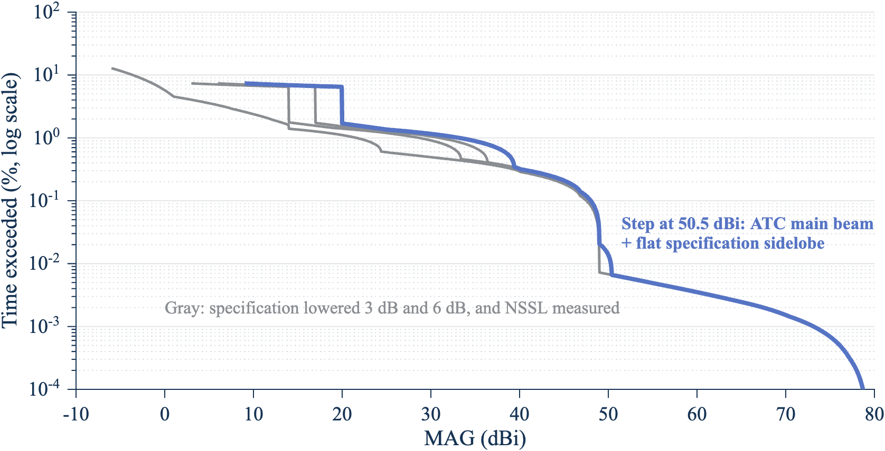

*Figure 11. The WSR-88D pattern changes the MAG below 51 dBi; above it, all patterns agree. Exceedance of the MAG at 0.5° at both ends, ASR-11, envelope over 216 modes. Source: `mag_pair_cdf_rev1` run by `report_numbers_rev7.m` (2026).*

**Which mode sets each percentile.** `worst_modes_rev8.csv` lists, for six cases and three takeoff-angle pairs, the mode that sets each envelope percentile and how many modes reach the same value (review finding Q9):

- **99.9%.** VCP 212 SAILS×3 AVSET 6.4, tied with one other mode, for every pattern in the bracket, both ATC radars, and the three angle pairs (0°/0°, 0.5°/0.5°, and 0.5°/0°).
- **99.999%.** The same mode, tied with one other, except the ASR-9 at 0.5°/0°, where VCP 12 SAILS×3 AVSET 6.4 with a CD cut at 12.524° sets it alone.
- **99%.** The same mode for the specification patterns and both ATC radars. For the NSSL pattern at 0°/0° and 0.5°/0°, VCP 12 SAILS×3 AVSET 6.4 with a CD cut sets it.
- **99.99%.** A plateau that 2 to 202 modes reach, so the named mode is the first of the tied modes in the list.
- **50% and 90%.** Every mode gives the same value for the specification patterns; for the NSSL pattern at 90%, 8 to 33 modes tie.

The worst mode also changes with the takeoff angle: the review found 33 different modes setting the envelope somewhere over 2,000 random pairs. The envelope bounds any mix of whole volumes of the 216 modes (Step 11 in Appendix D, and register row A3), with the one-volume exception of Section 11.3, so a study should use the envelope, not one mode. This bound holds for the CDF only; Section 9 shows that it doesn't carry over to the time-series statistics.

## 9. Time series, persistence, and harm

### 9.1 Method

The time series of revision 5 evaluated both antennas every 2 ms. Most of those steps can't produce high coupling: when neither beam is near the path, the MAG is at most the sum of the two antennas' gains outside their main beams. Revision 6 uses that bound.[^41]

1. **Find the event windows.** `scan_event_windows_rev1` marks every time step at which either beam is within 4° of the path. The windows are a subset of the 2 ms grid, about 5% of it.
2. **Bound the rest.** `ts_floor_rev1` finds the largest MAG possible outside the windows for the pair's takeoff angles: 15.4 dBi at a horizontal path with the NSSL pattern and 26.2 dBi with the specification pattern. Every per-scan maximum above this floor equals the maximum on the full grid. A scan with no window sample is reported as at or below the floor.
3. **Build the library once per pair of scan modes.** `scan_event_library_rev1` runs the scan clock (`scan_clock_rev1`, shared with the wrapper) and stores the windows. It doesn't depend on the antenna patterns or the takeoff angles.
4. **Apply each radar pair's gains.** `mag_pair_timeseries_rev1` evaluates the gains inside the windows and returns the maximum MAG per ATC revolution, per WSR-88D cut, and per WSR-88D volume, the persistence statistics, the exceedance curves, and the harm metric. It takes one pair or a batch of pairs that share the two scan modes (Section 13).

Each trial draws one ATC rotation-rate offset, uniform within ±0.5 degrees per second, and keeps it for the whole trial unless a drift model is chosen (Section 9.3). Every run of high volumes that touches the start or end of a trial is counted as censored (`censored_runs`): the trial cut it, so its length is a lower bound.

**Every mode, not only the worst mode for the CDF.** Revision 7 ran the time series only at the mode that is worst for the CDF. The CDF envelope bounds any mix of whole volumes because the share of time above a level is a weighted mean of the modes' shares; the share of volumes above a level, the length of a run of volumes, and the share of cuts hit aren't, so the mode that is worst for the CDF needn't be worst for them (review finding Q1). Revision 8 runs the time series for all 216 modes, at takeoff angles of 0° and 0.5° at both ends, with 120 one-hour trials each (seed 20261105), and reports for each statistic the largest value over the modes and the mode that sets it (`docs/figures/ts_all_modes_rev8.csv`, `ts_envelope_rev8.csv`).

**Time-step limit.** The 2 ms step can miss the ATC boresight by up to 0.03 dB, so the plateau of the ATC main beam plus the specification near sidelobe, 50.5 dBi from the patterns, is sampled between 50.47 and 50.50 dBi. At the mode that is worst for the CDF on a horizontal path, 99.5% of volumes reach 50.4 dBi and 32.0% reach 50.5 dBi (`vol_exceed_modes_rev8.csv`). The step near 50.5 dBi in the volume exceedance curves therefore sits where the time step puts it, not exactly at the pattern sum (review finding Q13).

### 9.2 How often high coupling comes back

The share of volumes whose maximum reaches a level depends on the scan mode (Table 9-1 and Figure 12). Over the 216 modes, it is largest for VCP 34 with one SAILS rescan, a clear-air mode, at every level from 55 to 70 dBi and both takeoff angles.

*Table 9-1. Largest value of each time-series statistic over the 216 modes, the mode that sets it, and the value at the mode that is worst for the CDF (VCP 212 SAILS×3 AVSET 6.4). ROC specification, ASR-11, same takeoff angle at both ends, 120 one-hour trials (`docs/figures/ts_envelope_rev8.csv`).*

| Statistic | Path 0°: largest (mode) | Path 0°: CDF-worst mode | Path 0.5°: largest (mode) | Path 0.5°: CDF-worst mode |
| --- | --- | --- | --- | --- |
| Volumes reaching 55 dBi | 42.9% (VCP 34 SAILS×1) | 28.9% | 54.3% (VCP 34 SAILS×1) | 33.7% |
| Volumes reaching 60 dBi | 34.8% (VCP 34 SAILS×1) | 23.7% | 48.6% (VCP 34 SAILS×1) | 30.9% |
| Volumes reaching 70 dBi | 15.9% (VCP 34 SAILS×1) | 14.2% | 29.3% (VCP 34 SAILS×1) | 20.0% |
| ATC revolutions reaching 60 dBi | 0.38% (VCP 12 SAILS×3 AVSET 10.0, CD) | 0.36% | 0.51% (VCP 12 SAILS×3 AVSET 10.0, CD) | 0.47% |
| Volumes at 60 dBi in runs of two or more | 55.0% (VCP 35 SAILS×1) | 39.9% | 63.6% (VCP 35 SAILS×1) | 46.2% |
| Longest run of volumes at 60 dBi | 15 (VCP 12 AVSET 8.0, CD) | 6 | 15 (VCP 12 AVSET 6.4, CD) | 9 |
| 0.5° cuts with a radial at 50 dBi | 86.5% (VCP 32) | 26.9% | 86.5% (VCP 32) | 26.9% |
| 0.5° cuts with a radial at 60 dBi | 9.8% (VCP 32) | 2.8% | 10.6% (VCP 32) | 3.1% |
| 0.5° cuts with a radial at 70 dBi | 6.0% (VCP 32) | 1.8% | 7.4% (VCP 31) | 2.2% |
| Largest radials hit in one cut at 60 dBi | 2 (every mode) | 2 | 2 (every mode) | 2 |

Each statistic has its own worst mode, because each counts a different unit of time:

- **Share of revolutions.** Over the modes, the share of ATC revolutions reaching 60 dBi ranges from 0.15% to 0.38% on a horizontal path and from 0.24% to 0.51% at 0.5°. The mode that is worst for the CDF is close to the largest, as expected: both count time near the path.
- **Share of volumes.** A volume of VCP 34 with one SAILS rescan lasts 638 s and holds four 0.5° revolutions (228 s at 0.5°), against 354 s and 183 s for VCP 212 with three rescans, so each VCP 34 volume holds more ATC revolutions that can reach the level. On a horizontal path 22 modes, and at 0.5° 49 modes, exceed the share of volumes at 60 dBi of the mode that is worst for the CDF.
- **Longest run in one-hour trials.** The run of 15 volumes is the cap that a one-hour trial puts on a mode with four-minute volumes, so it measures the trial length, not the mode (Section 9.3).

*Figure 12. Up to half of the WSR-88D volumes reach 60 dBi in the worst scan mode, half again as many as in the mode that is worst for the CDF. Share of volumes whose largest MAG reaches each level, ROC specification, ASR-11, path at 0.5° at both ends, 120 one-hour trials per mode. Source: `docs/figures/vol_exceed_modes_rev8.csv` (2026).*

Table 9-2 brackets the pattern and the ATC radar at the mode that is worst for the CDF. The bracket rows come from revision 7 and aren't the worst over the modes; the differences between the columns, which come from the patterns, apply to every mode.

*Table 9-2. Share of complete WSR-88D volumes whose maximum reaches each level, VCP 212 SAILS×3 AVSET 6.4, 120 one-hour trials (`docs/figures/bracket_ts_rev7.csv`).*

| Level | ROC specification, 0° | Specification − 3 dB or NSSL, 0° | ASR-9, ROC, 0° | ROC specification, 0.5° | ASR-9, ROC, 0.5° |
| --- | --- | --- | --- | --- | --- |
| 50 dBi | 99.5% | 32.5% | 31.9% | 99.5% | 100% |
| 55 dBi | 28.9% | 28.9% | 28.1% | 33.7% | 33.0% |
| 60 dBi | 23.7% | 23.7% | 23.2% | 30.9% | 30.3% |
| 70 dBi | 14.2% | 14.2% | 13.3% | 20.0% | 19.1% |

The 50 dBi row shows the knife edge:

- **ASR-11, specification pattern.** The ATC main beam plus the flat near sidelobe is 50.5 dBi, so on a horizontal path nearly all ASR-11 volumes reach 50 dBi.
- **ASR-9 on a horizontal path.** The same sum is 50.0 dBi, and only about a third of the volumes reach 50 dBi.
- **ASR-9 at 0.5°.** Every volume reaches 50 dBi for a different reason: the WSR-88D main beam on axis (45.5 dBi) plus the ASR-9 remote sidelobe (+5.5 dBi) gives 51.0 dBi on every pass of the 0.5° cut, and the ASR-9 volume step and 99.99% value both sit at 51.0 dBi. That level rests on the disputed ASR-9 remote sidelobe (Section 8.1): at +3.5 dBi it would be 49.0 dBi, below 50 dBi (review finding Q8).

Any threshold within about 1 dB of a sum of pattern constants behaves this way, so the report doesn't use one in its conclusions. Over the 216 modes the knife edge is wider still: on a horizontal path, 86.5% of the 0.5° cuts of VCP 32 have a radial at 50 dBi (Table 9-1).

**Sampling.** A bootstrap over the 120 trials of the headline run (VCP 212 SAILS×3 AVSET 6.4, horizontal path) gives 95% intervals of 21.0% to 26.5% for the share of volumes reaching 60 dBi and 11.9% to 16.4% for 70 dBi (`docs/figures/bootstrap_rev8.csv`). A set of ten 24-hour trials draws only ten rate offsets, so it is noisier: over 20 seeds of such a set, the share of volumes reaching 60 dBi at 0.5° ranged over 3.5 to 5.5 percentage points, depending on the mode and drift model (`seeds_summary_rev8.csv`). Revision 7's statement that the share agreed within 3 percentage points across trial sets was too narrow (review finding Q3).

### 9.3 How long high coupling lasts

Two things set the length of a run of high volumes: the trial length, and how close the ATC rotation rate comes to a lock with the volume time (Appendix D, Section D.3.2). A long run needs a whole number of ATC revolutions to match one WSR-88D volume for many volumes in a row.

**Trial length.** A one-hour trial caps a run at about 10 to 15 volumes, depending on the mode. With the same model and seed, ten 12-hour trials raise the longest run at 60 dBi on a horizontal path from 6 volumes (35 min) to 14 volumes (83 min), and at 0.5° from 9 to 14 volumes (`docs/figures/trial_length_rev8.csv`). The share of volumes reaching each level changes by less than 2 percentage points.

**Drift model and seed.** Revision 7 ran one seed per drift model, and the review found the longest run moved more between seeds than between models (review finding Q2). Revision 8 runs 20 seeds of ten 24-hour trials for each of three drift models (one fixed rate offset per trial, and a random walk of the rate with a step of 0.01 or 0.05 degrees per second per revolution, within the same ±0.5 degrees per second band) and two modes: VCP 34 SAILS×1, worst for the share of volumes, and VCP 212 SAILS×3 AVSET 6.4, worst for the CDF (`docs/figures/seeds_runs_rev8.csv`, `seeds_summary_rev8.csv`).

*Figure 13. With a fixed ATC rate offset, some seeds lock to the volume time for hours; a drifting rate breaks the lock within about three hours. Longest run of consecutive volumes at 60 dBi or more in each of 20 seeds of ten 24-hour trials, VCP 34 SAILS×1, path at 0.5°. Source: `docs/figures/seeds_runs_rev8.csv` (2026).*

*Table 9-3. Runs of volumes at 60 dBi or more, path at 0.5° at both ends, 20 seeds of ten 24-hour trials for each model. Ranges are over the seeds (`docs/figures/seeds_summary_rev8.csv`).*

| Statistic | VCP 212, fixed offset | VCP 212, walk 0.01 | VCP 212, walk 0.05 | VCP 34, fixed offset | VCP 34, walk 0.01 | VCP 34, walk 0.05 |
| --- | --- | --- | --- | --- | --- | --- |
| Volumes reaching 60 dBi | 29.0% to 34.5% | 29.1% to 32.6% | 29.1% to 32.8% | 44.5% to 49.9% | 44.9% to 50.0% | 45.2% to 49.9% |
| Median run (volumes) | 1 | 1 | 1 | 1 | 1 | 1 |
| 95th-percentile run (volumes) | 2 to 4 | 3 | 3 to 4 | 3 to 5 | 4 to 5 | 4 to 5 |
| Longest run (volumes), median over seeds | 6 | 7 | 6 | 6.5 | 9 | 9 |
| Longest run (volumes), largest over seeds | 54 (5.3 h) | 10 (59 min) | 9 (53 min) | 40 (7.1 h) | 17 (3.0 h) | 12 (2.1 h) |
| Volumes at 60 dBi in runs of two or more | 39.8% to 67.7% | 44.6% to 54.1% | 46.3% to 56.8% | 55.0% to 76.4% | 64.8% to 72.8% | 66.2% to 75.0% |
| Volumes at 60 dBi in runs of three or more | 9.7% to 41.8% | 17.1% to 25.8% | 19.3% to 27.4% | 22.5% to 47.7% | 33.7% to 49.4% | 36.5% to 49.7% |

What holds and what doesn't:

- **The median and 95th-percentile runs hold** across modes, seeds, and drift models: one volume and two to five volumes.
- **High coupling isn't mostly isolated.** Between 40% and 76% of the volumes reaching 60 dBi at 0.5° fall in runs of two or more volumes, and 10% to 50% in runs of three or more. Revision 7's "rarely for long" understated this.
- **The longest run depends on the drift model.** With one fixed rate offset for a whole 24-hour trial, a seed that draws a rate near a volume lock holds it for hours: 54 volumes (5.3 hours) for VCP 212 and 40 volumes (7.1 hours) for VCP 34. On a horizontal path the largest are 51 and 36 volumes. With either random walk, the longest run in 4,800 hours per mode is 17 volumes (3.0 hours) or less. The same model and seed spread make the trend in revision 7's Figure 13 unreliable; Figure 13 now shows every seed.

Which drift model applies is an FAA question: the ATC rotation-rate tolerance and how the rate wanders over hours (open item 3). No public value for either was found (TODO). Until it is known, a study that needs the length of a volume lock should use the fixed-offset result as the bound.

### 9.4 Harm metric

A share of time doesn't say how much of a WSR-88D product is affected. The harm metric counts, for each complete 0.5° cut, the radials during which the MAG reaches a level while the WSR-88D beam points in that radial (path ATC radar to WSR-88D). It counts radials exposed to high coupling, not corrupted data: whether a radial is corrupted depends on the path loss, the receiver, and the protection criterion, which belong in the link budget working paper. A brute-force count on the full 2 ms grid checks the code.

*Figure 14. The slow clear-air modes have three times as many 0.5° cuts exposed to high coupling as most other modes. Share of 0.5° cuts with a radial at 60 dBi or more, each of the 216 modes, ROC specification, ASR-11, 120 one-hour trials per mode. Source: `docs/figures/ts_all_modes_rev8.csv` (2026).*

The clear-air VCPs 31 and 32 rotate the 0.5° cut at about 5 degrees per second, against 12.5 to 21 degrees per second for VCP 212. The slower beam stays near the path longer, so an ATC main-beam pass is more likely to fall while the WSR-88D points at the ATC radar. At 60 dBi, 9.8% of their 0.5° cuts have a radial hit on a horizontal path and 10.6% at 0.5°; the median mode gives 3.0% and 3.3%. No mode has more than two 1° radials hit in one cut at 60 dBi (Table 9-1).

*Table 9-4. Harm metric at the mode that is worst for the CDF: ASR-11, specification pattern, VCP 212 SAILS×3 AVSET 6.4, 120 one-hour trials, 1° radials (`docs/figures/bracket_harm_rev7.csv`).*

| Level | Cuts with a radial at the level, 0° | Largest radials in a cut, 0° | Cuts with a radial at the level, 0.5° | Largest radials in a cut, 0.5° |
| --- | --- | --- | --- | --- |
| 40 dBi | 100% | 5 | 100% | 5 |
| 50 dBi | 26.9% | 3 | 26.9% | 3 |
| 60 dBi | 2.8% | 2 | 3.1% | 2 |
| 70 dBi | 1.8% | 2 | 2.2% | 2 |

With the specification lowered by 3 dB, or the measured pattern, 3.5% of cuts at this mode have a radial at 50 dBi on a horizontal path (3.8% at 0.5°); the 60 and 70 dBi rows don't change. With 0.5° super-resolution radials, the shares are the same and a cut has up to three more radials at 40 dBi and one more at 50 and 60 dBi (`docs/figures/harm_rev6.csv`).

## 10. Sector scans

No operational VCP scans a sector, but the November 4 meeting asked for a sector aimed at the ATC radar as a bounding case, and Section D.2 showed it is the largest change. Revision 6 adds sector scans to every part of both models.[^42]

- **Two sweep laws.** `sector_sweep_rev1` gives a restart sweep (the beam jumps back to the start of the sector at each pass) or a bidirectional sweep (back and forth, with an optional dwell at each turnaround). The wrapper options are `nexrad_sector_center_deg`, `nexrad_sweep_mode`, `nexrad_turnaround_s`, `atc_sector_deg`, and `atc_sector_center_deg`.
- **Exact slices for sectors.** The gain slice of Section 7.1 takes an azimuth interval. The two-part model makes sector slices per pair, with the bearing of the other radar from the sector center as an input (`brg_tx_deg`, `brg_rx_deg`). A bearing sweep of 26 bearings takes about 0.1 s.
- **Checks.** The revision 5 sector row of Section D.2 (10° sector) reproduces bit for bit, and the time series, the exact CDF, and the two-part model agree.

Two findings change how sector scans must be studied (`docs/figures/sector_bearing_sweep_rev1.csv`; 30° sector, worst mode):

- **The sector center isn't always the worst bearing.** For a restart sweep, it is: 69.95 dBi at 99.99% with the path at the center, 64.40 dBi at the edge. For a bidirectional sweep with a 0.5 s turnaround, the dwell parks the main beam on a path at the sector edge: 75.40 dBi against 68.05 dBi at the center, 7.4 dB higher at 99.99% and 7.6 dB higher at 99.9% (register rows E1 and E2). A sector study must sweep the bearing. The dwell is a bounding assumption, because it keeps the beam radiating while parked, and no public sweep law is known.
- **A defect in the bidirectional time series is fixed.** Each cut restarted the back-and-forth sweep at the same point, so part of the sector was never visited in the time series: per-volume maxima came out 13 to 39 dB low, and the engine's 99% value 10 dB low with the path 10° off center. The CDFs were not affected. The sweep phase now runs on across cuts and volumes (register row R1), and a test checks that the clock visits the whole sector.

## 11. Red-team reviews

### 11.1 Method

Two red teams tested the claims the results depend on, each in three layers:

1. **Attack register.** Each row names a claim, the test that could break it, a pass criterion set before the run, the result, and the evidence file. `redteam_runs_rev1` runs every attack and writes the register, `docs/redteam_register_rev1.csv` (39 rows), with the revision 5 inputs (NSSL measured pattern, 74 modes). Revision 7 reran the main attacks with the revision 6 inputs (option `inputs = "rev6"`, Section 11.5).[^43]
2. **Independent review.** A separate agent that had not seen the plan, the register, or the code history tried to break seven claims on November 10, 2026. It broke four, which became rows R1 to R6. The second red team, of the revision 6 paper, found findings P1 to P14 (Section 11.6); its author also wrote the paper, so it isn't independent. A separate agent then reviewed revision 7 independently and found findings Q1 to Q14 (Section 11.7).
3. **Human review.** NOAA and FAA subject-matter experts review the inputs and the findings. This layer hasn't happened yet.

A fault-seeding test plants 10 bugs across both models, one at a time, and runs the test suite. The suite caught all 10 (register row F2).

### 11.2 Register results

| Group | Claims tested | Result |
| --- | --- | --- |
| A. The convolution is valid | Independent pointing (A1), ATC rate tolerance (A2), mode mixtures (A3), complete mode set (A4) | A1 and A2 pass. A3 and A4 are findings (Section 11.3). |
| B. Numerical accuracy | Bias bound (B1), interpolation (B2), single-precision storage (B3), closed-form slice (B4), Monte Carlo intervals (B5) | All pass except B2: interpolation error up to 0.25 dB against a 0.1 dB claim; the help now states it. |
| C. Inputs | WSR-88D pattern (C1), ASR-9 remote sidelobe (C2), takeoff-angle convention (C3), site tilt (C4), far field (C5) | C1 and C2 changed the defaults (Section 8.1). C4 and C5 are findings (Section 11.3). C3 matches the RFS tool convention on hand cases; a full check needs an RFS workbook. |
| D. Time series | Rate drift (D1), run length (D2), event method (D3), harm (D4) | D2, D3, and D4 pass. D1 is in Section 9.3. |
| E. Sectors | Center is the worst bearing (E1), sweep laws (E2) | Findings (Section 10). |
| F. Software | Two models agree (F1), tests catch bugs (F2), agreement with the C# RFS tool (F3) | F1 and F2 pass. F3 needs an RFS workbook with coupling-distribution columns. |
| Defects found by the runs | X1 to X4 | X1 to X3 fixed. X4 is in the C# tool: the worst-case coupling function passes antenna 1's fallback model for antenna 2. It matters only when the two antennas use different fallback models; it is reported to the tool's owner. |
| Independent review | R1 to R6 | All fixed: R1 (Section 10), R2 (same as C1), R3 (216 modes), R4 (rounding never lowers a result), R5 (exact peak gain for sector slices), R6 (input checks). |

The defects X1 to X3:

- **X1.** With the ATC tilt at 2.5° and a +6.5 dBi floor, the ATC gain toward the path was the floor at every azimuth, and the wrapper crashed. It now runs with no main-beam region.
- **X2.** A closed-form slice that spanned one pattern cell built a row instead of a column and crashed in some sectors. Fixed.
- **X3.** The stated bias bound was one bin too small (Section 7.1). Only the statement changed; no value did.

### 11.3 Findings carried into the results

Values are given for the revision 6 inputs, with the revision 5 inputs in parentheses where they differ.

- **A mode change in the middle of a volume can exceed the envelope for one volume (A3).** The envelope bounds any mixture of whole volumes: the mixture's exceedance is a weighted mean of the modes' exceedances, and 5,000 random mixtures came out at or below it. A volume cut short by a mode change is different. The next volume starts again at the lowest cut, so the low cuts get more time than in any one mode. Over the window of the partial volume and the next full volume, the MAG came out up to 1.45 dB above the envelope at 99%, 0.30 dB at 99.9%, and 0.10 dB at 99.99% (1.35, 0.65, and 0 dB). The window lasts one volume, about 6 minutes, so the long-run distribution moves little; the per-volume statistics of Section 9 would see it.
- **Sites with a supplemental low cut couple a little more (A4).** The 216 modes use a 0.5° lowest cut. The NWS lists 22 sites with a supplemental cut from −0.2° to +0.4° (four at −0.2°), and a 2024 NWS notice lists supplemental cuts of 0.2° to 0.4° at three Gulf Coast sites. Adding one such cut to the worst mode raises the MAG by up to 0.65 dB from 99% to 99.999%, for takeoff angles from −0.2° to 0.5° (3.1 dB with the measured pattern, whose low sidelobes make the extra main-beam time count for more). The options `low_el_deg` and `low_el_mode` run those sites with their own lowest cut.
- **ATC tilt matters at 99%, 99.99%, and 99.999% (C4).** Over tilts from −1° to +2.5°, the MAG ranges over 2.4 dB at 99%, 0.2 dB at 99.9%, 3.3 dB at 99.99%, and 3.3 dB at 99.999%; the largest 99.99% value is at 0° tilt (with the measured pattern: 2.6 dB at 99%, none at 99.99%). Tilt is a per-pair input; site tilts are FAA data and aren't public.
- **Pairs closer than about 1.5 km are outside the model (C5).** The WSR-88D far field begins at 1.3 to 1.5 km across 2.7 GHz to 3.0 GHz, and the ATC radar's at 0.56 km. Closer pairs need a near-field coupling analysis.

### 11.4 NOAA case

In revision 6 the NOAA case differed from the baseline only in the ATC remote sidelobe, because the specification pattern had become the baseline (red-team finding P13). Revision 7 redefined it as the worst defensible combination of inputs from the attacks: the ROC specification pattern (C1), an ATC remote sidelobe of +6.5 dBi (3 dB above the ASR-11 value, C2), the ATC tilt with the largest 99.99% MAG (C4, 0°), and, for the sites that have one, a supplemental low cut (A4). Revision 7 fixed the takeoff angle at 0.5° at both ends, which isn't the worst angle (review finding Q5). Revision 8 takes the largest value over takeoff angles from −1° to 3° at each end, on the 0.05° grid of Section 8.2.

*Table 11-1. Envelope over 216 modes, ASR-11, ROC specification. "Largest" is over the takeoff surface; each percentile can occur at a different angle pair (`docs/figures/noaa_case_rev8.csv`). All values in dBi.*

| Case | 50% | 99% | 99.9% | 99.99% | 99.999% |
| --- | --- | --- | --- | --- | --- |
| Baseline, horizontal path | 9.0 | 31.05 | 44.75 | 50.30 | 68.70 |
| Baseline, 0.5° at both ends | 9.0 | 33.20 | 48.05 | 50.30 | 73.15 |
| Baseline, largest | 9.0 | 33.65 | 48.05 | 50.45 | 73.40 |
| NOAA case, 0.5° at both ends | 12.0 | 33.95 | 50.50 | 52.00 | 73.15 |
| NOAA case, largest | 12.0 | 34.45 | 50.65 | 52.00 | 73.40 |
| NOAA case, supplemental cut at 0.2°, largest | 12.0 | 34.50 | 50.60 | 52.00 | 73.50 |
| NOAA case, supplemental cut at −0.2°, largest | 12.0 | 34.15 | 50.45 | 52.00 | 72.75 |

At the same takeoff angles, the NOAA inputs add 3.0 dB at 50% and 90%, 0.75 dB at 99%, 2.45 dB at 99.9%, and 1.7 dB at 99.99%; the 99.999% value, set by the two main beams, doesn't change. Revision 7's "1.7 to 3 dB" missed the 99% value (review finding Q4). The largest NOAA values occur with the WSR-88D takeoff angle between 0.45° and 1° and hold over a range of ATC takeoff angles that includes 0° (`takeoff_worst_rev8.csv`). Over the surface they are 0.8 dB (99%) to 3.0 dB (50%) above the largest baseline values, and 5.9 dB above the horizontal-path baseline at 99.9%. A supplemental cut at 0.2° raises the largest values by at most 0.1 dB. A cut at −0.2° lowers the largest 99.999% value by 0.65 dB, because it lengthens the volume and so takes time from the 0.5° cut, whose beam lies on the worst path. NOAA and FAA reviewers decide which inputs stand.

### 11.5 Main attacks rerun with the revision 6 inputs

The register's attacks ran on the revision 5 inputs (red-team finding P7). Revision 7 reran the seven attacks most likely to change with the ROC specification pattern and 216 modes (`docs/figures/redteam_rev6/attacks/summary_rev6_inputs.csv`):

| Attack | Revision 5 inputs | Revision 6 inputs |
| --- | --- | --- |
| A1 Independent pointing | Pass: 2 of 296 checks outside the 95% interval | Pass: 7 of 864 checks outside (0.8%); largest difference 0.85 dB |
| A2 ATC rate tolerance | Pass: largest change at 99.9% 0.40 dB | Pass: 0.41 dB; no run over 1 dB |
| A3 Mode change mid-volume | 1.35, 0.65, 0 dB above the envelope | 1.45, 0.30, 0.10 dB |
| A4 Supplemental low cut | Up to 3.10 dB | Up to 0.65 dB |
| C4 ATC tilt | 99.99% unchanged over tilt | 99.99% ranges over 3.3 dB |
| D2 120 hours is enough | Pass: 70 dBi share 12.3% (10.6% to 14.2%), seed 1 | Pass: same (the 70 dBi level needs the main beam, which both patterns share) |
| NOAA case | 99.99%: 50.3 against 45.5 dBi | 50.3 against 50.3 dBi (superseded by Section 11.4) |

Every attack that passed still passes. A4 and C4 change in size, and both changes come from the specification's higher sidelobes: they raise the floor that the extra low cut competes with (A4) and make the ATC main beam plus a WSR-88D sidelobe set the 99.99% value, which the ATC tilt then moves (C4).

### 11.6 Second red team: findings on the revision 6 paper

| ID | Finding | What revision 7 does |
| --- | --- | --- |
| P1 | The headline 99.9% value was for a horizontal path only; at 0.5° it is 3.3 dB higher, and 4.65 dB higher at 99.999% | Section 8.2 and the summary give the largest value over takeoff angles from −1° to 3° (Figure 10, Table 8-1) |
| P2 | One-hour trials capped run lengths at 10 volumes | Runs touching a trial end are counted as censored; Section 9.3 reports run lengths as a distribution over drift models and long trials |
| P3 | The share of volumes reaching 50 dBi swings from 32% to 99.5% with a 0.5 dB change in ATC peak gain | Section 9.2 reports per-volume exceedance curves (Figure 12) and doesn't draw conclusions at one threshold |
| P4 | The specification envelope used as the gain everywhere overstates time at the sidelobe level | Section 8.3 brackets the pattern: specification, specification − 3 dB and − 6 dB, measured |
| P5 | The two ASR-9 sidelobe sources disagree | Section 8.1 states it; the ASR-9 inputs are a bound |
| P6 | The paper named the exact CDF as the default, but the code defaulted to Monte Carlo | The exact CDF is now the code default; Section 8.1 states the time-series default for each function |
| P7 | The register's attacks used the revision 5 inputs | Section 11.5 reruns the main attacks |
| P8 | Sections 7 to 10 of revision 6 kept conclusions that the new defaults contradict | They are now Appendix D, titled for the revision 5 inputs |
| P9 | No figures for the revision 6 results | Figures 10 to 14 |
| P10 | The bootstrap interval came from a different run | Recomputed on the headline run: 11.9% to 16.4% (Section 9.2) |
| P11 | "High by at most 0.3 dB" missed rare one-bin low cases | Corrected (Section 7) |
| P12 | Timings didn't state their conditions | Section 13 gives the machine, run and pattern for each |
| P13 | The NOAA case differed from the baseline in one input | Redefined (Section 11.4) |
| P14 | The summary gave single values | The summary gives each headline value with the input that moves it |

### 11.7 Independent review of the revision 7 paper

A separate agent that didn't write revision 7 reviewed it on November 11, 2026 (`docs/rev7_independent_review_rev1.md`). It found that every CDF percentile stood and that the time-series results didn't stand as worst-case results. The author reran the two High findings and one Medium finding before revision 8, and all three reproduced.

| ID | Severity | Finding | What revision 8 does |
| --- | --- | --- | --- |
| Q1 | High | The time series ran only at the mode that is worst for the CDF, which isn't worst for persistence or harm | Runs all 216 modes and reports the envelope of each statistic (Section 9.1, Table 9-1) |
| Q2 | High | The run-length conclusions rested on one seed per case | 20 seeds of ten 24-hour trials for three drift models and two modes; adds the share of high volumes in runs of two or three or more (Section 9.3) |
| Q3 | Medium | "Within 3 percentage points" across trial sets was too narrow | Gives the bootstrap interval and the spread over seeds (Section 9.2) |
| Q4 | Medium | The NOAA range "1.7 to 3 dB" was wrong at 99% | "0.8 to 3 dB", with each percentile (Section 11.4) |
| Q5 | Low | The NOAA case at 0.5° at both ends wasn't the worst takeoff angle | Takes the largest value over the takeoff surface (Table 11-1) |
| Q6 | Medium | The wrapper's on-path reference levels used the lowest cut only, so a supplemental low cut gave main beam to main beam of 72.5 dBi instead of 79.4 dBi | Uses the cut whose beam gives the largest WSR-88D gain on the path; new test `testRefLevelsUseCutNearestThePath` |
| Q7 | Medium | Five cited evidence files had no producing script | `report_numbers_rev8.m` writes every revision 8 table; `report_figures_rev8.m` draws Figures 12 to 14 from them; `testReportNumbersRev8` runs both |
| Q8 | Medium | The ASR-9 mechanism at 0.5° was wrong | WSR-88D main beam plus ASR-9 remote sidelobe, 51.0 dBi, which rests on the disputed +5.5 dBi (Section 9.2) |
| Q9 | Low | The worst-mode claim held only at 99.9% and 99.999%, and ties weren't reported | Lists the worst mode and the number of tied modes at each percentile (Section 8.3) |
| Q10 | Low | "Up to 79.4 dBi" on the path should be 79.5 dBi | Corrected (summary, Table 8-2) |
| Q11 | Low | Locations of the largest values were points on a 0.25° grid | Ranges on a 0.05° grid (Table 8-1) |
| Q12 | Info | The speed claims didn't state their assumptions | Single-thread timings and the assumptions behind the study estimate (Section 13) |
| Q13 | Info | The 50.5 dBi step is set by the 2 ms time step | Stated (Section 9.1) |
| Q14 | Info | A per-sample elevation passed as a row is read as a batch of takeoff angles | Documented in the help of `antenna_gain_rev1` |

The review asked for a second independent check of Sections 8 and 9 after revision 8 (open item 1).

## 12. Scope limits

The model gives antenna coupling between one pair of radars. Four things it doesn't do are recorded in the register as scope limits (rows G1 to G4):

- **No aggregate interference (G1).** Each WSR-88D is paired with one ATC radar. Several ATC radars within range of one WSR-88D would each add interference; their aggregate would need each pair's time series on a common clock. It belongs in the link budget working paper.
- **No polarization effects (G2).** The model assumes no polarization mismatch loss, which is conservative for the coupling. It doesn't model the effect of interference on the WSR-88D dual-polarization products.
- **No pulse-level coupling or frequency-dependent rejection (G3).** The MAG is the antenna part of the coupling only. Pulse timing, duty cycle, and the frequency-dependent rejection between the two waveforms belong in the link budget.
- **No validation against observed interference (G4).** No public record of observed WSR-88D interference was available to test the model. The ROC keeps interference records, which are restricted; they are named here only.

## 13. Speed

The time series was the bottleneck for an RFS-scale study: a 120-hour run took 3.5 s per radar pair and scan mode with the revision 6 code. Revision 7 profiled both models and removed the parts of the work that didn't depend on the radar pair. Every change reproduces the pinned revision 6 outputs (pair percentiles, worst modes, and every per-scan maximum and harm count of a four-hour run) to 1e-9 dB, the revision 5 references, and the full test suite (Section 15).

- **Scan states once per batch.** The pointing states at the window samples don't depend on the takeoff angles, but every pair recomputed them. `mag_pair_timeseries_rev1` now takes a batch of pairs that share two scan modes and computes each trial's states once.
- **Gains for many pairs in one call.** `antenna_gain_rev1` and `ts_floor_rev1` take a row of takeoff angles and return one column per pair; for the ATC radar's fixed tilt, the elevation pattern is evaluated once per angle instead of once per sample.
- **Tables built once.** The per-trial tables, 30% of the time, are now numeric arrays until the end, and the exceedance curves use one histogram.
- **Percentiles by bisection.** `mag_pair_cdf_rev1` finds each envelope percentile by bisection on the envelope exceedance, about 12 evaluations per percentile instead of every bin for every mode (option `pct_search`). The search over every bin was 45% of the pair time with 216 modes.

*Table 13-1. Measured on November 11, 2026, Apple silicon Mac, 8 cores, MATLAB R2025b, no parallel pool; ROC specification, ASR-11, worst mode. Single runs on a shared machine; expect ±30%. MATLAB uses several threads for some operations even without a pool, so these aren't single-core times.*

| Item | Revision 6 code | Revision 7 code |
| --- | --- | --- |
| Pair CDF, 216-mode envelope, 2,000 random pairs, takeoff angles −5° to 10° | 1.6 to 1.85 ms per pair | 0.9 to 1.1 ms per pair |
| Time series, 120 h, one pair | 3.5 s | 1.4 s |
| Time series, 120 h, batch of 64 pairs | 3.5 s per pair | 0.42 s per pair |
| WSR-88D table, 216 modes, 301 takeoff angles | 1.7 s | 1.7 s (unchanged) |

Revision 8 repeats the timings on one core: a MATLAB batch worker with one computational thread (`docs/figures/timing_rev8.csv`, `timing_rev8_machine.txt`, written by `report_numbers_rev8.m`; review finding Q12).

*Table 13-2. Revision 8 code, one computational thread, MATLAB R2025b Update 4, Apple silicon (MACA64), ROC specification, ASR-11, 120 one-hour trials.*

| Item | Time |
| --- | --- |
| WSR-88D table, 216 modes, 301 takeoff angles | 1.7 s |
| Pair CDF, bisection, per pair (500 random pairs) | 1.3 ms |
| Pair CDF, search over every bin, per pair (same pairs) | 3.1 ms |
| Event library, one pair of scan modes | 1.9 s |
| Time series, one pair | 2.3 s |
| Time series, per pair in a batch of 32 | 0.70 s |

On one core, bisection makes the pair CDF 2.5 times faster, and a batch of 32 pairs makes the time series 3.3 times faster per pair. What a study costs depends on how many pairs share both scan modes:

- **One mode per pair.** A study of 1,000 radar pairs with a time series at one mode each takes about 12 minutes on one core if the pairs fall in batches of 32 that share both modes, and about 38 minutes if every pair runs alone. Each distinct pair of scan modes adds 1.9 s to build its library; since the worst mode for the CDF changes with the takeoff angle (Section 8.3), the batches are smaller than the pair count suggests.
- **Every mode per pair.** Section 9 shows that a time-series result needs every mode, not one. For 1,000 pairs that is 216,000 pair-mode runs: about 42 hours on one core in batches of 32, or about 7 hours on six workers. A study can screen first: run the CDF for every pair, then the time series for every mode only at the pairs whose takeoff angles put them near the largest values of Table 8-1.

Parallel workers (`parallel_flag`) give results identical to a serial run.

## 14. Concerns from the November 4, 2026 Retuning LOE meeting

The meeting reviewed agency comments on revision 2 of the 2.7 GHz link budget working paper. The table lists the concerns that bear on the antennas and the MAG, grouped by topic, and how revisions 5 and 6 address each one. The "Raised by" column records who spoke at the meeting, from the transcript; it does not state a coordinated agency position.

| Group | Concern | Raised by | How the report addresses it |
| --- | --- | --- | --- |
| MAG basis | Main beam to main beam is current FAA practice; a histogram of pointing states is not a probability unless the pointing is random | FAA | Section D.1.11 compares the two. Step 6 explains when independent sampling is valid, and Section D.3.2 shows when it is not (equal, multiple, or volume-locked rates). |
| MAG basis | Prior practice: main beam to main beam for ARSR-4 pairs, statistical MAG for radars with different rates, about 99.9% in the earlier 2.7 GHz study | Meeting participants | Recorded as assumptions in the code and in Section D.3.1, as stated at the meeting. |
| MAG basis | A main beam to main beam case is required for every weather radar, with a sensitivity section | NOAA | Section D.1.11 gives the main beam to main beam values beside each percentile. Section D.2 is the sensitivity section. |
| Completeness | A run of several days might still miss some antenna interactions: main beam to main beam, main beam to sidelobe, everything | Meeting participant | Step 8 gives the time share and largest MAG of every pair of pattern regions, exact from the patterns and checked in a 120-hour run. Every pair occurs. Revision 6 computes the CDF exactly, so no interaction is missed by sampling (Section 7). |
| Synchronization | Radars with the same scan rate, or rates that are multiples, can drift into alignment and couple main beam to main beam for long periods | Meeting participants | Section D.3.2 gives how long alignment lasts and its odds. The 120-hour run found the WSR-88D form of it: a volume that matches a whole number of ASR-11 revolutions (Step 8). |
| Synchronization | Synchronization is not a coherent concept for the WSR-88D, which changes rate with each cut | NOAA | True within a volume (no two consecutive high revolutions in 120 hours). Across volumes, a steady volume time can lock to the ASR-11 (Section D.3.2). |
| Synchronization | Synchronization applies only between FAA radars | NOAA | Noted. This example doesn't use synchronization. |
| Scan modes | NEXRAD modes vary with weather, site, and operator, and mode statistics may not exist; there are 40 to 50 option combinations | NOAA | Steps 9 and 11 run all 74 allowed combinations and bound any mix of them. Revision 6 runs 216, adding every AVSET termination, and reports the one-volume exception at a mode change (Sections 8 and 11.3). |
| Scan modes | Aim one NEXRAD scan pattern at the ATC radar as a worst case, then add modes | Meeting participant (agreed approach) | Steps 5 to 9 run one volume in detail and then every mode. Section D.2 adds a sector scan aimed at the ATC radar as a bounding case; Section 10 shows the bearing must be swept, not assumed at the center. |
| Scan modes | Radar Next may scan differently from the WSR-88D | FAA | Rerun with its scan strategy when NOAA defines it. |
| Patterns | The MAG can fall below the main-beam gain of either radar; is that the right assumption? | FAA | Step 4 explains the 24.5 dBi floor. Section D.2 varies the NEXRAD back lobe by ±10 dB: the 99.9% and higher MAG don't change. Revision 6 makes the ROC specification envelope the default WSR-88D pattern (Section 8). |
| Patterns | The MAG calculation should be three-dimensional | Working paper author | The model uses the NEXRAD tilt of each cut and the ASR-11 cosecant-squared elevation pattern. Section D.2 varies the path elevation and the ASR-11 tilt. |
| Use of the MAG | Interference in low NEXRAD elevations persists into the composite products | FAA | Step 8 reports the per-cut maximum by elevation and how many consecutive volumes stay high. Revision 6 adds the harm metric: radials of each 0.5° cut exposed to high coupling (Section 9.4). Revision 8 runs it for every mode. |
| Use of the MAG | The MAG percentile, the I/N exceedance time, and the ITM reliability must be consistent | Meeting participant | The `sensitivity` output gives the time exceeded for each MAG choice. Combining them with the propagation statistics belongs in the link budget working paper. |
| Use of the MAG | ATC radars also detect precipitation, not only point targets | FAA | Noted. The per-revolution maximum applies to both uses. |

The meeting also raised items outside the MAG model, for the link budget working paper (Section 12): placeholder I/N thresholds, per-link ITM reliability and confidence, ground permittivity, climate settings for each path, aggregate interference, coherent and non-coherent classification, the ASR-11 frequency-pair separation (possibly 60 MHz, not 30 MHz), and ducting.

## 15. Checks done in this review

These checks test the implementation. They don't validate the model (Section 12).

### 15.1 Revision 8

- **Reference levels.** A test adds a supplemental cut at −0.2° with the path at 0.5° and checks that the reference levels equal those without the cut and that main beam to main beam is about 79.5 dBi (`testRefLevelsUseCutNearestThePath`, review finding Q6).
- **Evidence files.** `testReportNumbersRev8` runs `report_numbers_rev8.m` end to end with a small run and checks that it writes every file revision 8 cites, that each time-series envelope is at or above the value at the mode that is worst for the CDF, that main beam to main beam at 0.5°/0° is 79.5 dBi, and that the NOAA 50% value is 12 dBi (5.5 + 6.5).
- **Reproduction of revision 7.** At the mode that is worst for the CDF, the revision 8 run reproduces the revision 7 time-series values (23.7% and 30.9% of volumes at 60 dBi; 2.8% and 3.1% of cuts at 60 dBi), the revision 7 bootstrap interval at 70 dBi (11.9% to 16.4%), and the revision 7 trial-length runs (6 and 14 volumes). The review's VCP 35 SAILS×1 values (33.8% and 44.8% of volumes; 6.44% and 7.39% of cuts) reproduce exactly.
- **Tests.** All 227 tests in the 12 test files pass in MATLAB R2025b on November 11, 2026: 223 in a batch job and the four parallel-pool tests in the client. The two new tests are `testRefLevelsUseCutNearestThePath` and `testReportNumbersRev8`.
- **Numbers.** Every number in the summary and Sections 8, 9, 11.4, and 13 was checked against the table it cites in `docs/figures`.

### 15.2 Revision 7

- **Pinned outputs.** Before any revision 7 code change, `make_rev6_reference_rev1.m` pinned the revision 6 outputs: the pair percentiles, worst modes, and largest MAG on the path at six takeoff-angle pairs, and every per-scan maximum and harm count of four one-hour trials at takeoff angles of 0.5° and 0.3° (`test_data/rev6_*_reference_rev1.csv`). `test_regression_rev6` checks them after every change; all match to 1e-9 dB.
- **Batch equals single.** A batch of five pairs split into chunks of two gives every per-scan maximum, harm count, persistence table, and exceedance curve of the same pairs run one at a time (`testBatchEqualsSinglePairs`).
- **Bisection equals the full search.** On every grid node and 300 random pairs over all 216 modes, the bisection percentiles and worst modes equal the full search (`testBisectionGivesTheSameEnvelope`), and on 2,000 random pairs from −5° to 10° in a separate run.
- **Exceedance agrees with persistence.** At each persistence threshold, the exceedance curve equals the share of revolutions and volumes in the persistence table, and a run spanning a whole trial is counted as censored (`testExceedanceAndCensoring`).
- **Sidelobe margin.** A 3 dB margin lowers the specification envelope to −32 dB and −43 dB, keeps the main beam, and lowers the median MAG by 3 dB (`testSidelobeMarginBracket`).
- **Defaults.** The wrapper's default CDF method is exact, and the tests and reproductions that need Monte Carlo set it explicitly; the revision 5 sweep rows still reproduce to a relative 1e-10 (`test_regression_rev5`).
- **Revision 6 attacks.** The attack runner runs with the revision 6 inputs into its own folder and refuses to overwrite the revision 5 register (`testRev6InputsQuickRun`).
- **Tests.** All 225 tests in the 12 test files pass in MATLAB R2025b on November 11, 2026: 221 in a batch job and the four parallel-pool tests in the client, including a new check that the batched time series gives the same result in parallel (`testBatchParallelEqualsSerial`).
- **Numbers.** Every number in Sections 8 to 13 and the summary was checked against the table it cites in `docs/figures` or the register.

### 15.3 Revision 6

- The repository tests ran in MATLAB R2025b: all 216 tests in 11 files passed on November 10, 2026, including the parallel tests on a local pool, and the one test added on November 11 passed (217 in all). The new test `testReportNumbersRev6` runs `report_numbers_rev6.m` end to end with a small run and checks the 50% values against the far levels by hand (9.0 dBi and −6.0 dBi).
- **Revision 5 still reproduces.** With the revision 5 inputs set, the wrapper reproduces three rows of `vcp_sweep_rev5.csv` to a relative 1e-10 (`test_regression_rev5`), and the event time series reproduces `persistence_120h_rev5.csv` and `persistence_volume_120h_rev5.csv` exactly. The NSSL rows of `timeseries_rev6.csv` equal those tables.
- **Exact against sampled.** Exact slices match an azimuth-grid histogram within one bin for every antenna type and sector tested; the exact CDF falls inside the Monte Carlo intervals or within its stated round-up; in 500 random cases the two models agree (F1); the Monte Carlo intervals cover the exact value at the expected rate (B5).
- **Pinned references.** The two-part outputs for five pairs and six percentiles are pinned in `test_data/mag_lookup_reference_rev1.csv`, with the revision 5 inputs, so a change to any default can't move them silently.
- **Fault seeding.** The test suite caught all 10 planted faults (F2).
- **Hand checks of the revision 6 numbers.** The 50% and 90% values equal the sum of the two far levels (Section 8.2). The 99.9% WSR-88D pattern sensitivity matches the revision 5 sensitivity row for the ROC specification (+10.8, +0.7, +4.8, and 0 dB at 99% to 99.999%) within 0.05 dB. The ASR-9 50% value is 2.0 dB above the ASR-11 value, the difference of their remote sidelobes.
- Every number in Sections 7 to 12 was checked against the table it cites in `docs/figures` or the register.

### 15.4 Revision 5

The checks of revision 5 still hold for Appendix D:

- The repository tests ran in MATLAB R2025b: 152 tests in four files (`test_radar_mutual_gain_cdf_rev1.m`, `test_nexrad_asr11_rev1.m`, `test_scripts_rev1.m`, and `test_validation_rev1.m`). None failed. The script tests run every example script, the C# crosscheck, and `report_figures_rev5.m` end to end with small runs. The code targets R2024b; the one call newer than R2024b (`theme`, in `report_figures_rev5.m`) runs only on R2025a or later.
- MATLAB code coverage over all four test files reached 2,562 of 2,564 lines (99.9%), measured on the revision 4 code; revision 5 changes only the figure script's name and output names. The two lines not reached are a check in `nexrad_vcp_rev1` that valid option limits can't trigger and a default in `report_figures_rev5` that only a full-size run uses.
- Revision 5 reran `report_figures_rev5.m` at full size on November 5, 2026 (about 24 minutes). Its 33 tables (`docs/figures/*_rev5.csv`) match the revision 4 tables byte for byte, except the call tree, which differs only in the script name. All 152 tests passed again on the revision 5 code.
- Adding the ASR-9 in revision 4 left every ASR-11 result unchanged: a full rerun of the figure script reproduced every ASR-11 table in `docs/figures` byte for byte. The ASR-9 tests check each Radar B input, the reference levels by hand (75.49 dBi on the path, 24.0 dBi for the ASR-9 main beam and NEXRAD back lobe), and that the remote sidelobe can't exceed the radar's own first sidelobe.
- The tests found two defects, both fixed: the envelope built from mode summaries cut its low end short, and an ASR-11 tilt at or below −2.4° put the cosecant-squared start below 0° (now a clear error).
- The VCP tables reproduce the decoded Level II sequences. VCP 212 with SAILS×1 matches the cut order and volume time of the KLOT, KOAX, and KHGX files within 0.01 s.
- The mode envelope test draws mixtures of two modes with five weights and checks that each mixture percentile is at or below the envelope. The envelope built from mode summaries equals the one built from the samples.
- The main beam to main beam share of time matches a hand count from the beamwidths and the cut weights within 0.2%, and the time series matches the exact pattern-region shares within 0.1 percentage point.
- The alignment dwell matches a brute-force count of aligned periods for a 1:1 and a 2:1 rate pair within two periods, and its probabilities match closed forms.
- At every per-revolution maximum, the MAG equals the recorded NEXRAD gain plus the recorded ASR-11 gain, and the two worked pointing states of Step 4 reproduce by hand to 0.01 dB.
- The hand count of the 45.49 dBi and 37.64 dBi plateaus matches the simulated share of revolutions within 0.8 percentage points (Section D.1.9).
- A rerun of Case 1 (random mode, seed 20261101, 5 million samples) with Radar D gave the percentiles in the table below (`docs/figures/case1_percentiles_rev5.csv`). The 50th percentile (−11.15 dBi) equals the sum of the two back-region levels (−5.75 dBi and −5.4 dBi).

| Percentile | Mutual gain, path 2 to 1 (dBi) | Samples above |
| --- | --- | --- |
| 50 | −11.15 | 2,500,000 |
| 90 | 8.06 | 500,000 |
| 99 | 27.98 | 50,000 |
| 99.9 | 46.23 | 5,000 |
| 99.99 | 62.81 | 500 |
| 99.999 | 65.99 | 50 |

## 16. Open items

1. **Human review of the inputs and findings (red-team layer 3).** NOAA and FAA subject-matter experts decide which inputs stand: the WSR-88D pattern (specification, a lowered specification, measured, or a fleet sample), the ATC remote sidelobe levels, and the NOAA case (Sections 8 and 11.4). A reviewer who didn't write revision 8 should check Sections 8 and 9 again, as the review of revision 7 asks (Section 11.7).
2. **WSR-88D sidelobes.** No public value says how far typical WSR-88D sidelobes sit below the ROC specification; the 3 dB and 6 dB margins are study choices. A NOAA fleet sample of measured patterns would replace the bracket.
3. **ATC rotation-rate tolerance and drift.** The FAA value (for the ASR-11, in Order JO 6310.30B) replaces the ±0.5 degrees per second placeholder, and a measured drift would replace the random-walk steps. Together they decide whether a volume lock lasts minutes or hours: with a fixed offset, runs of 5 to 7 hours occur; with a random walk, 3 hours or less (Section 9.3).
4. **ASR-11 and ASR-9 patterns.** The remote sidelobe levels set the 99.9% MAG one for one. The ASR-9 value is a bound, and its two sources disagree (Section 8.1). A measured or manufacturer pattern would replace both.
5. **Per-site inputs.** Takeoff angles from the propagation model for each pair, ATC site tilts, and the WSR-88D sites with a supplemental low cut. The model takes all three as inputs; the tilts are FAA data and aren't public. Without takeoff angles, use the largest values of Table 8-1.
6. **Comparison with the C# RFS tool (F3).** Needs an RFS workbook with takeoff-angle and coupling-distribution columns. The method is in the register. Defect X4 in the tool is reported to its owner.
7. **Sector sweep law.** If NOAA proposes sector scans, the sweep law and turnaround behavior are needed; the bidirectional dwell is a bound (Section 10).
8. **Mode changes mid-volume.** If the link budget uses per-volume statistics, it should add the one-volume transition windows of Section 11.3.
9. **Scope.** Aggregate interference, polarization effects, pulse-level coupling, and validation against observed interference are outside the model (Section 12). The prior-practice values of Appendix D, Section D.3.1, come from the meeting, not the source reports.
10. **Time series at every mode.** A time-series result needs every scan mode, not only the mode that is worst for the CDF (Section 9). For an RFS-scale study that is about 42 core-hours per 1,000 pairs (Section 13); a screening rule that picks which pairs need it should be agreed.
11. **Input limits.** Statgain needs a peak gain of 10 dBi or more. F.1245 needs a peak gain above G1. The ASR cosecant-squared pattern needs a tilt above −2.4°. Takeoff angles must lie in the table grid (−5° to 10°) for the two-part model.

## Appendix A. Code traceability

### A.1 Added in revision 8

| Report claim | Implementation | Evidence level |
| --- | --- | --- |
| On-path reference levels at the cut nearest the path | `nexrad_asr11_mag_rev1.m`, `ref_levels` | `testRefLevelsUseCutNearestThePath` |
| Every revision 8 table: takeoff surface, worst modes and ties, time series for all 216 modes, seeds, NOAA case, worked example, reference levels, bootstrap, trial length, timings | `report_numbers_rev8.m` | `testReportNumbersRev8`, full run |
| Figures 12 to 14 | `report_figures_rev8.m`, from the revision 8 tables | `testReportNumbersRev8`, run |
| Row of takeoff angles against a per-sample column | `antenna_gain_rev1.m`, help text | Static inspection |

### A.2 Added in revision 7

| Report claim | Implementation | Evidence level |
| --- | --- | --- |
| Batched pair time series, censored runs, exceedance curves | `mag_pair_timeseries_rev1.m` | `testBatchEqualsSinglePairs`, `testExceedanceAndCensoring`, `test_regression_rev6` |
| Gains and floors for a row of takeoff angles | `antenna_gain_rev1.m`, `ts_floor_rev1.m` | `test_regression_rev6`; every column equals the scalar call |
| Bisection percentile search | `mag_pair_cdf_rev1.m`, option `pct_search` | `testBisectionGivesTheSameEnvelope`, `test_regression_rev6` |
| Exact CDF as the wrapper default; sidelobe margin | `nexrad_asr11_mag_rev1.m`, `fill_opts` and `build_systems` | `testSidelobeMarginBracket` |
| Red-team attacks with the revision 6 inputs | `redteam_runs_rev1.m`, option `inputs` | `testRev6InputsQuickRun`; evidence in `docs/figures/redteam_rev6/attacks` |
| Pinned revision 6 outputs | `make_rev6_reference_rev1.m`, `rev6_reference_rev1.m`, `test_data/rev6_*_reference_rev1.csv` | `test_regression_rev6` |
| Revision 7 tables and Figures 10 to 14 | `report_numbers_rev7.m` | Run |

### A.3 Added in revision 6

| Report claim | Implementation | Evidence level |
| --- | --- | --- |
| Exact gain slices (closed form, shift rule, grid; full rotation or sector) | `gain_slice_prep_rev1.m`, `gain_slice_rev1.m` | Tests against azimuth-grid histograms; red-team B1, B4 |
| Exact CDF in the original model | `mag_exact_cdf_rev1.m`; `nexrad_asr11_mag_rev1.m` option `cdf_method` | Tests against Monte Carlo; B5, F1 |
| Two-part model: tables and pair CDFs | `gain_dist_table_rev1.m`, `mag_pair_cdf_rev1.m`, `example_mag_lookup_rev1.m`, `validate_mag_lookup_rev1.m` | Pinned references; B1, B2, R4 tests |
| Scan modes, 216 or 74, and the site low cut | `vcp_mode_cases_rev1.m`, `nexrad_mode_scans_rev1.m`, `nexrad_vcp_rev1.m` | Tests; R3 and A4 runs |
| Revision 6 defaults (ROC specification, ASR-9 +5.5 dBi) | `nexrad_asr11_mag_rev1.m`, `assumptions` and `fill_opts` | `testDefaultsAreConservative`, citation test |
| Scan clock shared by every time series | `scan_clock_rev1.m`, `scan_clock_state_rev1.m` | Bit-for-bit reproduction of revision 5 |
| Event windows, floor, library, pair time series, harm metric | `scan_event_windows_rev1.m`, `ts_floor_rev1.m`, `scan_event_library_rev1.m`, `mag_pair_timeseries_rev1.m` | Reproduction of revision 5 persistence; brute-force harm count |
| Sector sweep laws | `sector_sweep_rev1.m` | `test_sectors_rev1` |
| Red-team attacks, register, fault seeding | `redteam_runs_rev1.m`, `redteam_fault_seed_rev1.m` | `test_redteam_rev1`; evidence in `docs/figures/redteam` |
| Revision 6 tables | `report_numbers_rev6.m` | `testReportNumbersRev6`, run |

### A.4 From revision 5

| Report claim | Implementation | Evidence level |
| --- | --- | --- |
| Coupling is the sum of transmit and receive gains | `radar_mutual_gain_cdf_rev1.m`, `coupling` | Static inspection, tests pass |
| VCP cut tables and options | `nexrad_vcp_rev1.m`, `vcp_table` and `insert_groups` | Tests against decoded Level II files |
| NEXRAD and ASR-11 inputs and sources | `nexrad_asr11_mag_rev1.m`, `assumptions` and `citations` | Static inspection, citation test |
| Maximum MAG per scan and the gains at each peak | `nexrad_asr11_mag_rev1.m`, `scan_maxima` | Tests of physical bounds, consistency, and decomposition |
| Plateau hand check | `nexrad_asr11_mag_rev1.m`, `plateau_check` | Test against the simulation |
| Percentile confidence intervals | `radar_mutual_gain_cdf_rev1.m`, `pct_table` | Test |
| Sensitivity table | `nexrad_asr11_mag_rev1.m`, `sensitivity_table` | Test |
| Mode envelope bound | `mag_mode_envelope_rev1.m` | Mixture test |
| CDF arrays | `radar_mutual_gain_cdf_rev1.m`, `cdf_array` | Test |
| Pattern-region pairs | `nexrad_asr11_mag_rev1.m`, `region_edges` and `lobe_pairs` | Hand-count test, time-series check |
| Persistence by revolution and by volume | `nexrad_asr11_mag_rev1.m`, `persistence` | Consistency test |
| Sector scan | `radar_mutual_gain_cdf_rev1.m`, `sector_az`; `nexrad_asr11_mag_rev1.m`, `scan_maxima` | Known-value tests |
| Sensitivity sweep | `mag_sensitivity_rev1.m`, `example_sensitivity_rev1.m` | Test, end-to-end script test |
| Alignment dwell | `alignment_dwell_rev1.m`, `example_asr11_drift_rev1.m` | Closed-form and brute-force tests |
| ASR-9 inputs (M.1464-2 Radar B) and the ATC radar choice | `nexrad_asr11_mag_rev1.m`, `assumptions` and `fill_opts` (`atc_radar`) | Known-value tests |
| ASR-9 sweep, envelope, and paired comparison | `example_asr9_rev1.m`, `vcp_mode_cases_rev1.m` | End-to-end script test |
| Prior practice and near field | `nexrad_asr11_mag_rev1.m`, `assumptions` (source `LOE_20261104`) | Citation test |
| Figures and tables | `report_figures_rev5.m`; every figure in this report comes from this script | Run |

Files in scope:

- `example_radar_mutual_gain_rev1.m`, `example_nexrad_asr11_rev1.m`, and `example_asr9_rev1.m`: entry points.
- `vcp_mode_cases_rev1.m`: the 74 VCP modes and the paper baseline, for both sweeps.
- `radar_mutual_gain_cdf_rev1.m`: sampling, coupling, statistics.
- `nexrad_asr11_mag_rev1.m`: WSR-88D, ASR-11, and ASR-9 inputs, per-scan maxima, reference levels, sensitivity.
- `nexrad_vcp_rev1.m`: NEXRAD VCP cut tables.
- `mag_mode_envelope_rev1.m` and `mag_mode_summary_rev1.m`: envelope over scan modes, from samples or compact summaries.
- `mag_sensitivity_rev1.m` and `example_sensitivity_rev1.m`: one-at-a-time sensitivity (Section D.2).
- `alignment_dwell_rev1.m` and `example_asr11_drift_rev1.m`: alignment of equal, multiple, and volume-locked rates (Section D.3).
- `peak_label_rev1.m` and `merge_overrides_rev1.m`: Figure 5 peak labels; small-run overrides for the script tests.
- `antenna_prepare_rev1.m` and `antenna_gain_rev1.m`: antenna patterns.
- `m1851_rect_field_rev1.m`: field of a cosine-taper aperture.
- `report_figures_rev5.m`: figures and CSV tables for this report.
- `test_radar_mutual_gain_cdf_rev1.m`, `test_nexrad_asr11_rev1.m`, `test_scripts_rev1.m`, `test_validation_rev1.m`, and `crosscheck_csharp_rev1.m`: test code.

Files added in revision 6: `gain_slice_prep_rev1.m`, `gain_slice_rev1.m`, `mag_exact_cdf_rev1.m`, `gain_dist_table_rev1.m`, `mag_pair_cdf_rev1.m`, `example_mag_lookup_rev1.m`, `make_mag_lookup_reference_rev1.m`, `validate_mag_lookup_rev1.m`, `nexrad_mode_scans_rev1.m`, `scan_clock_rev1.m`, `scan_clock_state_rev1.m`, `scan_event_windows_rev1.m`, `scan_event_library_rev1.m`, `ts_floor_rev1.m`, `mag_pair_timeseries_rev1.m`, `sector_sweep_rev1.m`, `redteam_runs_rev1.m`, `redteam_fault_seed_rev1.m`, `report_numbers_rev6.m`, and the tests `test_exact_cdf_rev1.m`, `test_gain_slice_rev1.m`, `test_mag_lookup_rev1.m`, `test_regression_rev5.m`, `test_sectors_rev1.m`, `test_timeseries_rev1.m`, and `test_redteam_rev1.m`. Figure A-1 is the revision 5 call tree.

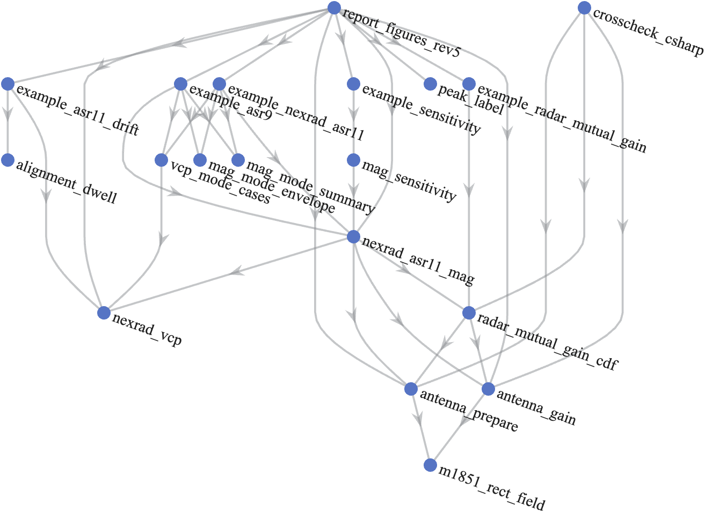

*Figure A-1. Call tree of the repository functions: direct calls only, read from the code with `matlab.codetools.requiredFilesAndProducts`. Tests and the small-run helper `merge_overrides_rev1` are left out. Source: `report_figures_rev5.m` and `docs/figures/call_tree_rev5.csv` (2026).*

## Appendix B. Numbers ledger

### B.1 Revision 8 (summary and Sections 8, 9, 11.4, and 13)

| Quantity | Exact value | Source | Form used |
| --- | --- | --- | --- |
| Largest 99%, 99.9%, 99.99%, 99.999% MAG, takeoff −1° to 3°, 0.05° grid, ROC, ASR-11 | 33.65, 48.05, 50.45, 73.40 dBi | `takeoff_worst_rev8.csv` | Same in tables; 48.1 and 73.4 dBi in the summary |
| Largest 99.9% and 99.999% MAG, NSSL; ASR-9 | 47.65, 73.40; 49.70, 72.35 dBi | `takeoff_worst_rev8.csv` | Same |
| Main beam to main beam on the path, WSR-88D 0.5°, ATC 0° | 79.5 dBi | `worked_example_rev8.csv`, `ref_levels_rev8.csv` | 79.5 dBi |
| Share of ASR-11 revolutions reaching main beam to main beam, 0.5°/0° | 0.0356% | `ref_levels_rev8.csv` | 0.036%, one in 2,800 |
| Volumes reaching 60 dBi, largest over 216 modes, 0° and 0.5° | 34.821%, 48.571% (VCP 34 SAILS×1) | `ts_envelope_rev8.csv` | 34.8%, 48.6% |
| Volumes reaching 60 dBi, CDF-worst mode, 0° and 0.5° | 23.736%, 30.866% | `ts_envelope_rev8.csv` | 23.7%, 30.9% |
| 0.5° cuts with a radial at 60 dBi, largest over modes, 0° and 0.5° | 9.846%, 10.583% (VCP 32) | `ts_envelope_rev8.csv` | 9.8%, 10.6% |
| 0.5° cuts with a radial at 60 dBi, CDF-worst mode, 0° and 0.5° | 2.769%, 3.099% | `ts_envelope_rev8.csv` | 2.8%, 3.1% |
| Volumes at 60 dBi in runs of two or more, 0.5°, over seeds, models, and both modes | 39.78% to 76.38% | `seeds_summary_rev8.csv` | 40% to 76% |
| Longest run at 60 dBi, fixed offset, 0.5°: VCP 212; VCP 34 | 54 volumes × 353.69 s; 40 volumes × 638.22 s | `seeds_summary_rev8.csv`, `ts_all_modes_rev8.csv` | 5.3 h; 7.1 h |
| Longest run at 60 dBi, random walk, any mode and angle | 17 volumes × 638.22 s | `seeds_summary_rev8.csv` | 3.0 h |
| Volumes reaching 60 and 70 dBi, 95% bootstrap interval, headline run | 21.01% to 26.54%; 11.86% to 16.38% | `bootstrap_rev8.csv` | 21.0% to 26.5%; 11.9% to 16.4% |
| Longest run at 60 dBi, 1 h and 12 h trials, 0° | 6, 14 volumes | `trial_length_rev8.csv` | Same |
| NOAA case, largest over the surface: 99%, 99.9%, 99.99%, 99.999% | 34.45, 50.65, 52.0, 73.40 dBi | `noaa_case_rev8.csv` | Same |
| NOAA case minus baseline at 0.5°/0.5°: 50%, 99%, 99.9%, 99.99% | 3.0, 0.75, 2.45, 1.7 dB | `noaa_case_rev8.csv` | 0.8 to 3 dB |
| Pair CDF per pair, bisection and full search, one thread | 1.270, 3.136 ms | `timing_rev8.csv` | 1.3, 3.1 ms |
| Time series, one pair; per pair in a batch of 32; library | 2.281, 0.699, 1.905 s | `timing_rev8.csv` | 2.3, 0.70, 1.9 s |

### B.2 Revision 7 (Sections 8 to 13 and the summary of revision 7)

| Quantity | Exact value | Source | Form used |
| --- | --- | --- | --- |
| Largest 99%, 99.9%, 99.99%, 99.999% MAG, takeoff −1° to 3°, ROC, ASR-11 | 33.65, 48.05, 50.45, 73.35 dBi | `takeoff_worst_rev7.csv` | 33.7, 48.1, 50.5, 73.4 dBi |
| Increase over the horizontal path at 99.9% and 99.999% | 3.30, 4.65 dB | `takeoff_worst_rev7.csv` | 3.3, 4.65 dB |
| Largest 99.9% and 99.999% MAG, NSSL | 47.55, 73.35 dBi | `takeoff_worst_rev7.csv` | 47.6, 73.4 dBi |
| Largest 99.9% and 99.999% MAG, ASR-9 | 49.7, 72.3 dBi | `takeoff_worst_rev7.csv` | Same |
| Main beam to main beam on a 0.5° path | 79.378 dBi | `bracket_cdf_rev7.csv` | 79.4 dBi |
| Worked example, WSR-88D at 0.5°, ATC at 0°: 99.9%, 99.99%, 99.999%; main beam to main beam | 48.05, 50.45, 73.3; 79.5 dBi | `worst_takeoff_example_rev7.csv` | 48.1, 50.5, 73.3; 79.5 dBi |
| Worked example: volumes reaching 60 and 70 dBi; longest run at 60 dBi | 31.227%, 20.217%; 9 volumes | `worst_takeoff_example_rev7.csv` | 31.2%, 20.2%; 9 |
| 50% MAG, specification, − 3 dB, − 6 dB, NSSL | 9.0, 6.0, 3.0, −6.0 dBi | `bracket_cdf_rev7.csv` | Same |
| 99.99% MAG at 0°, specification, − 3 dB, − 6 dB, NSSL | 50.3, 47.4, 45.5, 45.5 dBi | `bracket_cdf_rev7.csv` | Same |
| Volumes reaching 50 dBi, 0°: specification; − 3 dB or NSSL; ASR-9 | 99.549%, 32.491%, 31.859% | `bracket_ts_rev7.csv` | 99.5%, 32.5%, 31.9% |
| Volumes reaching 60 and 70 dBi, specification, 0° and 0.5° | 23.736%, 14.170%; 30.866%, 20.036% | `bracket_ts_rev7.csv` | 23.7%, 14.2%; 30.9%, 20.0% |
| Volumes reaching 70 dBi, 95% interval, headline run | 11.86% to 16.38% | `redteam_rev6/bootstrap_headline_rev6.csv` | 11.9% to 16.4% |
| Longest run at 60 dBi, 12 h trials (seed 20261105) | 14 volumes (4,952 s) | `redteam_rev6/trial_length_rev6.csv` | 14 volumes, 83 min |
| Runs at 60 dBi, path 0.5°, 24 h trials: median, 95th percentile, longest | 1; 3 to 3.8; 6 to 8 volumes | `drift_runs_rev7.csv` | 1; 3 to 4; 6 to 8 |
| 0.5° cuts with a radial at 60 dBi, 0° and 0.5° | 2.770%, 3.099% | `bracket_harm_rev7.csv` | 2.8%, 3.1% |
| 0.5° cuts with a radial at 50 dBi, specification and − 3 dB, 0° | 26.871%, 3.511% | `bracket_harm_rev7.csv` | 26.9%, 3.5% |
| NOAA case at 0.5°: 50%, 99.9%, 99.99%, 99.999% | 12.0, 50.5, 52.0, 73.15 dBi | `noaa_case_rev7.csv` | 12.0, 50.5, 52.0, 73.2 dBi |
| A3, A4, C4 with the revision 6 inputs | 1.45/0.30/0.10 dB; 0.65 dB; 3.3 dB at 99.99% | `redteam_rev6/attacks/summary_rev6_inputs.csv` | Same |
| Pair CDF time, 216 modes, revision 6 and 7 code | 1.60 to 1.84, 0.86 to 1.08 ms | runs of November 11, 2026 | 1.6 to 1.85, 0.9 to 1.1 ms |
| Time series, 120 h: one pair; batch of 64 | 1.43 s; 26.9 s (0.42 s per pair) | runs of November 11, 2026 | 1.4 s; 0.42 s per pair |

### B.3 Revision 6

| Quantity | Exact value | Source | Form used |
| --- | --- | --- | --- |
| Envelope MAG, ASR-11, ROC, 0/0, 50% to 99.999% | 9.0, 9.0, 31.05, 44.75, 50.3, 68.7 dBi | `headline_rev6.csv` | 9.0, 9.0, 31.1, 44.8, 50.3, 68.7 dBi |
| Envelope MAG, ASR-9, ROC, 0/0 | 11.0, 11.0, 29.7, 46.5, 49.7, 67.4 dBi | `headline_rev6.csv` | Same |
| Envelope MAG, ASR-11, NSSL, 0/0 | −6.0, −3.6, 20.3, 44.0, 45.5, 68.7 dBi | `headline_rev6.csv` | Same |
| Envelope MAG, ASR-9, NSSL, 0/0 | −4.0, −1.9, 19.45, 46.0, 47.5, 67.4 dBi | `headline_rev6.csv` | −4.0, −1.9, 19.5, 46.0, 47.5, 67.4 dBi |
| Envelope MAG, NOAA case, 0/0 | 12.0, 12.0, 31.85, 47.55, 50.3, 68.7 dBi | `headline_rev6.csv` | 12.0, 12.0, 31.9, 47.6, 50.3, 68.7 dBi |
| Bias bound of a pair percentile | 0.3 dB | `headline_rev6.csv`, `bias_dB` | 0.3 dB |
| Main beam to main beam on the path | 75.994 dBi | `ref_levels_rev6.csv` | 76.0 dBi |
| ATC main beam + WSR-88D near sidelobe, ROC | 50.5 dBi | `ref_levels_rev6.csv` | 50.5 dBi |
| ATC main beam + WSR-88D far sidelobe, ROC | 39.5 dBi | `ref_levels_rev6.csv` | 39.5 dBi |
| Floor outside event windows, 0/0 | 26.2 dBi (ROC), 15.4 dBi (NSSL) | run output; plan status table | Same |
| Volumes reaching 50 dBi, 120 h, ASR-11 | 99.549% (ROC), 32.491% (NSSL) | `timeseries_rev6.csv` | 99.5%, 32% |
| Volumes reaching 70 dBi, 120 h, ASR-11 | 14.170% | `timeseries_rev6.csv` | 14% |
| Longest run of volumes at 60 dBi or more, 120 h | 6 (2,122 s) | `timeseries_rev6.csv` | six volumes, 35 min |
| 0.5° cuts with a radial at 50 and 60 dBi or more, ASR-11, ROC | 26.871%, 2.770% | `harm_rev6.csv` | 27%, 2.8% |
| Largest radials per cut at 50 dBi, 1° radials | 3 | `harm_rev6.csv` | three |
| Worked pair 2.0°/1.7°, ASR-11, 99% to 99.999% | 28.85, 44.6, 48.8, 66.95 dBi | `lookup_pair_rev6.csv` | 28.9, 44.6, 48.8, 67.0 dBi |
| NOAA case tilt (largest 99.99%) | 0° (50.3 dBi) | `noaa_tilt_rev6.csv` | 0° |
| Mode change mid-volume, above the envelope, 99%, 99.9%, 99.99% | 1.35, 0.65, 0 dB | `redteam/A3_rev1.csv` | 1.35, 0.65, 0 dB |
| Supplemental low cut, largest MAG increase | 3.10 dB | `redteam/A4_rev1.csv` | 3.1 dB |
| ATC tilt range of the 99% and 99.999% MAG | 2.6 dB, 3.3 dB | `redteam/C4_rev1.csv` | Same |
| Volumes reaching 70 dBi, 95% bootstrap interval (NSSL, seed 1) | 10.6% to 14.2% | `redteam/D2_rev1.csv` | Same |
| Sector edge minus center, bidirectional, 99.99% | 75.40 − 68.05 = 7.35 dB | `sector_bearing_sweep_rev1.csv` | 7.4 dB |
| Envelope shortfall without the 216 modes (R3) | up to 4.35 dB at 99.9% | register row R3 | 4.35 dB |
| Pair time, 5,000 pairs, 74 modes | 1.12 ms | plan status table | 1.12 ms |
| Exact CDF step, one mode | 0.087 s | plan status table | 0.087 s |
| Event time series, one pair-hour | 18 ms | plan status table | 18 ms |

### B.4 Revision 5 (Appendix D)

| Quantity | Exact value | Source | Form used |
| --- | --- | --- | --- |
| Peak-gain main beam to main beam | 79.5 dBi | 45.5 + 34 | 79.5 dBi |
| Main beam to main beam on the path | 75.994 dBi | `ref_levels_rev5.csv` | 76.0 dBi |
| Worst-mode 99.9% MAG | 43.949 dBi | `sensitivity_rev5.csv` | 43.9 dBi, 36 dB below |
| Worst-mode 99.999% MAG | 68.857 dBi | `sensitivity_rev5.csv` | 68.9 dBi, 11 dB below |
| Envelope 99.9% MAG, 74 modes | 43.949 dBi | `mode_envelope_rev5.csv` | 43.9 dBi |
| Paper baseline 99.99% MAG | 62.700 dBi | `vcp_sweep_rev5.csv` | 62.7 dBi |
| Worst-mode time at 0.5° | 51.76% | `vcp_sweep_rev5.csv` | 52% |
| Main beam to main beam share of time | 0.00822% | `lobe_pairs_rev5.csv` | 0.008% |
| Both antennas on far sidelobes or back lobes | 87.2% | `lobe_pairs_rev5.csv` | 87% |
| ASR-11 revolutions at 45.5 dBi or more, 120 h | 11.02% | `plateaus_rev5.csv` | 11.0% |
| Revolutions per hour within 0.2 dB of main beam to main beam, 120 h | 0.383 | `rev_exceedance_120h_rev5.csv` | 0.38 per hour |
| Longest run of consecutive revolutions at 50 dBi or more, 120 h | 1 | `persistence_120h_rev5.csv` | one revolution |
| Longest run of consecutive volumes at 60 dBi or more, 120 h | 6 (2,122 s) | `persistence_volume_120h_rev5.csv` | six volumes, 35 min |
| Chance a volume lock lasts more than 1 h | 0.390% | `alignment_dwell_rev5.csv` | 0.39% |
| 99.9% MAG change for ±3 dB ASR-11 remote sidelobes | −2.92 and +2.95 dB | `sensitivity_sweep_rev5.csv` | about 3 dB |
| ASR-9 envelope 99%, 99.9%, 99.99%, 99.999% MAG, 74 modes | 18.862, 43.917, 45.490, 67.496 dBi | `asr9_mode_envelope_rev5.csv` | 18.9, 43.9, 45.5, 67.5 dBi |
| ASR-9 minus ASR-11, 99% and 99.999% MAG, worst mode, 24 h | −1.29 and −1.36 dB | `asr9_comparison_rev5.csv` | 1.3 dB and 1.4 dB lower |
| ASR-9 main beam to main beam on the path | 75.494 dBi | `asr9_ref_levels_rev5.csv` | 75.5 dBi |
| ASR-9 longest run of volumes at 60 dBi or more, 24 h | 4 (1,415 s) | `asr9_persistence_volume_rev5.csv` | four volumes, about 24 min |
| Chance an ASR-9 volume lock lasts more than 1 h | 0.381% | `alignment_dwell_rev5.csv` | 0.38% |
| Worst-mode 99.999% MAG, 95% interval at 5,000,000 samples | 66.84 to 71.07 dBi | `convergence_rev5.csv` | 66.8 to 71.1 dBi |

## Appendix C. References

- NOAA Radar Operations Center, [NEXRAD Technical Information](https://roc.noaa.gov/public-documents/wsr88d/NEXRAD-Technical-Information.pdf).
- NOAA Radar Operations Center, [Convective VCP Decision Matrix (VCP Info Sheet)](https://www.roc.noaa.gov/public-documents/operations-branch/VCP_Info_Sheet.pdf), February 2026.
- NOAA Radar Operations Center, [Theory and Concept of Operations for VCP 112](https://roc.noaa.gov/WSR88D/PublicDocs/NewTechnology/Theory_ConOps_VCP112.pdf), March 19, 2019.
- NOAA Radar Operations Center, [New VCP Paradigm](https://www.weather.gov/media/roc/NewScience/New_VCP_Paradigm_Public_Oct_2015.pdf), October 2015.
- NOAA NCEI, [Next Generation Weather Radar (NEXRAD) Level II data](https://www.ncei.noaa.gov/products/radar/next-generation-weather-radar).
- Unidata, [MetPy](https://unidata.github.io/MetPy/).
- NSSL, [Errata and supplement to the 1998 WSR-88D polarimetric upgrade report](https://www.nssl.noaa.gov/publications/wsr88d_reports/ERRATA1998Rpt_D3a(WC).pdf).
- [Recommendation ITU-R M.1849-3](https://www.itu.int/dms_pubrec/itu-r/rec/m/R-REC-M.1849-3-202302-I!!PDF-E.pdf), February 2023.
- [Recommendation ITU-R M.1464-2](https://www.itu.int/dms_pubrec/itu-r/rec/m/R-REC-M.1464-2-201502-I!!PDF-E.pdf), February 2015 (Table 1, Radars B and C; Annex 2, Section 2).
- [Recommendation ITU-R M.1851](https://www.itu.int/rec/R-REC-M.1851/en).
- [Recommendation ITU-R M.2069](https://www.itu.int/rec/R-REC-M.2069/en).
- Forecast International, [ASR-11 (DASR)](https://www.forecastinternational.com/archive/disp_pdf.cfm?DACH_RECNO=1032), August 2014.
- M. E. Weber, [FAA Surveillance Radar Data as a Complement to the WSR-88D Network](https://archive.ll.mit.edu/mission/aviation/publications/publication-files/atc-reports/Weber_1999_ATC-266_WW-15318.pdf), MIT Lincoln Laboratory ATC-266, 1999.
- M. E. Weber, [Assessment of ASR-9 Weather Channel Performance: Analysis and Simulation](https://archive.ll.mit.edu/mission/aviation/publications/publication-files/atc-reports/Weber_1986_ATC-138_WW-15318.pdf), MIT Lincoln Laboratory ATC-138, 1986 (Section II.A: maximum azimuth sidelobes −28 dB).
- NWS Warning Decision Training Division, [Supplemental Low Elevation Angles](https://training.weather.gov/wdtd/courses/rac/principles/supplemental.php) (22 sites, Build 19).
- NWS, [Service Change Notice 24-09: NEXRAD Level III product dissemination](https://www.weather.gov/media/notification/pdf_2023_24/scn24-09_nexrad_level_III_product_dissemination.pdf), 2024 (supplemental low elevation angles at KBMX, KMOB, and KLIX/KHDC with Build 22.1).
- Wikipedia, [ASR-9](https://en.wikipedia.org/wiki/ASR-9).
- FAA, [Airport Surveillance Radar (ASR-11)](https://www.faa.gov/air_traffic/technology/asr-11/).
- FAA, [Order JO 6310.30B, Maintenance Handbook for Airport Surveillance Radar, ASR-11 Facilities](https://www.faa.gov/regulations_policies/orders_notices/index.cfm/go/document.information/documentID/1028067), July 20, 2015.
- 2.7 GHz Retuning LOE, link budget analysis working paper comment adjudication meeting, transcript, November 4, 2026 (not public).

## Appendix D. Revision 5 worked example (NSSL measured pattern, 74 modes)

### D.1 WSR-88D and ASR-11 example

This example answers a question from the 2.7 GHz Retuning LOE: how does the MAG between a NOAA weather radar and an FAA ATC radar depend on the NEXRAD scan mode, and how does it compare with main beam to main beam? The function `nexrad_asr11_mag_rev1` holds every input with a source key, and its `citations` table gives the URL of each source.[^22]

The example follows 11 steps. Each step names the code that does the work and the numbers it produces, so that a reader can check each number by hand or rerun it. Every figure and table comes from `report_figures_rev5.m`.

**This appendix keeps the revision 5 inputs and numbers:** the NSSL measured WSR-88D pattern, 74 scan modes, and Monte Carlo sampling. Its method walk-through is unchanged; Sections 8 and 9 give the results under the revision 6 defaults. Some conclusions here no longer hold under those defaults, among them that the WSR-88D pattern matters little (Section D.2) and that the ASR-9 gives the same 99.9% value as the ASR-11 (Section D.4).

#### D.1.1 Inputs

| Parameter | Value | Source |
| --- | --- | --- |
| NEXRAD peak gain | 45.5 dBi at 2,850 MHz, including the radome | NOAA ROC, NEXRAD Technical Information (Rec. ITU-R M.1849-3 Radar 1: 45.0 dBi) |
| NEXRAD 3 dB beamwidth | 0.925° | NOAA ROC, NEXRAD Technical Information |
| NEXRAD sidelobes (revision 5 default; a sensitivity case in revision 6) | −35 dB to 2°, −48 dB at 6°, −55 dB at 20° and beyond | NSSL measurements of the KOUN antenna, 1998 report errata |
| NEXRAD sidelobes (revision 6 default, Section 8) | −29 dB beyond the main beam, −40 dB beyond 10° | NOAA ROC specification |
| NEXRAD scan | VCPs 12, 31, 32, 34, 35, 112, 212, and 215, with SAILS, MRLE, and AVSET options | Decoded from operational Level II data (Step 5) |
| ASR-11 peak gain | 34 dBi | Rec. ITU-R M.1464-2 Table 1, Radar C |
| ASR-11 beamwidths | 1.45° azimuth, 4.8° elevation | Rec. ITU-R M.1464-2 Table 1, Radar C |
| ASR-11 elevation pattern | Cosecant squared to +30°, Rec. ITU-R M.1851-2 Equations 25 to 27 | Rec. ITU-R M.1464-2 Table 1, Radar C |
| ASR-11 sidelobes | First +9.5 dBi (cosine taper), remote +3.5 dBi | Rec. ITU-R M.1464-2 Table 1, Radar C |
| ASR-11 tilt | 0° (beam nose on the horizon); allowed range −2.5° to +2.5° | Rec. ITU-R M.1464-2 Table 1, Radar C (TODO: site value) |
| ASR-11 rotation rate | 12.5 rpm (75 degrees per second, one revolution every 4.8 s) | Rec. ITU-R M.1464-2 Table 1, Radar C; Forecast International |
| ASR-11 rotation-rate variance | Uniform ±0.5 degrees per second, one offset per trial | Rec. ITU-R M.2069-0 Annex 1 drive accuracy (TODO: FAA Order JO 6310.30B value) |
| NEXRAD back lobe (90° to 180° off axis) | −55 dB, the NSSL far level held to 180°; varied in Section D.2 | NSSL measurements (no measured back lobe) |
| NEXRAD scan sector | 360° (every operational VCP); narrower sectors in Section D.2 | Bounding case asked for at the meeting |
| Path elevation | 0° at both ends | Location-agnostic assumption |
| Polarization mismatch | Not modeled (0 dB) | Study assumption; any mismatch would lower the MAG |
| Separation between the radars | Beyond the NEXRAD far-field distance, 2D²/λ = 1.38 km for the 8.53 m reflector at 2,850 MHz | NOAA ROC, NEXRAD Technical Information |

Radar C matches the ASR-11: a 25 kW solid-state transmitter with 1 µs and 89 µs pulses. The FAA standard and tolerance for the ASR-11 rotation rate are in FAA Order JO 6310.30B, which is available only on the FAA network. Until that value is available, the model uses the ±0.5 degrees per second drive accuracy of M.2069-0, and `opts.asr_rate_jitter_deg_s` changes it.[^23] Each radar uses one pattern to transmit and receive, so the MAG is the same in both directions (g12 = g21). The ASR-11 low beam is assumed for transmit and receive; the high beam is not modeled.

#### D.1.2 Step 1: Set the geometry

The NEXRAD is radar 1 and the ASR-11 is radar 2. The ASR-11 lies at 0° azimuth from the NEXRAD, and the NEXRAD lies at 180° azimuth from the ASR-11. The path is horizontal (0° elevation) at both ends. The distance between the radars does not enter the MAG; it enters the link budget through the basic transmission loss. Both antennas rotate through 360°, so the true bearing between the sites only shifts the rotation phase and does not change any result.[^4]

#### D.1.3 Step 2: Find the NEXRAD gain toward the ASR-11

The NEXRAD beam points at azimuth offset Δaz from the path and at the elevation (tilt) of the current cut. The angle γ between the beam axis and the path follows from the spherical law of cosines. With a path elevation of 0°, it reduces to:

cos γ = cos(tilt) · cos(Δaz)  (3)

The NEXRAD gain is then G_N(γ) = 45.5 − 12(γ/0.925)² dBi in the main beam, until that curve meets the sidelobe envelope of Section D.1.1. Beyond that point, the gain follows the envelope.[^24] Figure 1 shows the pattern.

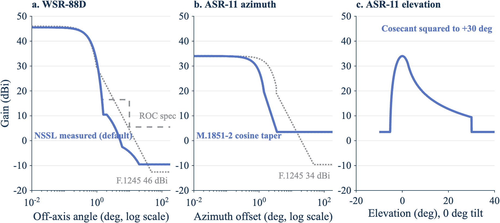

*Figure 1. The measured NEXRAD envelope falls below F.1245 beyond 1.5°, and the ASR-11 cosine taper is narrower than F.1245. Panel a: WSR-88D gain against off-axis angle. Panel b: ASR-11 azimuth cut. Panel c: ASR-11 elevation cut at 0° tilt. Source: NTIA analysis with `report_figures_rev5.m` (2026).*

When the NEXRAD beam azimuth is on the path (Δaz = 0), γ equals the tilt. The table gives the NEXRAD gain toward the ASR-11 at that moment for each cut. For the 0.5° cut, for example: 45.5 − 12(0.5/0.925)² = 45.5 − 3.51 = 41.99 dBi. When the NEXRAD beam points away from the path (Δaz = 180°), its gain is the −55 dB floor: 45.5 − 55 = −9.5 dBi.

| NEXRAD cut elevation | NEXRAD gain toward the ASR-11 with the beam azimuth on the path (dBi) | Region of the pattern |
| --- | --- | --- |
| 0.5° | 41.99 | Main beam |
| 0.9° | 34.14 | Main beam |
| 1.3° | 21.80 | Main beam |
| 1.8° | 10.5 | First sidelobe (−35 dB) |
| 2.4° | 9.2 | Sidelobe envelope |
| 3.1° | 6.9 | Sidelobe envelope |
| 4.0° | 4.0 | Sidelobe envelope |
| 5.1° | 0.4 | Sidelobe envelope |
| 6.4° | −2.7 | Sidelobe envelope |
| 8.0° to 19.5° | −3.5 to −9.25 | Far sidelobes |

Source: `docs/figures/nexrad_gain_by_cut_rev5.csv`.

The NEXRAD main beam reaches the ASR-11 strongly only on the 0.5°, 0.9°, and 1.3° cuts. Above 1.3°, a horizontal path is in the NEXRAD sidelobes even when the beam azimuth points at the ASR-11.

#### D.1.4 Step 3: Find the ASR-11 gain toward the NEXRAD

The ASR-11 beam points at azimuth offset Δaz_A from the path. Its tilt is 0°, so its elevation pattern adds 0 dB on a horizontal path, and the gain follows the azimuth cut of Figure 1b (Rec. ITU-R M.1851-2 cosine taper, 1.45° beamwidth):

| ASR-11 beam azimuth off the path | ASR-11 gain toward the NEXRAD (dBi) |
| --- | --- |
| 0° | 34.0 (peak) |
| 0.725° (half the beamwidth) | 30.9 |
| 2.9° (two beamwidths, near sidelobe region) | 7.1 |
| Largest near sidelobe, 2.9° or more off the path | 7.2 |
| Far from the path, out to 180° | 3.5 (remote sidelobe floor) |

Source: `docs/figures/asr11_gain_cut_rev5.csv`; the largest near sidelobe is the reference level in `docs/figures/ref_levels_rev5.csv`.

#### D.1.5 Step 4: Add the two gains for one pointing state

The MAG for one pointing state is the sum of the two gains, Equation 2. Two pointing states from trial 61 of the time series in Step 7 show the arithmetic.

| Pointing state | NEXRAD cut | NEXRAD beam off the path | γ, Equation 3 | NEXRAD gain (dBi) | ASR-11 beam off the path | ASR-11 gain (dBi) | MAG (dBi) |
| --- | --- | --- | --- | --- | --- | --- | --- |
| A, t = 3,346.33 s | 0.5° | 0.035° | 0.501° | 41.98 | 0.001° | 34.00 | 75.98 |
| B, t = 143.84 s | 0.9° | 0.074° | 0.903° | 34.06 | 0.066° | 33.98 | 68.04 |

For state B: γ = arccos(cos 0.9° · cos 0.074°) = 0.903°, and 45.5 − 12(0.903/0.925)² = 45.5 − 11.44 = 34.06 dBi. Both states are rows of `docs/figures/peaks_above_plateau_120h_rev5.csv` (trial 61).

Four limiting combinations frame every result in this section.[^18]

| Combination | NEXRAD gain (dBi) | ASR-11 gain (dBi) | MAG (dBi) |
| --- | --- | --- | --- |
| Main beam to main beam, peak gains | 45.5 | 34.0 | 79.5 |
| Main beam to main beam on the path (NEXRAD at 0.5°) | 41.99 | 34.0 | 75.99 |
| NEXRAD main beam at 0.5° + ASR-11 remote sidelobe | 41.99 | 3.5 | 45.49 |
| ASR-11 main beam + NEXRAD back lobe | −9.5 | 34.0 | 24.5 |

The last row answers a question from the meeting: the MAG can be lower than the main-beam gain of either radar. The NEXRAD gain beyond about 20° off axis is −9.5 dBi, below 0 dBi, so the ASR-11 main beam on the NEXRAD back lobe gives 34.0 + (−9.5) = 24.5 dBi. In this example that floor holds for every revolution: each ASR-11 revolution sweeps its main beam across the NEXRAD once, so no revolution peaks below 24.5 dBi (Step 8). The −55 dB back-lobe level is not measured; Section D.2 changes it by ±10 dB. Below the 99th percentile the change moves the MAG, but it doesn't change the 99.9% and higher values that a link budget uses.

#### D.1.6 Step 5: Turn a NEXRAD volume coverage pattern into time weights

The model covers every WSR-88D VCP found in operational data. To find them, we read the VCP number from the header of the Level II files of all WSR-88D sites (about 155) on six dates from January 2024 to January 2026, in winter, spring, summer, and fall. The survey found eight VCPs:

- **Precipitation and convective VCPs:** 12, 112, 212, and 215. The NOAA Radar Operations Center (ROC) VCP Info Sheet lists these.
- **Clear-air VCPs:** 31, 32, 34, and 35. ROC NEXRAD Technical Information lists 31, 34, and 35. VCP 32 is not in that table but appears in the 2024 archive.

The same archive holds VCPs 80 and 90, but only at sites whose names start with T. These are FAA Terminal Doppler Weather Radars, which operate in C band, so the model excludes them. The legacy VCPs 11, 21, 121, 211, and 221 didn't appear on any survey date.

The cut tables in `nexrad_vcp_rev1` come from the VCP messages in operational Level II files on the NOAA archive, decoded with MetPy. Each table names the file it came from in `scan.source_file`. Where a VCP was decoded at more than one site (KOAX, KHGX, and KLWX for VCP 212; KFTG for VCP 31; KVBX and KVTX for VCP 32; KAMA for VCP 34), the files give the same cuts and rates. VCPs 31 and 34 use the long pulse and the others the short pulse; pulse width changes the waveform, not the scan or the antenna pattern, so it doesn't change the MAG. The one exception is the Doppler cut of the 0.5° to 1.3° split cuts, whose rate follows the site's Doppler PRF (12.524, 14.458, 15.831, or 17.106 degrees per second); `cd_rate_deg_s` sets it for VCPs 12, 35, 212, and 215.[^25]

Each cut is one full revolution at the cut's azimuth rate, so the cut lasts 360°/rate seconds. Summing the cuts gives the volume time. The share of the volume spent at each elevation is the weight that random sampling gives that elevation. Elevation transitions are not modeled; for VCP 112, the ROC gives 322 s for the 20-cut volume, against 320.1 s here.[^26]

| VCP | Use | Cuts | Volume time (s) | Time at 0.5° (%) | Most SAILS rescans |
| --- | --- | --- | --- | --- | --- |
| 35 | Clear air, 0.5° to 6.4° | 12 | 410.0 | 23.8 | 1 |
| 215 | Default precipitation | 18 | 344.5 | 15.7 | 1 |
| 212 | Rapidly evolving convection | 17 | 279.3 | 16.4 | 3 |
| 12 | Rapidly evolving convection | 17 | 236.4 | 13.3 | 3 |
| 112 | Large-scale, high-velocity systems | 20 | 320.1 | 19.4 | 1 |
| 31 | Clear air, long pulse, 0.5° to 4.5° | 8 | 569.5 | 25.0 | None |
| 32 | Clear air, short pulse, 0.5° to 4.5° | 7 | 569.0 | 26.7 | None |
| 34 | Clear air, long pulse, 0.5° to 4.5° | 10 | 524.4 | 21.7 | 1 |

Source: `docs/figures/vcp_table_rev5.csv`.

The clear-air VCPs rotate slowly (4 to 8.5 degrees per second), so their volumes take 8.7 to 9.5 minutes. A slow rotation lengthens each cut but not its share of the volume, so time at 0.5° stays in the same range as for the precipitation VCPs.

SAILS adds rescans of the 0.5° cuts during the volume. MRLE rescans the lowest two to four elevations midway through the volume. AVSET ends the volume at 6.4° or above when no significant echoes lie above that elevation. The ROC VCP Info Sheet lists AVSET as compatible with SAILS and with MRLE; only SAILS and MRLE cannot be combined. The model runs every allowed combination (Step 9).[^35]

The worst mode in Step 9 is VCP 212 with three SAILS rescans and AVSET ending the volume at 6.4°. AVSET drops the five cuts from 8.0° to 19.5°, which shortens the volume from 416.61 s to 353.69 s without removing any 0.5° cut. Its weights are:

| Elevation | Cuts per volume | Azimuth rates (degrees per second) | Time per volume (s) | Share of volume (%) |
| --- | --- | --- | --- | --- |
| 0.5° | 8 | 21.149 (surveillance) and 12.524 (Doppler) | 183.07 | 51.76 |
| 0.9° | 2 | 21.149 and 12.524 | 45.77 | 12.94 |
| 1.3° | 2 | 23.027 and 12.524 | 44.38 | 12.55 |
| 1.8° to 6.4° (6 elevations) | 1 each | 26.389 to 28.224 | 12.76 to 13.64 each | 3.61 to 3.86 each |
| Total | 18 | | 353.69 | 100 |

Source: `docs/figures/worst_mode_weights_rev5.csv`.

For example, one 0.5° surveillance cut lasts 360/21.149 = 17.02 s and one 0.5° Doppler cut lasts 360/12.524 = 28.74 s. Four of each give 4 × (17.02 + 28.74) = 183.07 s, which is 183.07/353.69 = 51.76% of the volume. Figure 2 shows the schedule.

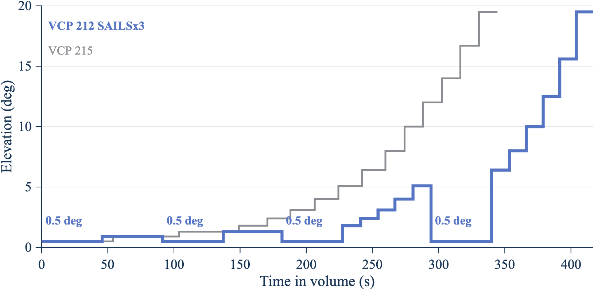

*Figure 2. SAILS×3 returns the NEXRAD beam to 0.5° four times per volume, and AVSET ends the volume at 6.4°. Source: cut tables in `nexrad_vcp_rev1.m`, decoded from NOAA Level II data (2026).*

#### D.1.7 Step 6: Sample pointing states and build the CDF

Random mode draws 5,000,000 independent pointing states. For each draw, the model does the following:[^10]

1. Picks a NEXRAD cut with probability equal to its share of the volume (Step 5).
2. Draws the NEXRAD beam azimuth uniformly from 0° to 360°.
3. Draws the ASR-11 beam azimuth uniformly from 0° to 360°.
4. Computes the NEXRAD gain (Step 2), the ASR-11 gain (Step 3), and their sum (Step 4).

Independent draws are valid because the two radars rotate at unrelated rates: 75 degrees per second for the ASR-11, against 12.5 to 28.7 degrees per second for the NEXRAD, with the rate changing every cut. The time series in Step 7 confirms this: its 99th percentile matches the random-mode value within 0.5 dB, the tolerance of the repository test. Section D.3.2 shows the one case where the timing matters: a volume time that matches a whole number of ASR-11 revolutions changes how high coupling repeats from scan to scan, though not the share of time at each MAG averaged over drive offsets.

The model then sorts the 5,000,000 MAG values. The p-th percentile is the MAG that is not exceeded for p percent of the time. The CDF array `cdf_array21` lists these percentiles from 0% to 100%, and the percentile table adds a 95% confidence interval for each value (Step 11).[^28]

#### D.1.8 Step 7: Run the time series and find the maximum MAG per scan

Random mode gives the share of time at each MAG, but not how the high values group in time. The time series runs both antennas forward from random start phases. Each trial lasts 3,600 s, and the run uses 120 trials (120 hours, 89,883 complete ASR-11 revolutions). A run of two to five days was asked for at the meeting. Each trial draws a new ASR-11 rate within 75 ± 0.5 degrees per second, a new NEXRAD start azimuth, and a new start point in the NEXRAD volume.[^17]

The time step is 0.002 s. In that time the ASR-11 beam moves 0.15°, about one tenth of its 1.45° beamwidth, so a sampled peak falls at most about 0.2 dB below the true peak. For each ASR-11 revolution (4.8 s), the model keeps the largest MAG and records, at that sample, each radar's gain and beam offset from the path.

#### D.1.9 Step 8: Read the maximum MAG per ASR-11 revolution

Figure 5 shows the maximum MAG in each revolution for one hour of the run. The hour shown is trial 61, the one with the most peaks above the 45.5 dBi plateau; `report_figures_rev5` picks it and reruns that trial alone to keep its samples.

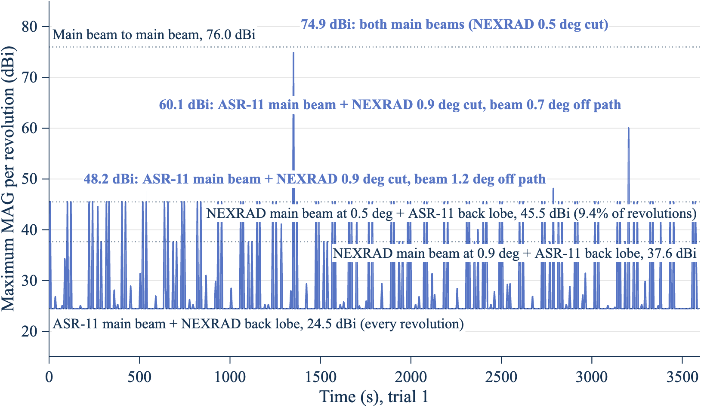

*Figure 5. Most ASR-11 revolutions peak at 24.5 dBi; higher peaks need the NEXRAD beam on one of its three lowest cuts. In this hour the peaks come back once per volume. The figure shows trial 61 of the worst mode (VCP 212 SAILS×3, AVSET 6.4). Source: `nexrad_asr11_mag_rev1` time series (2026).*

The figure has four kinds of features.

**The floor at 24.5 dBi.** Every revolution sweeps the ASR-11 main beam across the NEXRAD once, so every revolution reaches at least the ASR-11 peak gain plus the lowest NEXRAD gain: 34.0 + (−9.5) = 24.5 dBi.

**Plateaus at 45.5 dBi and 37.6 dBi.** Each NEXRAD cut is one revolution, so the NEXRAD main beam crosses the ASR-11 once per cut. During that crossing, the ASR-11 beam usually points elsewhere and contributes its +3.5 dBi floor. The MAG then reaches the NEXRAD gain on the path at that cut's tilt plus 3.5 dBi: 41.99 + 3.5 = 45.49 dBi on the 0.5° cuts and 34.14 + 3.5 = 37.64 dBi on the 0.9° cuts. The share of ASR-11 revolutions that contain such a crossing can be counted by hand. The worst mode has 8 cuts at 0.5° per 353.69 s volume, and each crossing falls in one 4.8 s ASR-11 revolution, so about 8 × 4.8/353.69 = 10.9% of revolutions reach 45.49 dBi.[^29]

| NEXRAD cut | Plateau level (dBi) | Cuts per volume reaching the level | Hand count of revolutions (%) | Simulated revolutions (%) |
| --- | --- | --- | --- | --- |
| 0.5° | 45.49 | 8 | 10.9 | 11.0 |
| 0.9° | 37.64 | 10 (0.5° and 0.9°) | 13.6 | 14.3 |
| 1.3° | 25.30 | 12 (0.5°, 0.9°, and 1.3°) | 16.3 | 19.0 |

The hand count matches the simulation at 45.49 dBi and 37.64 dBi. At 25.30 dBi it is a lower bound, because the ASR-11 main beam on a NEXRAD sidelobe also reaches that level.

**Peaks between 45.5 dBi and main beam to main beam.** A peak above the 45.5 dBi plateau needs the ASR-11 main beam to cross the NEXRAD while the NEXRAD beam is also near the path on one of its three lowest cuts. Figure 5 marks the 16 such peaks in trial 61 and letters the three largest; Figure 6 shows the two largest as they happen.

| Peak in Figure 5 | NEXRAD cut | NEXRAD gain (dBi), beam off the path | ASR-11 gain (dBi), beam off the path | What happened |
| --- | --- | --- | --- | --- |
| a, 76.0 dBi at 3,346 s | 0.5° | 41.98, 0.04° | 34.00, 0.00° | Both main beams on the path at the same time (state A of Step 4) |
| b, 74.1 dBi at 2,993 s | 0.5° | 40.40, 0.34° | 33.65, 0.25° | Both main beams, each a fraction of a degree from the path |
| c, 71.7 dBi at 3,490 s | 0.5° | 38.00, 0.53° | 33.69, 0.24° | ASR-11 main beam crossed while the NEXRAD beam was 0.53° from the path |

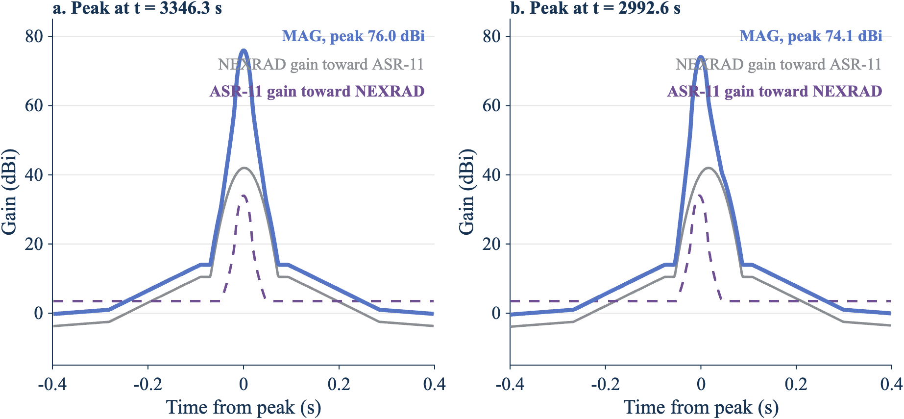

*Figure 6. A peak needs the brief ASR-11 main beam to land inside the NEXRAD main beam. In panel a, both beams cross the path together. In panel b, the ASR-11 main beam (dashed) crosses slightly before the NEXRAD beam reaches the path, so the MAG peaks 1.9 dB lower. Source: `nexrad_asr11_mag_rev1` time series, trial 61 (2026).*

**Peaks that come back once per volume.** In trial 61 the 16 peaks are 74 revolutions apart: 74 × 4.78 s ≈ 354 s, one NEXRAD volume. That trial drew an ASR-11 rate of about 75.3 degrees per second, inside the ±0.5 degrees per second tolerance, at which 74 revolutions take the same time as one 353.69 s volume. The same NEXRAD cut and the same part of the ASR-11 revolution then meet every volume, and the meeting point drifts slowly across both main beams. In the first half hour, the 0.9° cut produced peaks of 68.0, 66.9, 64.5, 60.8, 55.9, and 49.7 dBi in six consecutive volumes, falling as the meeting point moved off the beams. In the second half hour, the 0.5° cuts produced peaks of 60.4, 68.9, 74.1, and 76.0 dBi in four consecutive volumes, rising as it moved onto them. Section D.3.2 gives the odds of such a lock.

The ASR-11 main beam crosses the NEXRAD in about 0.02 s, while the NEXRAD main beam takes about 0.04 s to 0.07 s to cross the ASR-11. Outside a lock, the two crossings rarely overlap, so the MAG between 45.5 dBi and 76.0 dBi is rare and its exact value depends on how much they overlap. Over the full 120 hours:

| Maximum MAG in a revolution | Revolutions in 120 h | Share of revolutions (%) | Per hour |
| --- | --- | --- | --- |
| 24.5 dBi or more | 89,883 | 100 | 749 |
| 45.5 dBi or more | 9,904 | 11.0 | 82.5 |
| 50 dBi or more | 451 | 0.50 | 3.8 |
| 60 dBi or more | 323 | 0.36 | 2.7 |
| 70 dBi or more | 177 | 0.20 | 1.5 |
| Within 0.2 dB of main beam to main beam on the path (75.8 dBi or more) | 46 | 0.051 | 0.38 |

All 496 revolutions with a peak more than 1 dB above the 45.5 dBi plateau occurred on the 0.5° cuts (372), the 0.9° cuts (82), or the 1.3° cuts (42). The full list, with each radar's gain and beam offset at the peak, is in `docs/figures/peaks_above_plateau_120h_rev5.csv`.

For the NEXRAD, interference on its lowest cuts matters most, because the composite products draw on them. The per-cut maximum by elevation for the worst mode, over 40 complete volumes in the four-trial sweep, is:

| NEXRAD elevation | Complete cuts | Median of cut maxima (dBi) | Largest cut maximum (dBi) |
| --- | --- | --- | --- |
| 0.5° | 323 | 45.5 | 74.1 |
| 0.9° | 80 | 37.6 | 66.7 |
| 1.3° | 82 | 25.3 | 55.7 |
| 1.8° | 40 | 24.5 | 44.5 |
| 2.4° | 40 | 24.5 | 41.5 |
| 3.1° to 6.4° | 40 to 41 each | 24.5 | 31.3 to 38.0 |

Source: `docs/figures/by_elevation_rev5.csv`.

##### Which parts of the two patterns couple

At the meeting, participants asked whether a long simulation could miss any interaction: main beam to main beam, main beam to sidelobe, or any other. The model splits each antenna pattern into four regions, by the angle between the beam axis and the direction of the other radar:

- **Main beam:** gain above the first-sidelobe level. For the NEXRAD, this ends where the main beam meets the −35 dB envelope, 1.58° off axis. For the ASR-11, it ends where the azimuth pattern falls to −24.5 dB, 2.52° off the path.
- **Near sidelobe:** from there to where the gain first falls to its far level: 20.0° for the NEXRAD and 3.55° for the ASR-11.
- **Far sidelobe:** from there to 90°.
- **Back lobe:** beyond 90°.

The NEXRAD angle is the 3-D off-axis angle, so it includes the cut's tilt; the ASR-11 angle is the azimuth offset, because its cosecant-squared beam is broad in elevation. In random mode the two beam azimuths are independent and uniform, and the NEXRAD cut is drawn with its time weight. The share of time in each pair of regions is therefore the product of the two antennas' shares, and the code computes it exactly from the patterns. The time series counts the same shares from its samples as a check.[^30]

| NEXRAD region | ASR-11 region | Time (%) | Time in the 120 h series (%) | Largest MAG (dBi) |
| --- | --- | --- | --- | --- |
| Main beam | Main beam | 0.0082 | 0.0077 | 76.0 |
| Main beam | Near sidelobe | 0.0034 | 0.0032 | 51.5 |
| Main beam | Far sidelobe or back lobe | 0.58 | 0.58 | 45.5 |
| Near sidelobe | Main beam | 0.15 | 0.15 | 44.5 |
| Far sidelobe or back lobe | Main beam | 1.25 | 1.24 | 24.5 |
| Near sidelobe | Near, far, or back | 10.31 | 10.30 | 20.0 |
| Far sidelobe or back lobe | Near, far, or back | 87.71 | 87.72 | 0.0 |

Every combination occurs, and the simulation reaches each one's largest value. Both main beams are on the path together 0.0082% of the time, about 7 s a day, and in short pieces. Each antenna's main beam alone is on the path 0.59% (NEXRAD) and 1.40% (ASR-11) of the time. The full 16-pair table is in `docs/figures/lobe_pairs_rev5.csv`.

##### How long high coupling lasts

A high revolution is usually alone. The code counts runs of consecutive ASR-11 revolutions, and of consecutive NEXRAD volumes, whose maximum reaches each level.[^33]

| Level | Runs of high revolutions in 120 h | Longest run of revolutions | High volumes (%) | Longest run of volumes |
| --- | --- | --- | --- | --- |
| 45 dBi | 9,884 | 2 (9.6 s) | 100 | Every volume |
| 50 dBi | 450 | 1 (4.8 s) | 32.5 | 9 (53 min) |
| 60 dBi | 323 | 1 | 23.7 | 6 (35 min) |
| 70 dBi | 175 | 1 | 14.2 | 4 (24 min) |

Two consecutive revolutions reach 45 dBi when the 0.5° surveillance cut and the 0.5° Doppler cut follow each other. No two consecutive revolutions reach 50 dBi, because the NEXRAD beam crosses the path only once per cut. The volume runs come from locks like the one in trial 61, which has two runs of four volumes at 60 dBi or more. Of all the runs of volumes at 60 dBi or more, 77% are single volumes; the longest, six volumes, is in another hour of the run. A criterion stated per scan should use the revolution columns; a criterion that counts repeated hits on the same NEXRAD elevation over time should use the volume columns.

#### D.1.10 Step 9: Repeat for every scan mode

`example_nexrad_asr11_rev1` repeats Steps 5 to 8 for 74 VCP modes and the paper baseline, with seed 20261105, 5,000,000 random samples, and a time series of 4 trials of 3,600 s each.[^27] For each VCP, it runs every combination the radar allows: no option, SAILS with one to the most rescans, or MRLE of two, three, or four elevations, each with and without AVSET at 6.4°. Where a VCP's default Doppler-cut rate is faster than 12.524 degrees per second, it also runs each combination at that slowest decoded rate.[^35] The table shows the 12 highest modes and each VCP with no options; the full table is in `docs/figures/vcp_sweep_rev5.csv`.

| Mode | Time at 0.5° (%) | 99% (dBi) | 99.9% (dBi) | 99.99% (dBi) |
| --- | --- | --- | --- | --- |
| VCP 212 SAILS×3 AVSET 6.4 | 51.8 | 20.2 | 43.9 | 45.5 |
| VCP 12 SAILS×3 AVSET 6.4, Doppler cut at 12.524 degrees per second | 51.8 | 20.2 | 43.9 | 45.5 |
| VCP 12 SAILS×3 AVSET 6.4 | 47.0 | 19.4 | 43.6 | 45.5 |
| VCP 12 SAILS×2 AVSET 6.4, Doppler cut at 12.524 degrees per second | 44.6 | 19.5 | 43.4 | 45.5 |
| VCP 212 SAILS×2 AVSET 6.4 | 44.6 | 19.5 | 43.4 | 45.5 |
| VCP 212 SAILS×3 | 43.9 | 18.8 | 43.3 | 45.5 |
| VCP 12 SAILS×3, Doppler cut at 12.524 degrees per second | 43.9 | 18.8 | 43.3 | 45.5 |
| VCP 12 SAILS×2 AVSET 6.4 | 39.9 | 18.6 | 42.8 | 45.5 |
| VCP 112 SAILS×1 AVSET 6.4 | 38.9 | 19.4 | 42.7 | 45.5 |
| VCP 35 SAILS×1, Doppler cut at 12.524 degrees per second | 38.7 | 19.6 | 42.7 | 45.5 |
| VCP 35 SAILS×1 | 38.4 | 19.5 | 42.7 | 45.5 |
| VCP 12 SAILS×3 | 38.0 | 17.6 | 42.6 | 45.5 |
| VCP 32 | 26.7 | 14.4 | 39.8 | 45.5 |
| VCP 31 | 25.0 | 14.0 | 39.0 | 45.5 |
| VCP 35 | 23.8 | 18.3 | 38.8 | 45.5 |
| VCP 34 | 21.7 | 17.6 | 37.7 | 45.5 |
| VCP 112 | 19.4 | 16.3 | 37.5 | 45.4 |
| VCP 212 | 16.4 | 15.3 | 36.8 | 45.4 |
| VCP 215 | 15.7 | 14.4 | 36.4 | 45.4 |
| VCP 12 | 13.3 | 14.0 | 35.2 | 45.4 |
| Paper baseline (F.1245, 3 rpm, horizon) | Not applicable (0° tilt) | 22.5 | 42.4 | 62.7 |

AVSET with the most SAILS rescans is the worst case for every VCP that allows both, because AVSET removes high cuts and SAILS adds 0.5° cuts. VCP 212 has a default Doppler-cut rate of 12.524 degrees per second, so VCP 12 at that rate repeats VCP 212. VCPs 31 and 32 allow no SAILS, MRLE, or AVSET, and VCP 34 allows SAILS×1 only.

The clear-air VCPs don't change the worst case. Their 99.9% MAG follows the same trend with time at 0.5° as the other modes. Their 99% MAG is lower, because VCPs 31 and 32 have no cuts at 0.9° and 1.3°: the next elevation above 0.5° is 1.5°, which puts the NEXRAD path gain further down its pattern. Figure 3 shows what drives the ranking.

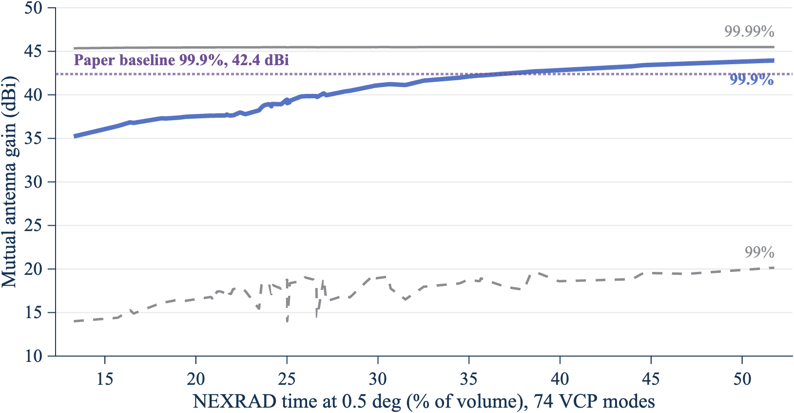

*Figure 3. The more time the NEXRAD spends at 0.5°, the higher the 99.9% coupling. The lines join the 74 VCP modes in order of time at 0.5°. Source: `docs/figures/vcp_sweep_rev5.csv` (2026).*

The 99.99% MAG is near 45.5 dBi for every VCP mode, because that percentile falls on the 45.49 dBi plateau of Step 8: the NEXRAD main beam at 0.5° plus the ASR-11 remote sidelobe floor. The M.1464-2 remote sidelobe level of the ASR-11 therefore sets this percentile.

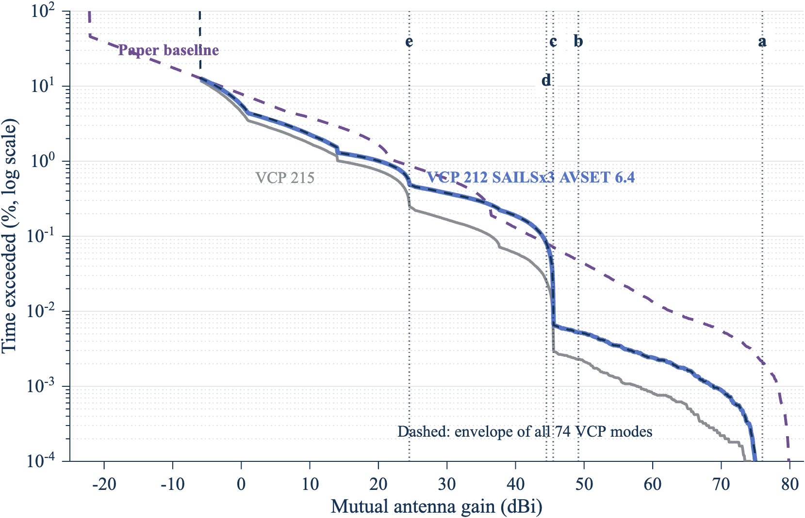

*Figure 4. Below 0.01% of the time, the worst VCP mode couples far less than the paper baseline. The dashed dark line is the envelope of all 74 VCP modes. The dotted lines are reference levels: a, main beam to main beam on the path (76.0 dBi); b, NEXRAD main beam and ASR-11 near sidelobe (49.2 dBi); c, NEXRAD main beam and ASR-11 back lobe (45.5 dBi); d, ASR-11 main beam and NEXRAD near sidelobe (44.5 dBi); e, ASR-11 main beam and NEXRAD back lobe (24.5 dBi). Source: `docs/figures/ref_levels_rev5.csv` (2026).*

#### D.1.11 Step 10: Compare main beam to main beam with the statistical MAG

At the November 4, 2026 meeting, participants described main beam to main beam coupling as current FAA practice, and asked for a main beam to main beam case for every weather radar as a sensitivity analysis. Figure 7 and the table compare the two approaches. A negative difference is the relief, in dB, that a MAG choice takes relative to the peak-gain main beam to main beam value. The same number of decibels applies one for one to the required basic transmission loss.[^19]

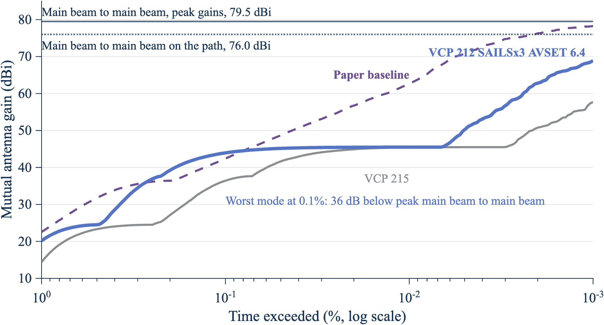

*Figure 7. Even at 0.001% of the time, the statistical MAG of the worst VCP mode stays 10.6 dB below peak-gain main beam to main beam. The lines are the time-weighted MAG from 99% to 99.999%; the horizontal lines are main beam to main beam with peak gains (79.5 dBi) and on the path (76.0 dBi). Source: `docs/figures/cdf_array_rev5.csv` and `docs/figures/mbmb_vs_statistical_rev5.csv` (2026).*

| MAG choice | Worst mode (dBi) | Difference from peak-gain main beam to main beam (dB) | VCP 215 (dBi) | Paper baseline (dBi) |
| --- | --- | --- | --- | --- |
| Main beam to main beam, peak gains | 79.5 | 0 | 79.5 | 80.0 |
| Main beam to main beam, on the path | 76.0 | −3.5 | 76.0 | 80.0 |
| Largest MAG in the 4-hour time series | 74.1 | −5.4 | 75.7 | 80.0 |
| 99.999% MAG | 68.9 | −10.6 | 57.7 | 78.2 |
| 99.99% MAG | 45.5 | −34.0 | 45.4 | 62.7 |
| 99.9% MAG | 43.9 | −35.6 | 36.4 | 42.4 |
| 99% MAG | 20.2 | −59.3 | 14.4 | 22.5 |

The paper baseline uses F.1245 patterns of 46 dBi and 34 dBi, so its main beam to main beam value is 80.0 dBi. Its NEXRAD beam always points at the horizon, so main beam to main beam on the path equals the peak-gain value.

The time-weighted MAG and the per-revolution maximum answer different questions. The 99.9% time-weighted MAG (43.9 dBi) is exceeded 0.1% of the time. The maximum MAG in a revolution reaches 45.5 dBi in 11.0% of ASR-11 revolutions, because each revolution contains many samples and the peak is taken over all of them. A link budget that compares a time percentage of interference with an I/N criterion uses the time-weighted MAG. A criterion stated per scan, such as missed detections, uses the per-revolution maximum.

#### D.1.12 Step 11: Bound the MAG for any mix of scan modes

Participants at the meeting noted that VCP choice depends on the weather, the site, and the operator, and that usable statistics of mode use may not exist. The mode envelope removes the need for them.

Let mode i have weight wᵢ ≥ 0, with the weights summing to 1. The exceedance of the mixture is P_mix(G > x) = Σ wᵢ Pᵢ(G > x), which is at most the largest Pᵢ(G > x). At x equal to the largest p-percentile over the modes, every Pᵢ(G > x) is at most 1 − p/100. The p-percentile of the mixture is therefore at most the largest p-percentile over the modes.[^20]

| Percentile | Envelope over 74 VCP modes (dBi) | Worst mode |
| --- | --- | --- |
| 99% | 20.2 | VCP 12 SAILS×3 AVSET 6.4, Doppler cut at 12.524 degrees per second |
| 99.9% | 43.9 | VCP 212 SAILS×3 AVSET 6.4 |
| 99.99% | 45.5 | VCP 212 SAILS×3 AVSET 6.4 |
| 99.999% | 68.9 | VCP 212 SAILS×3 AVSET 6.4 |

The bound covers only the modes in the envelope. The 74 modes include every WSR-88D VCP in the 2024 to 2026 survey (Step 5) and every option combination the radar allows, so the bound holds for any mix of current operations. A future NEXRAD mode, or a Radar Next scan strategy, needs its own run, and the envelope then takes the larger value. All operational VCPs rotate a full 360°, so pointing a scan toward the ATC radar does not change the result. Section D.2 bounds a sector scan centered on the ATC radar, which the meeting asked for as a worst case.

#### D.1.13 Sample size

Both parts of the method use samples, so both have sampling error.

**Random mode.** The 95% confidence interval of each percentile comes from order statistics: the p-quantile lies between the sorted samples at ranks n·p ∓ 1.96·√(n·p·(1 − p)). The table gives the interval for the worst mode at three sample sizes.[^28]

| Samples | 99% (dBi), 95% interval | 99.9% (dBi), 95% interval | 99.99% (dBi), 95% interval | 99.999% (dBi), 95% interval |
| --- | --- | --- | --- | --- |
| 500,000 | 19.9 (19.4 to 20.3) | 43.8 (43.5 to 44.2) | 45.49 (45.49 to 45.49) | 71.0 (63.7 to 73.4) |
| 5,000,000 | 20.2 (20.0 to 20.3) | 43.9 (43.9 to 44.0) | 45.49 (45.49 to 45.49) | 68.9 (66.8 to 71.1) |
| 20,000,000 | 20.2 (20.1 to 20.3) | 44.0 (43.9 to 44.0) | 45.49 (45.49 to 45.49) | 68.6 (67.6 to 69.6) |

With 5,000,000 samples, the 99%, 99.9%, and 99.99% values are known to within 0.2 dB, so more samples do not change them. The 99.999% value has only 50 samples above it, and its interval spans 4.2 dB. A link budget that uses the 99.999% MAG needs 20,000,000 samples or more, or should quote the interval.

**Time series.** The per-revolution statistics depend on rare events, so they need a long run. Four hours (about 3,000 revolutions) gave a 99.9th percentile of the per-revolution maximum of 70.4 dBi; 120 hours (89,883 revolutions) gave 74.5 dBi (`docs/figures/asr_rev_pct_rev5.csv` and `asr_rev_pct_120h_rev5.csv`). Four hours contained no revolution within 0.2 dB of main beam to main beam; 120 hours contained 46. Only the long run caught the volume locks of Step 8. Per-scan results in this report therefore use the 120-hour run.

### D.2 Sensitivity

At the meeting, participants asked for a sensitivity section and for main beam to main beam as a sensitivity case for every weather radar. Section D.1.11 gives the main beam to main beam case. This section changes one antenna or scan assumption at a time, starting from the worst mode, and reports how far the MAG moves. Every run uses the same seed, so each change comes from the assumption and not from sampling. A MAG change applies one for one to the required basic transmission loss, so the working paper can carry these numbers straight into its frequency separations.[^34]

The table gives the change in the time-weighted MAG at each percentile from the baseline. The steps are study choices, not measured alternatives. Where a published value exists, the step uses it: the ROC specification envelope, the F.1245 patterns of the working paper, and the M.1464-2 tilt range. Where no value exists, the step is a round amount on each side of the baseline: ±10 dB for the NEXRAD back lobe and ±3 dB for the ASR-11 remote sidelobes. The low ASR-11 tilt is −2.0° rather than the M.1464-2 limit of −2.5°, because the M.1851-2 cosecant-squared pattern starts at the tilt plus 2.4°, which must stay above 0°.

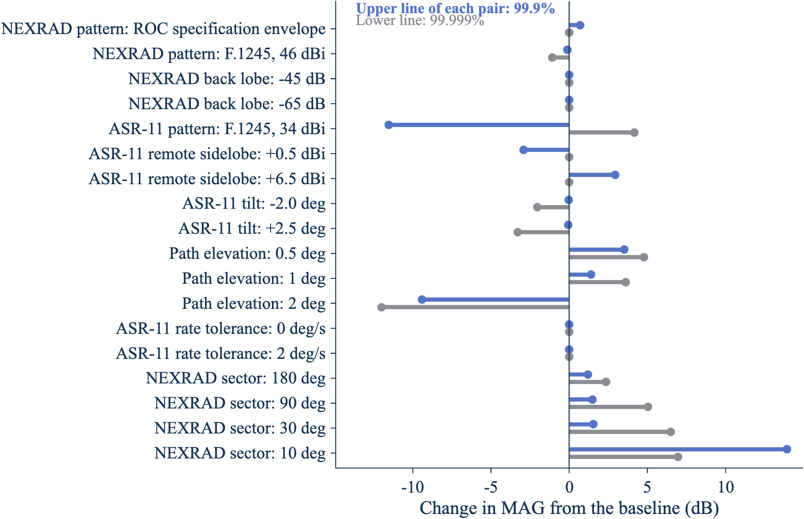

*Figure 8. The ASR-11 sidelobe level, the path elevation, and a NEXRAD sector scan move the MAG the most; the NEXRAD back lobe and the ASR-11 rate tolerance don't move the upper percentiles. Source: `docs/figures/sensitivity_sweep_rev5.csv` (2026).*

| Assumption | Case | 99% (dB) | 99.9% (dB) | 99.99% (dB) | 99.999% (dB) | Main beam to main beam on the path (dBi) |
| --- | --- | --- | --- | --- | --- | --- |
| Baseline (worst mode) | 20.2, 43.9, 45.5, and 68.9 dBi | 0 | 0 | 0 | 0 | 76.0 |
| NEXRAD pattern | ROC specification envelope | +10.8 | +0.7 | +4.8 | 0 | 76.0 |
| NEXRAD pattern | F.1245, 46 dBi | +4.5 | −0.1 | +3.9 | −1.1 | 75.8 |
| NEXRAD back lobe | −45 dB | +2.8 | 0 | 0 | 0 | 76.0 |
| NEXRAD back lobe | −65 dB | −5.9 | 0 | 0 | 0 | 76.0 |
| ASR-11 pattern | F.1245, 34 dBi | +3.0 | −11.5 | +7.9 | +4.2 | 76.0 |
| ASR-11 remote sidelobe | +0.5 dBi | −0.7 | −2.9 | −3.0 | 0 | 76.0 |
| ASR-11 remote sidelobe | +6.5 dBi | +0.6 | +2.9 | +3.0 | 0 | 76.0 |
| ASR-11 tilt | −2.0° | −1.6 | 0 | 0 | −2.0 | 73.9 |
| ASR-11 tilt | +2.5° | −2.6 | −0.1 | 0 | −3.3 | 72.7 |
| Path elevation | 0.5° | +1.3 | +3.5 | +3.5 | +4.8 | 79.4 |
| Path elevation | 1° | +1.1 | +1.4 | +3.3 | +3.6 | 75.5 |
| Path elevation | 2° | −5.1 | −9.4 | +1.2 | −12.0 | 45.9 |
| ASR-11 rate tolerance | 0 degrees per second | 0 | 0 | 0 | 0 | 76.0 |
| ASR-11 rate tolerance | 2 degrees per second | 0 | 0 | 0 | 0 | 76.0 |
| NEXRAD sector | 180° | +4.3 | +1.2 | +3.8 | +2.4 | 76.0 |
| NEXRAD sector | 90° | +16.9 | +1.5 | +12.8 | +5.0 | 76.0 |
| NEXRAD sector | 30° | +24.3 | +1.5 | +23.9 | +6.5 | 76.0 |
| NEXRAD sector | 10° | +25.3 | +13.9 | +28.4 | +7.0 | 76.0 |

The rows group into four findings.

- **The ASR-11 sidelobes set the 99.9% and 99.99% MAG.** Those percentiles sit on the plateau of the NEXRAD main beam plus the ASR-11 remote sidelobes (Step 8), so they move one for one with the remote sidelobe level: ±3 dB in gives ±3 dB out. With F.1245 for the ASR-11, the 99.9% MAG falls 11.5 dB, because F.1245 far sidelobes fall to −10 dBi, below the +3.5 dBi remote level, while the 99.99% value rises 7.9 dB, because F.1245 sidelobes near the main beam are higher. A measured ASR-11 pattern would replace this assumption directly.
- **The NEXRAD pattern matters less.** The ROC specification envelope (−29 dB sidelobes) raises the 99.99% MAG by 4.8 dB; F.1245 raises it by 3.9 dB. The back lobe changes only the low percentiles: ±10 dB moves the 99% MAG by +2.8 dB and −5.9 dB and leaves the 99.9% and higher values unchanged.
- **The path elevation matters at both ends.** A path 0.5° above the horizon puts the NEXRAD 0.5° beam on the path, so main beam to main beam on the path rises from 76.0 dBi to 79.4 dBi and the 99.9% MAG rises 3.5 dB. At 2°, the path is above the lowest cuts, and the 99.9% MAG falls 9.4 dB. The ASR-11 tilt has the opposite effect, small at 99.9% and up to 3.3 dB lower at 99.999%. The real path elevation comes from the propagation model for each pair of sites.
- **A sector scan aimed at the ATC radar is the largest change.** No operational VCP scans a sector, but the meeting asked for this bounding case. With a 30° sector centered on the ASR-11, the NEXRAD beam is near the path 12 times as often, the 99.99% MAG rises 24 dB, and 82% of ASR-11 revolutions reach 45 dBi. With a 10° sector, every revolution does. A sector scan would need its own MAG.

The ASR-11 rate tolerance doesn't change the time-weighted MAG, because random mode averages over every rate. It changes how long high coupling lasts (Section D.3.2).

Two more assumptions bound where the model applies:

- **Near field.** The patterns are far-field patterns. They hold for radars farther apart than 2D²/λ, which is 1.38 km for the 8.53 m NEXRAD reflector at 2,850 MHz. Closer pairs need a near-field analysis.
- **Polarization.** The model assumes no polarization mismatch loss. The NEXRAD transmits both linear polarizations; any mismatch with the ASR-11 would lower the coupling, so this choice is conservative.

### D.3 Synchronization and prior practice

#### D.3.1 Prior practice, as stated at the meeting

Participants at the November 4, 2026 meeting described how earlier studies chose the MAG. The source reports were not available for this review, so the code records each statement as an assumption with the source key `LOE_20261104`, and this report treats each one as correct.[^31]

| Study or practice | MAG choice | Reason given at the meeting |
| --- | --- | --- |
| 1.3 GHz study, ARSR-4 to ARSR-4 | Main beam to main beam | Equal scan rates can drift into relative synchronization and couple main beam to main beam for long periods, as long as about a month. |
| 1.3 GHz study, CARSR to CARSR | Not main beam to main beam | The antennas were synchronized so that they don't point at each other. |
| 1.3 GHz study, radars with different scan rates | Not main beam to main beam | No synchronization concern. |
| 1.3 GHz study, statistical model used for the FAA | High percentiles, 99.5% and above | Main beam to main beam is rare, so a high percentile stays conservative without assuming it. |
| Earlier 2.7 GHz study | About 99.9% (exact value not recalled) | Statistical MAG below 100%. |
| Current FAA practice for 2.7 GHz ATC assignments | Main beam to main beam | The system must be protected at all times. |

The meeting also noted that scan rates shouldn't be integer multiples of each other (for example, 5 rpm and 10 rpm), because such radars can stay aligned in the same way as radars with equal rates.

#### D.3.2 How long two beams stay aligned

`alignment_dwell_rev1` turns the synchronization concern into a number.[^32] Two antennas rotate at rates r₁ and r₂. Main beam to main beam means that both beams are inside their 3 dB beamwidths of the path at the same instant, so the MAG is within 6 dB of the peak-gain value. Take the nearest ratio r₁/r₂ ≈ p/q. The joint pointing repeats every joint period T_j = 360p/r₁, with one chance of main beam to main beam in each period. Once the beams are aligned, they stay aligned while a phase drifts across a window:

δ = q·r₁ − p·r₂  (4)

W = q·BW₁ + p·BW₂  (5)

T_ep = W / |δ|  (6)

In these equations, δ is the phase drift rate in degrees per second, W is the alignment window in degrees, BW is each 3 dB azimuth beamwidth, and T_ep is the length of an aligned episode in seconds. Equal nominal rates give δ = 0, so only the difference between the two drives ends an episode. With each drive offset by a constant amount, uniform in ±0.5 degrees per second, the code finds the probability that an episode lasts longer than a given time. A constant offset is the persistent case; a drive whose rate wanders ends episodes sooner.

| Radar pair | Ratio | Joint period (s) | Window (°) | Probability an aligned episode lasts longer than 10 min | 1 h | 1 day | 30 days |
| --- | --- | --- | --- | --- | --- | --- | --- |
| ASR-11 and ASR-11, both 12.5 rpm | 1:1 | 4.8 | 2.9 | 0.96% | 0.16% | 0.0067% | 0.00022% |
| ASR-11 at 12.5 rpm and a 6.25 rpm radar with the same beam | 2:1 | 9.6 | 4.35 | 0.73% | 0.12% | 0.0050% | 0.00017% |
| ASR-11 and one WSR-88D cut (0.5° Doppler cut, 28.7 s) | 6:1 | 28.8 | 7.0 | 0 | 0 | 0 | 0 |
| ASR-11 and a whole WSR-88D volume (worst mode, 353.69 s) | 74:1 | 355.2 | 7.0 | 2.3% | 0.39% | 0.016% | 0.00054% |

For example, for two ASR-11 radars an episode lasts longer than 1 h when |δ| < 2.9/3,600 = 0.00081 degrees per second. The difference of two uniform ±0.5 degrees per second offsets has a triangular distribution on ±1 degree per second, so the probability is 1 − (1 − 0.00081)² = 0.16%.

The equal-rate and 2:1 rows support the prior practice of main beam to main beam for radars with equal or multiple rates: a pair that aligns can stay aligned for hours, and the drive tolerance alone sets how often. The FAA rotation-rate tolerance (Order JO 6310.30B) would replace the ±0.5 degrees per second placeholder in these rows.

The two WSR-88D rows show two different things. Within one cut, the NEXRAD rate changes at the end of the cut, which lasts at most 28.7 s, so alignment can't outlast the cut.

Across volumes, it can. Each cut crosses the path once per volume, so the volume acts as a slow rotation at 360/353.69 = 1.018 degrees per second, and its "beamwidth" is the 0.925° beam crossed at the 0.5° Doppler rate, 0.925 × 1.018/12.524 = 0.075° of volume phase. Equation 4 then gives the 74:1 row: 74 ASR-11 revolutions take about one volume, and if the ASR-11 rate is near 74 × 360/353.69 = 75.32 degrees per second, the same pair of crossings meets every volume. That rate is inside the ±0.5 degrees per second tolerance. With a uniform offset, the chance of a lock that lasts longer than 1 h is 0.39%. In the 120-hour run, which drew one constant rate offset per hour, trial 61 locked for the whole hour (Step 8).

So the prior practice for radars with different scan rates holds in part. The WSR-88D and ASR-11 rates are different, and within a volume, coupling of 50 dBi or more lasts at most one revolution. But a WSR-88D mode with a steady volume time can lock to a whole number of ASR-11 revolutions, and then the same coupling returns every volume, about every 6 minutes, until the ASR-11 rate drifts or the NEXRAD changes mode. Two facts would settle how often this happens: the FAA rotation-rate tolerance and drift of the ASR-11 (Order JO 6310.30B), and how steady the WSR-88D volume time is in practice. Until then, a link budget that counts repeated hits on the same NEXRAD elevation should use the volume persistence of Step 8, not only the per-revolution statistics.

### D.4 The ASR-9 as the ATC radar

The FAA operates two airport surveillance radars in 2.7 GHz to 2.9 GHz: the ASR-11 of Section D.1 and the older ASR-9. This section keeps the revision 5 inputs, including an ASR-9 remote sidelobe of +3.5 dBi. Revision 6 sets it to +5.5 dBi, from the −28 dB maximum azimuth sidelobe level in MIT Lincoln Laboratory ATC-138, and Section 8 gives the ASR-9 results with that value. This section reruns the WSR-88D example with the ASR-9 in place of the ASR-11. The option `opts.atc_radar = "asr9"` selects it in `nexrad_asr11_mag_rev1`, and `example_asr9_rev1.m` runs every VCP mode and compares the two radars.[^36]

#### D.4.1 ASR-9 inputs

Rec. ITU-R M.1464-2 doesn't name its radars. Radar B in Table 1 is the ASR-9: Annex 2 Section 2 describes Radar B as an airport radar with a 60 NM range, 256 azimuth intervals of about 1.4°, ten pulses at one pulse repetition frequency followed by eight at another, and high-beam and low-beam feed horns. Table 1 gives it a klystron transmitter with 1,320 kW and a 1.03 µs pulse. These match the published ASR-9 description (two coherent processing intervals, a 1.0 µs pulse, about 1.1 MW, high and low beams). The same table gives the values below, and the model uses them as it uses Radar C for the ASR-11.

| Parameter | ASR-9 | ASR-11 (Section D.1.1) | Source for the ASR-9 |
| --- | --- | --- | --- |
| Peak gain | 33.5 dBi | 34 dBi | M.1464-2 Table 1, Radar B (MIT Lincoln Laboratory ATC-266: about 34 dB) |
| Azimuth beamwidth | 1.3° | 1.45° | M.1464-2 Table 1, Radar B (Wikipedia and ATC-266: 1.4°) |
| Elevation beamwidth and pattern | 4.8°, cosecant squared to +30° | Same | M.1464-2 Table 1, Radar B |
| First sidelobe | +7.3 dBi (−26.2 dB, the same cosine taper) | +9.5 dBi (−24.5 dB) | M.1464-2 Table 1, Radar B |
| Remote sidelobes | +3.5 dBi | +3.5 dBi | Not given for Radar B; the Radar C value is used (TODO) |
| Tilt | 0°, model range −2.5° to +2.5° | Same | Not given for Radar B; the Radar C range is used (TODO: site value) |
| Rotation rate | 12.5 rpm (75 degrees per second) | Same | M.1464-2 Table 1, Radar B; Wikipedia; working paper Table 4.4-1 |
| Rotation-rate variance | Uniform ±0.5 degrees per second | Same | M.2069-0 drive accuracy (TODO: FAA value) |
| F.1245 peak gain (paper baseline) | 34 dBi | 34 dBi | Working paper Table 4.4-1 |

ATC-266 describes the ASR-9 and ASR-11 beam patterns as "essentially identical." In the M.1464-2 values the two differ only in peak gain (0.5 dB), azimuth beamwidth (0.15°), and first sidelobe level (2.2 dB). The paper baseline (F.1245 at 34 dBi for both radars, NEXRAD at 3 rpm on the horizon) is the same for the two radars, so it isn't rerun.

#### D.4.2 Results

The ASR-9 sweep runs the same 74 VCP modes with the same seed and run size as Step 9. The worst mode is the same: VCP 212 with SAILS×3 and AVSET 6.4 at 99.9% and above, and VCP 12 with SAILS×3, AVSET 6.4, and the slow split-cut rate at 99%. The envelope over the 74 modes bounds the MAG for any mix of modes, as in Step 11.[^37]

| Envelope over 74 modes | 99% | 99.9% | 99.99% | 99.999% |
| --- | --- | --- | --- | --- |
| ASR-11 (Step 11) | 20.2 dBi | 43.9 dBi | 45.5 dBi | 68.9 dBi |
| ASR-9 | 18.9 dBi | 43.9 dBi | 45.5 dBi | 67.5 dBi |

For a paired comparison, the code runs both radars at the worst mode for 24 one-hour trials with the same seed. The two runs share every random pointing state and rotation-rate draw, so each difference comes from the ATC radar antenna alone.

| Quantity, VCP 212 SAILS×3 AVSET 6.4 | ASR-11 | ASR-9 | ASR-9 minus ASR-11 |
| --- | --- | --- | --- |
| Peak gains, main beam to main beam | 79.5 dBi | 79.0 dBi | −0.5 dB |
| Main beam to main beam on the path | 76.0 dBi | 75.5 dBi | −0.5 dB |
| NEXRAD main beam + ATC near sidelobe | 49.2 dBi | 48.5 dBi | −0.6 dB |
| NEXRAD main beam + ATC back lobe | 45.5 dBi | 45.5 dBi | 0 dB |
| ATC main beam + NEXRAD near sidelobe | 44.5 dBi | 44.0 dBi | −0.5 dB |
| ATC main beam + NEXRAD back lobe | 24.5 dBi | 24.0 dBi | −0.5 dB |
| 99% time-weighted MAG | 20.2 dBi | 18.9 dBi | −1.3 dB |
| 99.9% time-weighted MAG | 43.9 dBi | 43.9 dBi | 0.0 dB |
| 99.99% time-weighted MAG | 45.5 dBi | 45.5 dBi | 0.0 dB |
| 99.999% time-weighted MAG | 68.9 dBi | 67.5 dBi | −1.4 dB |
| ATC revolutions whose maximum reaches 45 dBi | 11.0% | 11.0% | 0.0 points |
| Longest run of NEXRAD volumes at 60 dBi or more, 24 h | 4 | 4 | 0 |
| Time with both main beams on the path | 0.0082% | 0.0081% | −0.0001 points |
| ATC main-beam region edge (Step 8) | 2.52° | 2.49° | −0.03° |

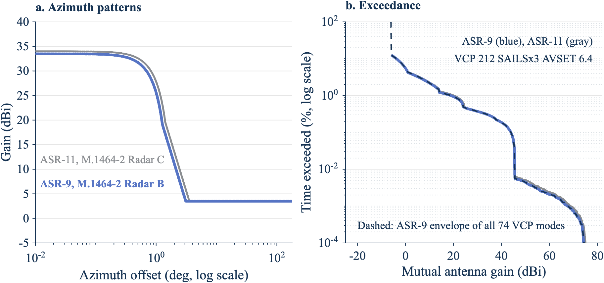

*Figure 9. The ASR-9 and ASR-11 give nearly the same MAG; the ASR-9 is lower by up to 1.4 dB in the 99% and 99.999% values. Panel a: azimuth cuts from M.1464-2 Radars B and C. Panel b: exceedance at VCP 212 SAILS×3 AVSET 6.4, 24 hours, same random draws, with the ASR-9 envelope over the 74 modes. Source: `docs/figures/asr9_comparison_rev5.csv` and `asr9_mode_envelope_rev5.csv` (2026).*

The results follow from the pattern regions of Step 8:

- **The 99.9% and 99.99% MAG don't change.** Both come from the NEXRAD main beam at 0.5° on the path while the ATC radar points a remote sidelobe at the NEXRAD (45.5 dBi, Step 8). Both radars use the same +3.5 dBi remote level, so these values are the same. For the ASR-9, M.1464-2 gives no remote level, and the value is the ASR-11's. Section D.2 shows that the 99.9% MAG moves about one for one with it, so an ASR-9 remote level would move the ASR-9 99.9% and 99.99% MAG by the same amount.
- **The 99% MAG is 1.3 dB lower.** At 99%, the level comes from the ATC main beam and its skirt crossing the NEXRAD far sidelobes and back lobe (below the 24.5 dBi of Step 4). The ASR-9 beam is narrower and 0.5 dB weaker, so it spends less time at each gain in that range.
- **The 99.999% MAG is 1.4 dB lower.** This tail needs both main beams near the path, so the narrower, weaker ASR-9 beam lowers it. The 95% interval of either value spans about 4 dB at 5,000,000 samples (Section D.1.13), so the 1.4 dB difference is small next to that uncertainty.
- **Persistence is the same.** In 24 hours of the worst mode with the ASR-9, no two consecutive ASR-9 revolutions reached 50 dBi. The longest run of consecutive NEXRAD volumes at 60 dBi or more was four volumes (1,415 s, about 24 min), and 76% of such runs lasted one volume (`docs/figures/asr9_persistence_volume_rev5.csv`). The paired ASR-11 run gave the same longest run.
- **Both main beams are on the path 0.0081% of the time.** Both antennas point a far sidelobe or the back lobe at the other radar 87% of the time (`docs/figures/asr9_lobe_pairs_rev5.csv`).

#### D.4.3 Synchronization with the ASR-9

The ASR-9 and ASR-11 both rotate at 12.5 rpm. Section D.3.2 applies to every pair of them: a pair of ATC radars that falls into alignment can stay aligned for hours, and the drive tolerance alone sets how often. The table adds the ASR-9 rows to the Section D.3.2 table, with the same ±0.5 degrees per second placeholder for each drive (`docs/figures/alignment_dwell_rev5.csv`).

| Radar pair | Ratio | Joint period (s) | Window (°) | Probability an aligned episode lasts longer than 10 min | 1 h | 1 day | 30 days |
| --- | --- | --- | --- | --- | --- | --- | --- |
| ASR-9 and ASR-9, both 12.5 rpm | 1:1 | 4.8 | 2.6 | 0.86% | 0.14% | 0.0060% | 0.00020% |
| ASR-9 and ASR-11, both 12.5 rpm | 1:1 | 4.8 | 2.75 | 0.91% | 0.15% | 0.0064% | 0.00021% |
| ASR-9 and a whole WSR-88D volume (worst mode, 353.69 s) | 74:1 | 355.2 | 6.86 | 2.3% | 0.38% | 0.016% | 0.00053% |

The narrower ASR-9 beam shortens each window a little. Under the prior practice of Section D.3.1, an ASR-9 paired with an ASR-9 or an ASR-11 is an equal-rate pair, for which earlier studies used main beam to main beam. A WSR-88D and an ASR-9 have different rates, but a steady NEXRAD volume time can lock to 74 ASR-9 revolutions as it does to the ASR-11.

[^1]: radar_mutual_gain_cdf_rev1.m, lines 2 to 19 | https://github.com/nicklasorte/mutual_antenna_gain/blob/99d3000fe59a62234992e34e36a25a9913d5161a/radar_mutual_gain_cdf_rev1.m#L2-L19
[^2]: example_radar_mutual_gain_rev1.m, lines 1 to 12 | https://github.com/nicklasorte/mutual_antenna_gain/blob/99d3000fe59a62234992e34e36a25a9913d5161a/example_radar_mutual_gain_rev1.m#L1-L12
[^3]: example_nexrad_asr11_rev1.m, lines 1 to 14 | https://github.com/nicklasorte/mutual_antenna_gain/blob/d367a9047512c436434538e1d61f153c38c2c4a4/example_nexrad_asr11_rev1.m#L1-L14
[^4]: radar_mutual_gain_cdf_rev1.m, lines 38 to 44 | https://github.com/nicklasorte/mutual_antenna_gain/blob/99d3000fe59a62234992e34e36a25a9913d5161a/radar_mutual_gain_cdf_rev1.m#L38-L44
[^5]: radar_mutual_gain_cdf_rev1.m, lines 243 to 250 | https://github.com/nicklasorte/mutual_antenna_gain/blob/99d3000fe59a62234992e34e36a25a9913d5161a/radar_mutual_gain_cdf_rev1.m#L243-L250
[^6]: antenna_gain_rev1.m, off_axis_deg | https://github.com/nicklasorte/mutual_antenna_gain/blob/99d3000fe59a62234992e34e36a25a9913d5161a/antenna_gain_rev1.m
[^7]: antenna_prepare_rev1.m, line 168 and make_offaxis_interp | https://github.com/nicklasorte/mutual_antenna_gain/blob/99d3000fe59a62234992e34e36a25a9913d5161a/antenna_prepare_rev1.m#L168
[^8]: antenna_gain_rev1.m, statgain_dBi | https://github.com/nicklasorte/mutual_antenna_gain/blob/99d3000fe59a62234992e34e36a25a9913d5161a/antenna_gain_rev1.m
[^9]: antenna_prepare_rev1.m, prep_array | https://github.com/nicklasorte/mutual_antenna_gain/blob/99d3000fe59a62234992e34e36a25a9913d5161a/antenna_prepare_rev1.m
[^10]: radar_mutual_gain_cdf_rev1.m, draw_state_random | https://github.com/nicklasorte/mutual_antenna_gain/blob/99d3000fe59a62234992e34e36a25a9913d5161a/radar_mutual_gain_cdf_rev1.m
[^11]: radar_mutual_gain_cdf_rev1.m, random_chunk and fill_opts | https://github.com/nicklasorte/mutual_antenna_gain/blob/99d3000fe59a62234992e34e36a25a9913d5161a/radar_mutual_gain_cdf_rev1.m
[^12]: radar_mutual_gain_cdf_rev1.m, check_random_mode_valid | https://github.com/nicklasorte/mutual_antenna_gain/blob/99d3000fe59a62234992e34e36a25a9913d5161a/radar_mutual_gain_cdf_rev1.m
[^13]: radar_mutual_gain_cdf_rev1.m, run_time_series | https://github.com/nicklasorte/mutual_antenna_gain/blob/99d3000fe59a62234992e34e36a25a9913d5161a/radar_mutual_gain_cdf_rev1.m
[^14]: radar_mutual_gain_cdf_rev1.m, event_stats | https://github.com/nicklasorte/mutual_antenna_gain/blob/99d3000fe59a62234992e34e36a25a9913d5161a/radar_mutual_gain_cdf_rev1.m
[^15]: radar_mutual_gain_cdf_rev1.m, sync_sweep | https://github.com/nicklasorte/mutual_antenna_gain/blob/99d3000fe59a62234992e34e36a25a9913d5161a/radar_mutual_gain_cdf_rev1.m
[^16]: radar_mutual_gain_cdf_rev1.m, cdf_table and pct_table | https://github.com/nicklasorte/mutual_antenna_gain/blob/99d3000fe59a62234992e34e36a25a9913d5161a/radar_mutual_gain_cdf_rev1.m
[^17]: nexrad_asr11_mag_rev1.m, lines 404 to 533 (scan_maxima) | https://github.com/nicklasorte/mutual_antenna_gain/blob/99d3000fe59a62234992e34e36a25a9913d5161a/nexrad_asr11_mag_rev1.m#L404-L533
[^18]: nexrad_asr11_mag_rev1.m, lines 157 to 191 (ref_levels) | https://github.com/nicklasorte/mutual_antenna_gain/blob/99d3000fe59a62234992e34e36a25a9913d5161a/nexrad_asr11_mag_rev1.m#L157-L191
[^19]: nexrad_asr11_mag_rev1.m, lines 194 to 212 (sensitivity_table) | https://github.com/nicklasorte/mutual_antenna_gain/blob/99d3000fe59a62234992e34e36a25a9913d5161a/nexrad_asr11_mag_rev1.m#L194-L212
[^20]: mag_mode_envelope_rev1.m, lines 1 to 64 | https://github.com/nicklasorte/mutual_antenna_gain/blob/99d3000fe59a62234992e34e36a25a9913d5161a/mag_mode_envelope_rev1.m#L1-L64
[^21]: example_radar_mutual_gain_rev1.m, lines 21 to 107 | https://github.com/nicklasorte/mutual_antenna_gain/blob/99d3000fe59a62234992e34e36a25a9913d5161a/example_radar_mutual_gain_rev1.m#L21-L107
[^22]: nexrad_asr11_mag_rev1.m, lines 234 to 344 (assumptions and citations) | https://github.com/nicklasorte/mutual_antenna_gain/blob/99d3000fe59a62234992e34e36a25a9913d5161a/nexrad_asr11_mag_rev1.m#L234-L344
[^23]: nexrad_asr11_mag_rev1.m, lines 268 to 272 and 440 to 456 | https://github.com/nicklasorte/mutual_antenna_gain/blob/99d3000fe59a62234992e34e36a25a9913d5161a/nexrad_asr11_mag_rev1.m#L268-L272
[^24]: nexrad_asr11_mag_rev1.m, lines 389 to 401 (pencil_table) | https://github.com/nicklasorte/mutual_antenna_gain/blob/99d3000fe59a62234992e34e36a25a9913d5161a/nexrad_asr11_mag_rev1.m#L389-L401
[^25]: nexrad_vcp_rev1.m, lines 1 to 122 (help, references and survey) | https://github.com/nicklasorte/mutual_antenna_gain/blob/d367a9047512c436434538e1d61f153c38c2c4a4/nexrad_vcp_rev1.m#L1-L122
[^26]: nexrad_vcp_rev1.m, lines 124 to 291 | https://github.com/nicklasorte/mutual_antenna_gain/blob/d367a9047512c436434538e1d61f153c38c2c4a4/nexrad_vcp_rev1.m#L124-L291
[^27]: example_nexrad_asr11_rev1.m, lines 16 to 145 | https://github.com/nicklasorte/mutual_antenna_gain/blob/38e19629a610395f903fb845dd5537786d1e4337/example_nexrad_asr11_rev1.m#L16-L145

[^28]: radar_mutual_gain_cdf_rev1.m, lines 452 to 474 (cdf_array and pct_table) | https://github.com/nicklasorte/mutual_antenna_gain/blob/99d3000fe59a62234992e34e36a25a9913d5161a/radar_mutual_gain_cdf_rev1.m#L452-L474

[^29]: nexrad_asr11_mag_rev1.m, lines 536 to 576 (plateau_check) | https://github.com/nicklasorte/mutual_antenna_gain/blob/99d3000fe59a62234992e34e36a25a9913d5161a/nexrad_asr11_mag_rev1.m#L536-L576
[^30]: nexrad_asr11_mag_rev1.m, lines 673 to 741 (region_edges, lobe_pairs) | https://github.com/nicklasorte/mutual_antenna_gain/blob/38e19629a610395f903fb845dd5537786d1e4337/nexrad_asr11_mag_rev1.m#L673-L741
[^31]: nexrad_asr11_mag_rev1.m, lines 345 to 351 (prior-practice assumptions, source LOE_20261104) | https://github.com/nicklasorte/mutual_antenna_gain/blob/38e19629a610395f903fb845dd5537786d1e4337/nexrad_asr11_mag_rev1.m#L345-L351
[^32]: alignment_dwell_rev1.m, lines 1 to 148; example_asr11_drift_rev1.m | https://github.com/nicklasorte/mutual_antenna_gain/blob/38e19629a610395f903fb845dd5537786d1e4337/alignment_dwell_rev1.m#L1-L148
[^33]: nexrad_asr11_mag_rev1.m, lines 760 to 791 (persistence) | https://github.com/nicklasorte/mutual_antenna_gain/blob/38e19629a610395f903fb845dd5537786d1e4337/nexrad_asr11_mag_rev1.m#L760-L791
[^34]: mag_sensitivity_rev1.m and example_sensitivity_rev1.m | https://github.com/nicklasorte/mutual_antenna_gain/blob/38e19629a610395f903fb845dd5537786d1e4337/example_sensitivity_rev1.m
[^35]: example_nexrad_asr11_rev1.m, lines 25 to 73 (option combinations) | https://github.com/nicklasorte/mutual_antenna_gain/blob/38e19629a610395f903fb845dd5537786d1e4337/example_nexrad_asr11_rev1.m#L25-L73
[^36]: nexrad_asr11_mag_rev1.m, assumptions (ATC radar block, ASR-9 = M.1464-2 Radar B) | https://github.com/nicklasorte/mutual_antenna_gain/blob/52c5b9f1a36b76b54d47690591e5ddfe12da475e/nexrad_asr11_mag_rev1.m#L316-L359
[^37]: example_asr9_rev1.m and vcp_mode_cases_rev1.m | https://github.com/nicklasorte/mutual_antenna_gain/blob/52c5b9f1a36b76b54d47690591e5ddfe12da475e/example_asr9_rev1.m

[^38]: gain_slice_prep_rev1.m and gain_slice_rev1.m | https://github.com/nicklasorte/mutual_antenna_gain/blob/f4d05b472bfffaf0dcba30e5dff4d4a19b8bf701/gain_slice_rev1.m
[^39]: mag_exact_cdf_rev1.m; nexrad_asr11_mag_rev1.m, option cdf_method | https://github.com/nicklasorte/mutual_antenna_gain/blob/f4d05b472bfffaf0dcba30e5dff4d4a19b8bf701/mag_exact_cdf_rev1.m
[^40]: gain_dist_table_rev1.m and mag_pair_cdf_rev1.m | https://github.com/nicklasorte/mutual_antenna_gain/blob/f4d05b472bfffaf0dcba30e5dff4d4a19b8bf701/mag_pair_cdf_rev1.m
[^41]: scan_event_windows_rev1.m, ts_floor_rev1.m, scan_event_library_rev1.m, mag_pair_timeseries_rev1.m | https://github.com/nicklasorte/mutual_antenna_gain/blob/f4d05b472bfffaf0dcba30e5dff4d4a19b8bf701/mag_pair_timeseries_rev1.m
[^42]: sector_sweep_rev1.m; scan_clock_state_rev1.m (sweep phase) | https://github.com/nicklasorte/mutual_antenna_gain/blob/f4d05b472bfffaf0dcba30e5dff4d4a19b8bf701/sector_sweep_rev1.m
[^43]: redteam_runs_rev1.m and docs/redteam_register_rev1.csv | https://github.com/nicklasorte/mutual_antenna_gain/blob/f4d05b472bfffaf0dcba30e5dff4d4a19b8bf701/docs/redteam_register_rev1.csv

**DRAFT//PRE-DECISIONAL**
