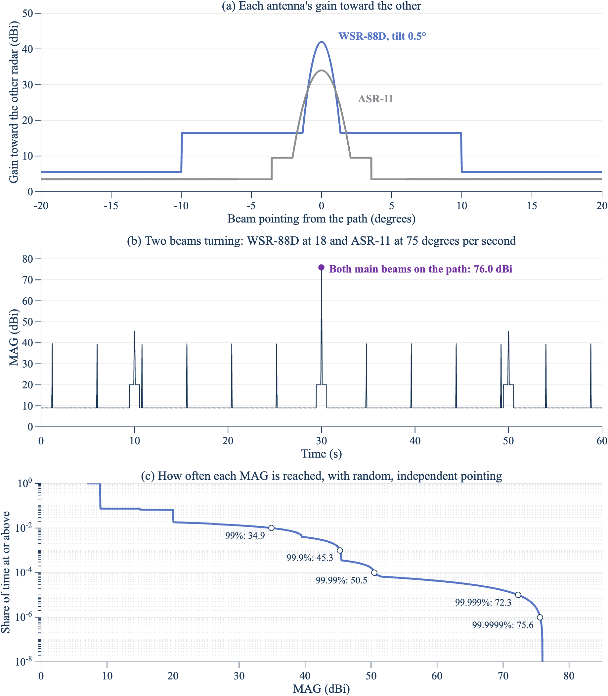

**DRAFT//PRE-DECISIONAL**

# How much do a weather radar and an airport radar couple? The simple version

Draft of November 12, 2026. Source: `simple_mag_nexrad_asr11_rev1.m` in the repository `nicklasorte/mutual_antenna_gain`. The full method is in the methodology report, revision 15.

## The question

A WSR-88D weather radar and an ASR-11 airport surveillance radar both operate near 2.8 GHz, and both antennas turn. How strongly one couples into the other depends on where each antenna points at each moment. The mutual antenna gain (MAG) measures that coupling:

MAG = gain of the WSR-88D toward the ASR-11 + gain of the ASR-11 toward the WSR-88D, in dBi.

A link budget adds the MAG to the transmit power and subtracts the path loss. A higher MAG means more interference.

## The two antennas

Each antenna has a narrow main beam and much weaker sidelobes:

- **WSR-88D.** A pencil beam 0.925° wide with 45.5 dBi peak gain. Its sidelobes are at most 16.5 dBi out to 10° from the beam and 5.5 dBi beyond (the ROC specification). Scanning its lowest cut at 0.5°, it puts at most 42.0 dBi on a horizontal path.
- **ASR-11.** A fan beam 1.45° wide in azimuth with 34 dBi peak gain. Its first sidelobe is 9.5 dBi, and its remote sidelobes 3.5 dBi (Rec. ITU-R M.1464-2, Radar C).

In this simple version, each main beam follows G = Gpeak − 12(angle/beamwidth)² until it meets its sidelobe level.

## What happens as the beams turn

*Figure 1. The MAG is high only when both main beams cross the path together, and that's rare. Panel a: each antenna's gain toward the other. Panel b: one minute of both beams turning (WSR-88D at 3 rpm, ASR-11 at 12.5 rpm, start phases chosen so both cross the path at 30 s). Panel c: share of time at or above each MAG with random, independent pointing. Horizontal path, WSR-88D at 0.5°. Source: NTIA analysis with `simple_mag_nexrad_asr11_rev1.m` (2026).*

- **Most of the time, both antennas point away.** The MAG is 9.0 dBi, the two far sidelobes added (5.5 + 3.5).
- **Each beam's sweep gives a short spike.** The ASR-11 main beam crosses the path every 4.8 s and lifts the MAG to 39.5 dBi. The WSR-88D main beam crosses every 20 s and lifts it to 45.5 dBi.
- **Both main beams together give 76.0 dBi.** That's 67 dB above the usual level, but it needs both narrow beams on the path in the same instant.

## How often each level occurs

If the two antennas point independently, which holds when their rotation rates drift apart, the share of time at each level follows exactly from the two patterns:

| Share of time below | MAG (dBi) |
| --- | --- |
| 50% | 9.0 |
| 99% | 34.9 |
| 99.9% | 45.3 |
| 99.99% | 50.5 |
| 99.999% | 72.3 |
| 99.9999% | 75.6 |

The MAG is at or above 50 dBi about 0.6 s an hour and at or above 70 dBi about 0.06 s an hour. These values are computed, not sampled, so the 99.9999% value has no sampling error.

## What the full model adds

The simple version captures the mechanism. The full model adds three things that change the numbers:

1. **Scan modes.** A real WSR-88D steps through a sequence of elevation cuts and spends only part of its time at 0.5°. Over the 216 operational modes, the 99.999% value on a horizontal path is 68.7 dBi, against 72.3 dBi here.
2. **Path elevation.** The elevation of each radar seen from the other moves the tail by several decibels. A horizontal path isn't the worst case.
3. **Rotation drift and time.** With exactly constant rates, the pointing repeats, every 120 s at these rates, and the two main beams may never meet. Real rates drift, and how fast they drift decides whether high coupling comes back for seconds or for hours.

**DRAFT//PRE-DECISIONAL**
